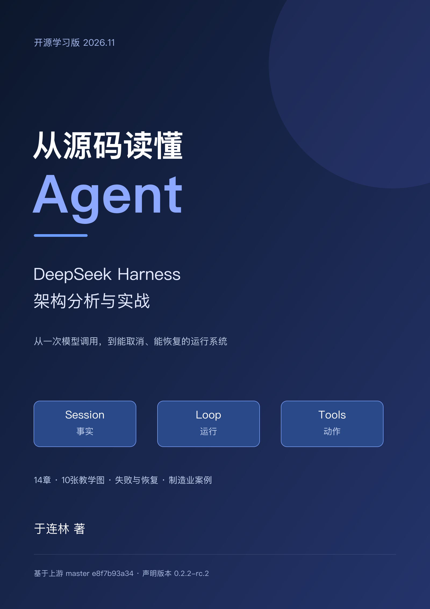

# 从源码读懂 Agent

**DeepSeek Harness 架构分析与实战**

一本面向有编码基础、想系统阅读Agent源码的中文开源书。沿一条用户任务，理解插件、会话事实、模型请求、工具执行、审批、取消、恢复和任务协作，再把这些方法迁移到自己的Agent。

作者与维护者：[于连林](https://github.com/yll2wcf)。这是独立学习项目，非DeepSeek官方出版物。

[下载PDF](https://github.com/yll2wcf/deepseek-harness-book/releases/latest/download/deepseek-harness-book.pdf) · [下载EPUB](https://github.com/yll2wcf/deepseek-harness-book/releases/latest/download/deepseek-harness-book.epub) · [全部版本](https://github.com/yll2wcf/deepseek-harness-book/releases) · [提交勘误](https://github.com/yll2wcf/deepseek-harness-book/issues)

## 你能从中学到什么

从“能调用模型”走到“能解释一项任务怎样完成”：找到输入入口、辨认事实所有者、追踪工具的准入和结算，并检查取消与重启之后系统根据什么继续。每章都保留阅读地图、例子、练习与本章回顾。

前言、14章和结语分为四部分，配有10张教学图；升级说明随电子书一起收录。

| 部分 | 章节 | 重点 |
|---|---|---|
| 先看见Agent怎样运行 | 1—3 | 启动、跟踪一条消息、大型仓库阅读方法 |
| 插件怎样组成系统 | 4—6 | Cordis、Service、Event、Waterfall、Profile和Patch |
| 一次任务的核心循环 | 7—10 | Session事实、请求组装、Turn/Step/Inbox、工具执行 |
| 从演示程序到工程系统 | 11—14 | 权限沙箱、恢复压缩、子任务协作、制造业异常案例 |

## 在线阅读

- [前言](preface.md)
- [第1章 Agent不是一个聊天接口](chapters/01-agent-is-not-chat-api.md)
- [第2章 跟着一条消息走完整个系统](chapters/02-follow-a-message-through-the-system.md)
- [第3章 大型仓库不是从第一个文件读到最后一个](chapters/03-how-to-read-a-large-agent-repository.md)
- [第4章 从第一个Cordis插件开始](chapters/04-first-cordis-plugin.md)
- [第5章 服务、事件与Waterfall怎样协作](chapters/05-services-events-waterfalls.md)
- [第6章 dsh如何组装一棵插件树](chapters/06-how-dsh-builds-plugin-tree.md)
- [第7章 Session Event是系统的事实来源](chapters/07-session-event-source-of-truth.md)
- [第8章 模型请求不是在一个函数里拼出来的](chapters/08-how-model-request-is-built.md)
- [第9章 Agent Loop的Turn、Step与Inbox](chapters/09-agent-loop-turn-step-inbox.md)
- [第10章 一个工具调用真正经历了什么](chapters/10-tool-execution-pipeline.md)
- [第11章 文件、命令、审批与沙箱](chapters/11-files-commands-approval-sandbox.md)
- [第12章 会话怎样恢复、分叉与压缩](chapters/12-session-recovery-fork-compaction.md)
- [第13章 子智能体不是多开几个聊天窗口](chapters/13-subagents-jobs-workflows.md)
- [第14章 自己动手写一个Agent Harness](chapters/14-build-your-own-agent-harness.md)
- [结语](conclusion.md)
- [本次源码升级说明与验证范围](appendices/source-update-2026-11.md)

## 版本和复现

本版于2026年11月13日按上游master提交 [`e8f7b93a34`](https://github.com/deepseek-ai/deepseek-harness/tree/e8f7b93a344964de3dca1ace9e72b6e4d6de87cb) 修订，仓库声明版本为`0.2.2-rc.2`。该提交不同于同名发布标签；需要精确复现时请使用完整提交。

上游源码要求Node.js `>=24.9.0`、pnpm `11.28.5`。书中保留的旧实验输出和数量属于`0.1.2-alpha.1`，每章标明适用范围。本轮源码对照不等于最新版全部实验通过，完整验证情况见升级说明。

本仓库包含书稿、构建工具和35份历史实验源码及配置。正文中以`tmp/`开头的历史实验命令属于当时上游工作区，不能直接在本仓库根目录执行；参阅[历史实验说明](examples/legacy/README.md)。阅读无需API Key，真实模型调用费用和凭据由读者自行管理。制造业案例使用模拟数据，不接入MES/EAM等生产系统。

## 自己构建与参与

见[构建说明](BUILD.md)、[贡献指南](CONTRIBUTING.md)和[版本记录](CHANGELOG.md)。欢迎指出读不懂的解释、失效的源码定位和可复现错误。提交Issue时请注明章节、书稿版本、源码提交、运行环境和原始错误；不要上传密钥或真实业务数据。

## 许可与致谢

原创文字、教学图采用[CC BY-SA 4.0](LICENSE)，原创示例和构建代码采用[MIT](LICENSE-CODE)。引用的DeepSeek Harness源码保留原有MIT许可证，具体归属见[第三方声明](THIRD_PARTY_NOTICES.md)。感谢DeepSeek及Cordis贡献者开放源码，让读者可以沿真实实现学习Agent工程。
