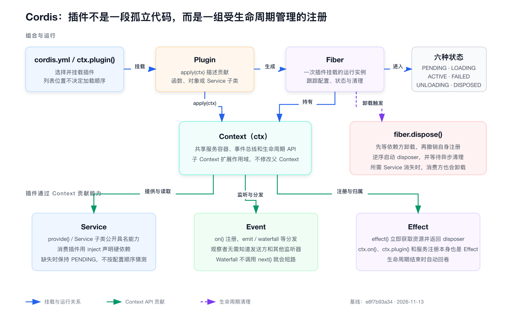

# 第4章 从第一个 Cordis 插件开始

> 本章源码基线：DeepSeek Harness `0.2.2-rc.2`，提交 `e8f7b93a344964de3dca1ace9e72b6e4d6de87cb`，当前要求Node.js `>=24.9.0`。插件、Effect与依赖卸载按当前vendored Cordis复核；终端输出和独立Cordis实验均来自旧提交 `cd5ef8148158c3a752a658978873241fdf8e2bbc`，本轮未重跑，不能作为新版启动结果。

第1章运行 `dsh` 时，我们看见一棵由很多能力组成的应用；第3章沿着 Bash 反向追踪时，我们又反复遇到插件、服务和 Provider。可真正开始写插件以后，一个更基本的问题会冒出来：插件到底只是一个被调用的函数，还是一个可以独立出生、等待、失败和退出的运行单元？

这个区别很重要。普通函数返回以后，计时器、连接、事件监听器和缓存可能仍然活着。Agent 应用却会修改配置、替换工具、重连服务，甚至在任务仍在运行时关闭。如果旧插件留下一个监听器，新插件又注册一个，下一次工具调用就可能执行两遍；如果旧连接没有断开，凭据轮换后它还可能继续访问已经失效的端点。

Cordis 给出的基础答案是四个相互连接的概念：Plugin 描述贡献，Context 提供协作入口，Fiber 表示一次具体挂载，Effect 记录这次挂载需要撤销的东西。读完本章，你应该能写出一个可运行的小插件，解释它从 `PENDING` 到 `ACTIVE` 再到 `DISPOSED` 的过程，并能检查它卸载后是否真的没有留下资源。

第一次阅读不必记住全部状态和热替换细节，先抓住一句关系：配置选择 Plugin，Loader 为它建立 Fiber，Fiber 通过 Context 取得协作能力，并拥有本次挂载产生的 Effect。后面的状态、失败和重载，只是在回答这条关系何时建立、何时撤销。

## 第一个插件没有启动代码

先看最小示例。配套文件位于 [`tmp/cordis-tutorial/01-first-plugin`](../examples/legacy/upstream-tmp/cordis-tutorial/01-first-plugin/hello.ts)。本章用它解释当前仍成立的插件定义方式；独立启动脚本属于旧版历史实验。阅读代码不需要执行脚本，新版应用应把插件加入 `dsh` profile，不能把旧Cordis bin当成受支持的Harness入口。历史复现方式集中放在本章后半部分。

```ts
import type { Context } from '@deepseek-ai/cordis'

export const name = 'hello'

export function apply(_ctx: Context): void {
  console.log('hello from my first plugin')
}
```

它没有创建应用，没有读取命令行，也没有写 `main()`。与它配套的 `cordis.yml` 只有一行：

```yaml
- name: './hello.ts'
```

运行教程启动器后，终端输出 `hello from my first plugin`。背后发生了三件事：启动器创建根 Context 并挂载 Loader；Loader 读取 `cordis.yml`，解析模块；Cordis 为这一行建立运行实例，再用对应 Context 调用 `apply()`。插件只回答“我装入系统以后贡献什么”，配置负责回答“这次应用选择装入谁”。

这种分工是理解 DeepSeek Harness 的第一个判断。几百个包不会在一个总入口里被逐个 `import` 和调用，而是由配置选中后交给 Loader 挂载。以后看到某个插件的 `apply()`，不要急着寻找它的顶层调用者；先查它由哪一行配置装入，又在哪个 Profile 中生效。

Cordis 接受函数、带 `apply` 方法的对象和 `Service` 子类三种插件形态。初学时优先使用函数，因为它最直接地暴露输入 Context、配置与注册动作。等插件需要向其他插件公开具名能力时，再使用第5章介绍的 Service 类形态。

> 核心建议
> 阅读插件时，把“模块定义”和“一次挂载”分开。相同插件可以被不同配置挂载多次；每次挂载都有自己的配置、依赖状态和清理责任。

## Context 不是随手堆属性的全局对象

`apply(ctx)` 的参数看上去像一个很大的对象。你可以写 `ctx.tools`、`ctx.llm`、`ctx.sessions`，也可以调用 `ctx.on()`、`ctx.plugin()`、`ctx.effect()`。如果只看语法，很容易把它理解成全局变量集合。

更准确的说法是：Context 是当前插件访问服务、事件、注册表和生命周期能力的入口。它背后有服务存储、事件总线和插件 Registry；常用方法会以 mixin 的方式出现在 `ctx` 上。例如 `ctx.on` 转发给事件服务，`ctx.plugin` 转发给插件注册表，`ctx.effect` 则把新 Effect 交给当前 Fiber 所有。

Context 还携带当前作用域。一个插件从 `ctx` 读取到哪个服务，不只取决于服务名称，还可能取决于隔离范围。后面的 Agent 实现会利用作用域让不同 Agent 看见各自的工具或提示词贡献。此时如果把 Context 当成普通全局对象，就很难解释为什么同名服务可以在局部被替换，也很难解释事件为什么只送到匹配的对象。

初读源码时不必马上进入作用域算法，但要形成一条纪律：不要把任意业务状态直接塞到 `ctx` 上。公开能力应由 Service 拥有，跨插件通知应由类型化事件表达，资源应归入 Effect；Context 负责把这些机制连接起来。

[`Context API`](https://github.com/deepseek-ai/deepseek-harness/blob/e8f7b93a344964de3dca1ace9e72b6e4d6de87cb/docs/cordis-api/context.zh.md)把这些入口分成子 Context、服务存储与 mixin 等部分。第一轮只需记住四个最常用动作：`ctx.plugin()` 挂载子插件，`ctx.get()` 查询可选服务，`ctx.on()` 注册监听器，`ctx.effect()` 管理框架不知道的资源。

## Plugin 是定义，Fiber 是运行实例

Plugin 是一份可重复使用的能力定义，Fiber 是这份定义的一次运行实例。Fiber 持有本次挂载的 Context、经过验证的配置、生命周期状态、Effect 集合和子插件关系。

调用 `ctx.plugin(heartbeat)` 会返回 Fiber。Loader 读取一行 YAML 后做的事虽然更完整，但最终同样会形成 Fiber。于是“插件卸载”并不是删除某个模块文件，而是让一个具体 Fiber 进入卸载流程，撤销它拥有的 Effect，并递归处理子 Fiber。

[`Fiber API`](https://github.com/deepseek-ai/deepseek-harness/blob/e8f7b93a344964de3dca1ace9e72b6e4d6de87cb/docs/cordis-api/fiber.zh.md)列出了六种状态：

```text
PENDING → LOADING → ACTIVE → UNLOADING → DISPOSED
                 ↘ FAILED
```

`PENDING` 表示插件已经声明，但必需服务尚不可用；`LOADING` 表示配置已经能够解析，`apply` 正在执行；`ACTIVE` 表示加载完成；`FAILED` 表示配置校验或 `apply` 失败；`UNLOADING` 表示正在清理；`DISPOSED` 表示这次挂载已经结束。

状态不是给界面看的装饰。它直接帮助诊断三类常见现象：配置写了但没有日志，可能是 `PENDING`；启动明确报错，可能是 `FAILED`；旧插件已经看不见但端口仍被占用，说明资源没有正确归入 Effect，不能仅凭 Fiber 进入 `DISPOSED` 就判断外部资源已释放。

Fiber 的 `await()` 用于等待加载决议，`dispose()` 用于卸载并等待清理结束，`restart()` 会先卸载再按当前配置重新加载。普通插件作者不必直接操作所有方法，但读 HMR、Profile 重载和测试时会频繁看到它们。

## Effect 不是“顺便写个清理函数”

下面这个计时插件来自本书的[生命周期实验](../examples/legacy/upstream-tmp/cordis-tutorial/02-lifecycle/lifecycle.ts)：

```ts
function heartbeat(ctx: Context): void {
  console.log('heartbeat plugin loading')
  ctx.effect(() => {
    const timer = setInterval(() => console.log('tick'), 200)
    return () => {
      clearInterval(timer)
      console.log('heartbeat cleaned up')
    }
  })
}
```

`ctx.effect()` 的主体立即运行，所以定时器在插件加载时创建；主体返回的函数是 disposer，也就是撤销这项 Effect 的清理函数。它会在两种情况之一发生时运行：调用 `ctx.effect()` 返回的 disposer，或拥有它的 Fiber 被卸载。重复调用 disposer 不会重复清理。



这段代码真正表达的是所有权：定时器属于 `heartbeat` 这次挂载。不是因为某位开发者碰巧记得在应用退出时调用 `clearInterval()`，而是创建资源和声明撤销方式发生在同一处，框架知道应在什么时候接管清理。

外层插件再用 `ctx.plugin(heartbeat)` 挂载它，700毫秒后调用 `await fiber.dispose()`。旧基线实验记录的输出是：

```text
heartbeat plugin loading
tick
tick
tick
heartbeat cleaned up
disposed
```

`disposed` 出现在 `heartbeat cleaned up` 之后，说明这条路径等待了登记的清理。对于数据库连接、子进程或watcher，等待清理比只发出关闭请求更可靠；但Promise兑现不自动证明外部资源已经消失。当前Fiber卸载会等待各disposer，并把清理异常写入logger；调用方还应检查诊断和资源终态，不能假定所有清理错误都会从 `dispose()` 向上抛出。

Effect 的 disposer 按注册顺序的逆序启动，这与“后取得的资源先释放”相符。不过多个异步 disposer 可以并发运行。如果释放 B 以后才能释放 A，不要赌并发完成顺序，应把两步放进同一个 disposer，并在里面依次 `await`。

```ts
ctx.effect(async () => {
  const connection = await openConnection()
  const subscription = await connection.subscribe()
  return async () => {
    await subscription.close()
    await connection.close()
  }
})
```

这里的关键不是代码长短，而是依赖关系被一个 disposer 明确表达。清理失败也不应被空 `catch` 忽略；上层需要知道应用是否真的结束，至少要留下能够定位资源和动作的诊断。

## 哪些动作已经自动成为 Effect

初学 Effect 后，另一个常见错误是把所有注册再包一层 `ctx.effect()`。这会制造多余嵌套，还可能让清理责任变得难读。Cordis 已经让常用注册自动归入当前 Fiber：

- `ctx.on()` 注册的事件监听器会在插件卸载时移除。
- `ctx.plugin()` 挂载的子插件会随父 Fiber 递归卸载。
- Service 注册会在提供方卸载时撤销。
- Harness 中遵守注册约定的注册表方法会返回 disposer，并把贡献绑定到调用插件；例如 `ctx.tools.register()`。

真正需要自己包装的通常是 Cordis 不认识的外部资源：`setInterval`、文件 watcher、Socket、数据库连接、子进程，以及第三方库返回的 unsubscribe 函数。

判断方法很朴素：如果创建动作离开当前 `apply()` 后仍会继续工作，就检查谁拥有它的退出；如果调用的是注册 API，就先读返回值和文档，确认框架是否已经把它登记为 Effect。

> 踩坑提醒
> “进程退出了”不是资源清理正确的证据。短命令可能借助操作系统回收一切；只有在同一进程内卸载并重新挂载插件，才能暴露重复监听、未关闭连接和旧状态残留。

## 卸载与热替换为什么必须是一件事

热替换常被想象成“把旧函数地址换成新函数地址”。对有状态插件来说，这远远不够。旧版可能已经注册服务、监听器和工具，还可能持有文件句柄。新版如果直接加载，两代能力就会同时存在。

旧版独立HMR实验先加载 `v1`，修改文件后得到：

```text
hmr demo v1 loaded
hmr reload plugin at hmr-demo.ts
hmr demo v1 cleaned
hmr demo v2 loaded
```

最值得观察的是后两行的顺序：旧版清理完成，新版才装入。HMR 因此不会绕开生命周期，而是完整执行旧实例的卸载和新实例的加载。只要一项贡献没有归入旧 Fiber，热替换就可能留下旧版本的注册或资源。

服务依赖还会让卸载继续向外传播。第5章会详细说明 `inject`：当提供方消失时，消费方不能继续拿着旧引用运行，它也会卸载并进入等待；提供方恢复后，消费方再重新加载。这使“替换一个服务实现”成为整组依赖关系的受控变化，而不是在运行对象中偷偷改字段。

这里需要把Cordis模块HMR与Profile Patch分开。当前 `dsh` 已移除旧版 `patchReload: live/startup` 和相应CLI watcher，不能再声称Web自动观察用户Patch、其他Profile仅启动时应用。Patch组合由当前启动流程决定；显式配置更新或模块热替换仍需完整撤销旧树。第6章按当前实现追踪组合层。

## 配置失败应该发生在 `apply()` 之前

插件通常会导出 `Config` Schema。下面的最小配置要求 `targets` 是字符串数组，并为 `greeting` 提供默认值：

```ts
export const Config: Schema<Config> = Schema.object({
  greeting: Schema.string().default('Hello'),
  targets: Schema.array(String).default(['world']),
})

export function apply(_ctx: Context, config: Config): void {
  for (const target of config.targets) {
    console.log(`${config.greeting}, ${target}!`)
  }
}
```

旧基线有效配置省略 `greeting` 时输出 `Hello, alpha!` 和 `Hello, beta!`；把 `targets` 写成字符串后，Loader以状态码1报告 `$.targets expected array but got not-an-array`。这些是历史输出。本轮核对的当前职责仍是先解析配置，再调用插件：`apply()`接收验证后的配置，不应自己猜测必需字段是否有效；具体错误文本需在所用版本重跑确认。

这种“先验证，再产生 Effect”的顺序能缩小半启动窗口。如果配置错误直到建立连接后才发现，插件还必须回卷前面创建的资源。即便 Schema 已通过，`apply()` 仍可能抛错，因此每一项外部资源仍应在创建时立即登记清理，不要等函数末尾统一收集。

在 `dsh` 的应用启动层，[`app-boot`](https://github.com/deepseek-ai/deepseek-harness/blob/e8f7b93a344964de3dca1ace9e72b6e4d6de87cb/packages/boot/app-boot/README.zh.md)还会等待插件树完成加载并检查失败状态。启动失败时先拆卸应用 Context，再把带插件与阶段信息的错误交给进程。这一层把单个 Fiber 的失败提升为明确的应用启动失败，避免一个缺少核心能力的 Agent 继续对外提供服务。

也要区分模块无法解析和插件运行失败。当前 Cordis 教程说明，路径或包名无法解析会通过 logger 报告；在 logger 导出器尚未就绪的早期，这条消息可能看不见。新增配置没有效果时，应同时检查模块拼写、Fiber 状态与启动输出，不能只等异常退出。

## 清理也是一个并发流程

写演示插件时，资源通常只有一个定时器；进入 Agent 系统以后，一个插件可能同时拥有模型流、工具调用、子进程、文件 watcher 和待写入日志。卸载不再是“调用一次 close”，而是一个需要定义新工作、在途工作和资源释放关系的并发流程。

第一次阅读先记住三步：停止接收新工作，结算或取消在途工作，最后释放底层资源。具体的工具取消与恢复语义会在第10、12章继续展开，本节只保留插件作者必须承担的生命周期责任。

第一件事是停止接受新工作。若插件已经进入 `UNLOADING`，新的请求不能继续登记到旧 Fiber，也不能悄悄转到一项即将消失的服务。`ctx.effect()` 在已 dispose 的 Fiber 上会报告 `INACTIVE_EFFECT`，就是为了阻止资源被挂到一个没有未来清理机会的所有者上。

第二件事是决定在途工作怎样结束。纯读取可以等待完成，也可以配合 `AbortSignal` 取消；写操作若已经送到外部系统，取消本地 Promise 并不能证明外部没有执行。插件的 disposer 应关闭自己拥有的入口和连接，业务层则要把“未开始”“已取消”“结果未知”和“已完成”区分开。后面的工具与恢复章节会继续处理这个问题。

第三件事才是释放底层资源。多个彼此独立的连接可以并发关闭，有依赖的资源则必须在同一个 disposer 中顺序处理。若父插件先于子插件收到退出请求，Fiber 关系还要保证子树的清理被等待，而不是父进程直接结束。

当前源码还明确保护服务依赖的卸载顺序：提供方离开ACTIVE后，先等待依赖它的消费Fiber卸载，再撤销自身Effect。这样消费方清理时仍能使用所依赖的服务。它与“同一Fiber内逆序启动多个清理函数”是两个不同层面的顺序，不能混成所有资源全局串行释放。

因此，测试卸载至少要包含一个并发场景：发起一项尚未完成的异步工作，触发 `fiber.dispose()`，观察新请求是否被拒绝、在途请求如何结算、disposer 何时兑现。只测试空闲插件的加载和卸载，会漏掉 Agent 最常见的生命周期风险。

## 进程退出不等于插件卸载

Node进程结束时，操作系统通常会回收本进程内存和文件描述符，却不保证所有后代进程或外部业务动作同时停止。这容易制造假象：即使插件没有disposer，短命令也可能看起来已经结束。Web服务和SDK Server长期运行，插件热替换或显式配置更新发生在同一进程中，旧监听器和旧对象更不会由操作系统代为清理。

验证生命周期时，应优先在同一根 Context 中完成“挂载 → 调用 → dispose → 再挂载 → 再调用”。如果第二次调用收到两份事件，说明旧监听器残留；如果新 Provider 无法绑定端口，说明旧资源没有释放；如果消费方仍读到旧配置，说明注册没有随 Fiber 撤销。

应用关闭还要等待根 Fiber。`process.exit()` 会跳过许多异步清理机会，不应成为插件自己的常规结束方式。一次性应用可以请求上层关闭，由启动器统一 dispose 根 Context 并决定退出码；这样插件树的每个层级都有机会完成自己的清理。

旧版计时实验只在回调结束后让事件循环自然退出，没有把 `process.exit()` 写进插件。这个观察点仍值得保留：应该验证资源释放后进程没有剩余工作，不能靠强制终止掩盖残留。本轮没有重新执行该实验。

## 配置更新不是直接修改对象

Fiber 持有通过验证的当前配置，但配置变化不能简单写成 `fiber.config.port = 4103`。插件可能已经用旧端口创建 Server，用旧目录建立 watcher，用旧模型注册能力；只改对象不会同步这些外部状态。

更可靠的过程是把配置更新视为一次生命周期变化：校验新配置，卸载旧贡献，按新配置重新加载。若新配置无效，运行层需要明确失败，长时应用的事务式 HMR还应保留最后一个可用实例，不能先毁掉旧树再发现新树无法启动。

这也解释了为什么配置字段与 disposer 必须一起评审。新增 `timeoutMs` 看似只是 Schema 多一个数字，但若它影响正在运行的计时器，更新时就要确认旧计时器被取消、新计时器按新值建立。新增连接地址则要确认旧连接关闭、依赖方等待并重新取得服务。

读到 `fiber.update()` 或 `fiber.restart()` 时，不要只追字段赋值。应该沿着状态变化检查配置何时校验、Effect 何时撤销、依赖插件何时重新决议，以及失败后系统保持哪一代实例。

## 用 Effect 标签留下诊断线索

`ctx.effect(execute, label?)` 可以附带标签，Fiber 的 `getEffects()` 则能返回仍在活动的带标签 Effect 元数据。对复杂插件来说，`database connection`、`workspace watcher`、`tool registration` 这样的短标签能让诊断比一串匿名 disposer 更有意义。

标签不应复述实现步骤，也不能替代错误处理。它应该命名被拥有的资源或注册，让维护者在插件无法退出时快速回答“还剩什么”。如果一个 Effect 内部又建立子 Effect，诊断树还能保留这种嵌套关系。

可以在开发测试中这样使用它：插件进入 `ACTIVE` 后记录预期标签；dispose 前确认关键资源都存在；dispose 兑现后确认 Fiber 已到 `DISPOSED`，外部观察点也不再触发。不要让生产逻辑依赖诊断字符串，它们是观察工具，不是协议字段。

## 给迷你 Harness 加入第一个可卸载能力

本书的迷你 Harness 最终会拥有模型、工具、Session 与审批。现在先只加入一个 `activity-meter` 插件：它监听自定义的 `demo/activity` 通知，统计当前进程收到多少次活动；同时用定时器每秒输出一次计数。

实现时，事件监听使用 `ctx.on()`，定时器使用 `ctx.effect()`。前者已自动归入 Fiber，后者需要显式返回 `clearInterval()`。父插件保存 Fiber，只在测试中调用 `dispose()`；业务代码不直接持有监听器 disposer。

验收不是“控制台出现数字”，而是四个阶段都可观察：挂载后 Fiber 为 `ACTIVE`；发送两次事件后计数为2；卸载时定时器清理日志先于 `dispose()` 兑现；卸载后再发送事件，计数不变且终端不再出现周期输出。

随后把同一插件重新挂载，计数应从新的初始值开始，监听器只执行一次。若旧值继续累积，说明状态被放到了模块全局；若一次事件增加两次，说明监听器没有随旧 Fiber 撤销。这个练习把“可逆 Effect”从定时器示例推进到 Agent 插件最常见的状态与事件组合。

## 用失败矩阵代替一句“加载失败”

插件问题至少应区分以下阶段：

| 阶段 | 典型现象 | 首要证据 | 期望处理 |
|---|---|---|---|
| 模块解析 | 配置项没有挂载或 logger 报找不到模块 | 模块名、base URL、启动日志 | 修正路径或安装依赖 |
| 依赖等待 | 没有输出，Fiber 为 `PENDING` | `inject` 与当前服务表 | 补 Provider 或改为明确降级 |
| 配置校验 | `apply()` 前报告字段错误 | Schema 与稳定错误路径 | 拒绝无效配置 |
| 插件加载 | `apply()` 抛错，Fiber 为 `FAILED` | 插件名、阶段、cause | 回卷已建立的 Effect |
| 运行期间 | 服务存在但请求失败 | 服务调用、事件和业务日志 | 按能力约定结算 |
| 卸载期间 | `dispose()` 不兑现或资源仍活动 | Effect 标签、句柄与超时 | 定位未结束的 disposer |

把阶段写清后，排查才不会用同一个“重启试试”覆盖所有问题。尤其要避免把 `PENDING` 当失败，也不要把进程状态码0当作插件已经 `ACTIVE` 的证明。

对 Agent 插件还要补一项模型可见性检查。若插件注册了提示词、工具 Schema 或运行上下文，卸载后不仅运行实现要消失，下一次模型请求中的对应内容也必须消失。否则模型会继续看到一项已经不能执行的能力。第8、10章会用请求快照验证这一点，本章先把它列入生命周期责任。

界面上的工具清单和诊断页也应从当前注册表重新投影，不能缓存旧插件留下的显示项。运行能力、模型描述和用户可见状态必须属于同一代插件实例。

## 一张生命周期检查表

每写一个插件，可以按下面八项做自查：

| 检查项 | 要回答的问题 |
|---|---|
| 挂载来源 | 哪个 Bundle、Patch 或父插件选择了它？ |
| 必需服务 | `inject` 是否列全，缺失时会停在哪个状态？ |
| 配置验证 | 默认值、无效类型和缺失字段是否在 `apply()` 前处理？ |
| 运行贡献 | 它注册了哪些 Service、事件、工具或子插件？ |
| 外部资源 | 定时器、连接、watcher、进程分别归哪个 Effect？ |
| 卸载等待 | disposer 是否返回 Promise，调用方是否等待完成？ |
| 重载行为 | 旧贡献撤销以后，新版本是否才开始工作？ |
| 失败诊断 | 日志能否指出插件、阶段和最早失败原因？ |

这张表比“有没有 `dispose()` 方法”更有用。清理责任可能分布在 `ctx.on()`、Service 注册、工具注册和自定义 Effect 中；检查的是所有权是否完整，不是某个函数名是否出现。

## 亲手完成计时插件实验

下面是旧版独立Cordis实验的原始命令，适用于隔离的旧提交checkout和当时Node.js 22环境。先按历史实验说明复制配套源码，再安装并构建旧版；不能在第1章的新提交上直接执行后宣称验证成功。实验不需要API Key。深层目录的登录shell可能命中另一套Node.js，因此在实际运行目录核对版本：

```sh
cd tmp/cordis-tutorial/02-lifecycle
node --version
env TSX_TSCONFIG_PATH="$PWD/../../../tsconfig.base.json" \
  node --import tsx ../../../vendor/cordis/bin.js
```

未修改示例时，命令应以状态码0结束，并依次出现加载、三次 `tick`、`heartbeat cleaned up` 和 `disposed`。清理日志必须早于 `disposed`，最后一次清理之后不得再出现 `tick`；这两个观察点比“终端最终回到提示符”更能证明 disposer 被等待。

然后做三个修改：把 disposer 改成异步并延迟100毫秒，确认 `disposed` 仍在清理完成后出现；主动调用两次 disposer，确认第二次不重复清理；移除 `clearInterval()`，观察进程为何无法自行结束，再恢复代码。若运行时报模块无法解析，先核对依赖构建、当前目录和 `TSX_TSCONFIG_PATH`，不要把环境问题误判为生命周期行为。

接着按第2周实验记录运行无效配置和 HMR 案例。无效配置应以状态码1失败，最早稳定错误包含 `$.targets expected array`，且 `apply()` 不产生问候输出；HMR 要观察旧版 cleaned 早于新版 loaded。HMR 是交互实验，最后用 Ctrl-C 停止启动器，不把主动中断状态当作产品失败。不要把含随机 Loader id 的完整堆栈复制到笔记，只保存能够跨运行复核的错误片段。

## 本章源码阅读路线

第一轮按以下顺序阅读即可：

1. [`第一个插件`](https://github.com/deepseek-ai/deepseek-harness/blob/e8f7b93a344964de3dca1ace9e72b6e4d6de87cb/docs/cordis-tutorial/01-first-plugin.zh.md)，确认 Loader、配置项和 `apply()` 的关系。
2. [`生命周期与 Effect`](https://github.com/deepseek-ai/deepseek-harness/blob/e8f7b93a344964de3dca1ace9e72b6e4d6de87cb/docs/cordis-tutorial/02-lifecycle-and-effects.zh.md)，核对自动注册与自定义资源的清理责任。
3. [`Context API`](https://github.com/deepseek-ai/deepseek-harness/blob/e8f7b93a344964de3dca1ace9e72b6e4d6de87cb/docs/cordis-api/context.zh.md)，只读 `ctx.plugin`、服务访问、事件 mixin 与 `ctx.effect`。
4. [`Fiber API`](https://github.com/deepseek-ai/deepseek-harness/blob/e8f7b93a344964de3dca1ace9e72b6e4d6de87cb/docs/cordis-api/fiber.zh.md)，记录状态、`dispose()`、`await()` 和 Effect 返回值。
5. 第2周实验记录，把公开约定与真实输出逐项对照。

先不要进入 vendored Cordis 的调度细节。能够用公开 API 解释每一行实验输出，并能写出不泄漏资源的插件，已经达到本章目标。

## 动手练习

### 练习一：让清理可以被证明

写一个插件，同时创建定时器和临时文件 watcher。加载时输出两个资源名称，卸载时分别输出关闭完成；测试必须在同一进程中卸载插件，再等待一段时间，证明没有新的 tick 或文件回调出现。

### 练习二：制造半启动失败

在 `apply()` 中先创建一项 Effect，再故意抛错。记录资源是否被清理、Fiber 最终状态和进程退出码。随后把错误改成 Schema 校验失败，比较两种失败发生在生命周期的哪个位置。

### 练习三：检查一个真实 Harness 插件

从最终 `--dump-config` 随机选一行，打开对应包的入口。用本章检查表记录它注册什么、依赖什么、有哪些外部资源，以及卸载时由谁撤销。只追一项资源，不要扩展成整包说明。

## 本章回顾

Plugin 是可挂载的能力定义，Fiber 是一次具体运行；Context 给插件提供服务、事件、注册和作用域入口；Effect 把贡献与撤销方式交给同一个生命周期所有者。配置校验把无效输入挡在 `apply()` 之前，`dispose()` 则等待清理完成。HMR 之所以能够替换插件，不是因为函数可以重新导入，而是因为旧实例可以被完整卸载。

现在我们已经解释了一个插件怎样活、怎样退出，下一章要处理插件之间的关系：什么时候直接调用 Service，什么时候广播 Event，什么时候用 Waterfall 把决定交给下一层，以及一个遗漏的 `next()` 为什么会让整个 Agent 流程悄悄停止。
