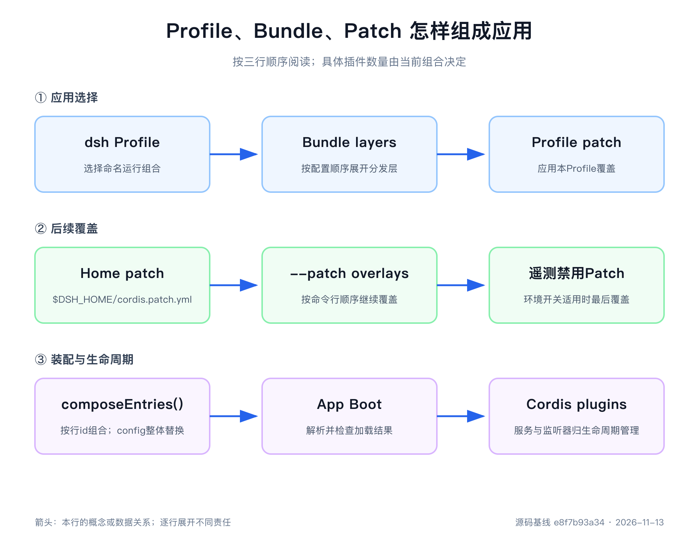

# 第6章 dsh 如何组装一棵插件树

> 本章源码基线：DeepSeek Harness `0.2.2-rc.2`，提交 `e8f7b93a344964de3dca1ace9e72b6e4d6de87cb`。当前项目要求 Node.js `>=24.9.0`，声明的包管理器为 `pnpm@11.28.5`。本次更新核对源码，未重新安装依赖或执行配置实验；旧实验只作为明确标注的历史记录。

前两章已经解释单个插件怎样管理生命周期、多个插件怎样通过 Service 和 Event 协作。可当我们运行 `dsh web` 时，还有一个问题没有回答：上百个插件是谁选进来的，为什么同一个仓库既能启动浏览器界面，也能运行一次性 Headless 任务？

如果把 `cordis.yml` 当成普通配置清单，答案似乎只是“Web 多写几行，Headless 少写几行”。实际机制更有层次：`dsh` 选择具名 Profile，Profile 按顺序选择 Bundle，Bundle 交付 Patch，Profile、Harness Home 和本次命令继续添加覆盖层，最后所有 Patch 才合成为 Loader 要挂载的插件树。

这一章的目标是掌握一套反查方法：从最终配置的一行出发，找出它由哪个 Bundle 插入、被哪些用户层修改、对应哪个插件实现，并判断它为什么只出现在某种应用表层。顶层行数会随版本变化，不适合用作架构定义。

第一次阅读只记一条主线：`dsh` 选择 Profile，Profile 按顺序选择 Bundle，Bundle 用 Patch 提交插件配置，Loader 再把最终配置变成 Plugin 与 Fiber。Profile、Bundle 和 Patch 都负责“选什么、怎样覆盖”，真正运行的仍是第4、5章介绍的插件。

## 所有受支持的 Node 应用都从 `dsh` 出发

当前架构把应用入口收在一个地方：所有受支持的 Node 应用都从 `dsh` CLI 加一个具名 Profile 启动。随仓库交付的模板包括 `web`、`headless`、`sdk`、`sdk-minimal` 和 `acp`。首个非 flag、非 `plugin` token 会被解析为 Profile 名，因此 `dsh web` 等价于 `dsh --profile web`，自定义名称也采用同一规则。`desktop` 保留给 Electron 载体，普通 Node 启动器会拒绝它。

这个约束看似严格，却解决了一个很实际的问题：如果每个包都能提供自己的 bin，每个示例都能内联挂载一套插件，Profile、环境加载、关闭处理、模块解析和 Patch 顺序就可能各写一份。用户看到相同包名，却无法确定自己走的是哪条启动路径。

因此，vendored CLI、只供构建或测试使用的可执行文件、进程内直接挂载插件和私有浏览器预览都不算 Harness 应用启动器。[`docs/architecture.zh.md`](https://github.com/deepseek-ai/deepseek-harness/blob/e8f7b93a344964de3dca1ace9e72b6e4d6de87cb/docs/architecture.zh.md)的“应用启动”章节明确记录了这一点，仓库还用入口校验脚本阻止新的 Node 应用绕过 `dsh`。

Python SDK 并没有破坏这个约定。它的运行时 wheel 打包同一个 `dsh`，客户端默认选择 `sdk` Profile；极简示例选择 `sdk-minimal`。TypeScript SDK 同样解析同版本的 `dsh` 并选择 Profile。SDK 提供调用接口，应用的组装仍然归同一启动器。

> 核心建议
> 看到某个包能被直接导入或某个测试能在进程内挂载插件，不要据此推断它是受支持的产品入口。先从 `dsh` 和 Profile 追踪正式启动路径。

## 启动器只解析自己拥有的参数

根 `package.json` 的 `dsh` 脚本进入 [`apps/cli/src/bin.ts`](https://github.com/deepseek-ai/deepseek-harness/blob/e8f7b93a344964de3dca1ace9e72b6e4d6de87cb/apps/cli/src/bin.ts)。`bin.ts` 先调用 [`parseDshArgs()`](https://github.com/deepseek-ai/deepseek-harness/blob/e8f7b93a344964de3dca1ace9e72b6e4d6de87cb/apps/cli/src/args.ts)，再按结果选择 Profile 启动、插件管理或配置导出。

CLI 拥有 Profile 选择、可选模板初始化、附加 `--patch`、配置或 Schema 导出，以及插件管理这些外层决定。它遇到第一个不认识的应用参数后，把剩余 token 原样交给插件树。因此下面两条命令中的 `--profile` 与 `--patch` 属于启动器，`--no-open` 与任务字符串属于各自的应用插件：

```sh
pnpm dsh --profile web --patch ./local.patch.yml --no-open
pnpm dsh --profile headless "run the tests"
```

Web Profile 中的 `web-startup` 插件解释 `--no-open`、`--port` 等 Web 参数；Headless 的启动插件取得任务文本。启动器不需要随着每个应用新增参数而变大，应用插件也不会越过 Profile 层偷偷决定自己的组合。

参数顺序因此有明确要求：启动器 flag 要出现在应用参数之前。第一个未知 token 开始内层参数后，后面的内容不再回到外层解析。`dsh --profile web --help` 显示 Web 应用帮助，裸 `dsh --help` 才显示启动器帮助。

配置导出又是一个重要例外。导出模式不启动应用参数 Provider，所以拒绝同时接收 `--port` 等应用参数。[`args.ts`](https://github.com/deepseek-ai/deepseek-harness/blob/e8f7b93a344964de3dca1ace9e72b6e4d6de87cb/apps/cli/src/args.ts)要求 `--dump-config`、`--dump-default-config`、`--dump-config-schema` 三者互斥，并禁止给默认配置导出附加 `--patch`。前两项用于观察配置层，Schema 导出用于检查配置字段；不能把任何一种静态导出当成应用已经运行。

## Profile 是一个有名字的应用组合

Profile 位于 `$DSH_HOME/profiles/<name>`。第一次使用随附 Profile 时，[`initProfile()`](https://github.com/deepseek-ai/deepseek-harness/blob/e8f7b93a344964de3dca1ace9e72b6e4d6de87cb/packages/boot/app-boot/src/profile.ts)会准备一个独立目录，其中至少有三类文件：

- `package.json`：保存树外插件依赖，以及有顺序的 `dsh.profile.bundles`。
- `cordis.patch.yml`：该 Profile 自己的用户 Patch 层，初始内容为 `[]`。
- `pnpm-workspace.yaml`：让通过 `dsh plugin` 安装的树外插件使用预期的模块布局。

真正准备启动时，[`prepareProfile()`](https://github.com/deepseek-ai/deepseek-harness/blob/e8f7b93a344964de3dca1ace9e72b6e4d6de87cb/apps/cli/src/profile-boot.ts)还会写入一个空的 `cordis.yml`。它不是用户编辑入口，而是 Loader 的实际根文件和相对路径锚点。插件树全部由 Patch 在这份空列表之上组合；每次重写空根还能避免 Loader 的树回写把已经组合的行固化进去，导致下次启动重复插入。

一个 Web Profile manifest 的核心可以缩成：

```json
{
  "dsh": {
    "profile": {
      "bundles": [
        "@deepseek-ai/dsh-base",
        "@deepseek-ai/dsh-web-app"
      ]
    }
  }
}
```

Profile 自己不实现模型、工具或 HTTP 服务。它为一组有顺序的 Bundle 命名，保存这一 Profile 的依赖与覆盖。当前 manifest 不再声明 `patchReload`；不要把旧版本的 `live`、`startup` 写回新 Profile。

随附 Profile 会在首次使用时按模板创建；模板与默认 Bundle 列表归 [`official-bundles/src/bundles.ts`](https://github.com/deepseek-ai/deepseek-harness/blob/e8f7b93a344964de3dca1ace9e72b6e4d6de87cb/packages/util/official-bundles/src/bundles.ts)所有。不存在的自定义名称不会凭空猜组合，可以通过 `dsh plugin --profile <name> add <package>` 建立，其默认 Bundle 是 `dsh-base`。`--from-default-profile` 还能以随附模板替换一个自定义 Profile；这是会修改该 Profile 的操作，不能当成只读查看命令。

## 实验时先隔离 Harness Home

`DSH_HOME` 不只是 Profile 文件所在目录。运行过程还可能在其中保存设置、Session、存储数据和模块解析辅助目录。若直接使用个人默认 Home 做源码实验，一次 Patch 修改可能影响平时使用的 Web，测试 Session 也会混入长期记录。

本书所有 Profile 实验都把 `DSH_HOME` 指向 `tmp/profile-bundle-tutorial/runtime-homes/<case>`。Web、Headless 和 SDK Minimal 各用独立目录，Profile 层与 Home 层覆盖也使用不同对照目录。这样每条命令的输入可见，删除实验目录即可恢复，不依赖个人机器此前留下的状态。

隔离 Home 还能揭示一类常见误判：同一条 `--dump-config` 在两台机器上结果不同，未必是源码或操作系统不同，可能只是 `$DSH_HOME/cordis.patch.yml` 有不同内容。记录实验时，应把 Profile 名、工作目录和显式 Home 一起写下，只记录命令尾部参数不够复现。

启动器在首次使用时会写 Profile 模板，所以只读检查也要考虑目标目录是否可写。第1周曾在默认主目录不可写时遇到创建 Profile 的 `EPERM`；改用隔离 Home 后问题消失。这个现象属于运行目录权限，不是 Web 或模型故障。

## Bundle 是可以分发的 Patch 层

Bundle 是 npm 包，但它的产品作用不是给业务代码 import 一个工具函数。Bundle 的 `package.json` 通过 `dsh.bundle.patch` 指定一份或多份 Patch 文件，并在 dependencies 中携带该层会装入的插件代码。单文件是常见形式，读源码时不能假定每个 Bundle 永远只有一个 `cordis.patch.yml`。

例如 `@deepseek-ai/dsh-base` 交付模型访问、Session、工具、安全与持久化等共享核心；`@deepseek-ai/dsh-web-app` 在其上增加 Web 启动、HTTP、RPC、工作区和浏览器客户端；`@deepseek-ai/dsh-headless` 增加一次性任务启动与结果输出。

Profile 中 Bundle 的顺序有意义。启动器先从自身安装目录解析内置 Bundle，再从 Profile 目录解析树外 Bundle，然后按 manifest 顺序读取各自 Patch。一个 Bundle 可以插入新行，也可以修改前层已存在的行。因此后层既能增加表层能力，也能调整共享核心在该表层中的配置。

加载失败要分清归属。当前 `loadProfileDirectory()` 会跳过无法读取、宿主平台不支持或版本要求不兼容的 Bundle，把原因放入 `skippedBundles`，启动器再报告这些项；Profile manifest 和用户 Patch 的错误仍然抛出。看到程序继续运行时，必须核对跳过报告和最终树，不能推断所有声明的 Bundle 都已挂载。

Bundle 与 Plugin 也不要混为一谈。Plugin 是 Cordis 实际挂载的运行能力；Bundle 是把多行插件配置作为一个可安装层交付的分发单元。一个 Bundle 可以装入许多 Plugin，也可以只覆盖前层几行而不提供新的运行实现。

判断改动放在哪里时，可以用三个问题：只是改变某台机器的端口或默认模型，写用户 Patch；要给一类 Profile 分发一组插件，写 Bundle；要实现新的 Service、事件或工具，先写 Plugin，再由合适的 Bundle 选择它。

把长期能力代码塞进 `--patch` 指向的本地文件，短期也许能运行，却没有解决分发与依赖。另一台机器拿到 Patch 后，还必须能够解析其中的插件包；Profile 的 `package.json` 才是树外依赖的安装归属。反过来，仅为修改一个端口建立新 Bundle，又会把机器偏好包装成公共产品层。扩展点选错以后，最先失去的通常不是功能，而是“谁负责升级和清理”的答案。

## Patch 是按行 id 修改配置树

Bundle、Profile 与命令行 Overlay 最终使用同一种 Patch 列表。每个 Loader 行通常有稳定 `id`、插件模块 `name`、依赖 `inject`、`config` 和 `disabled` 等字段。Patch 可以按 id 修改已有行，也可以使用 `insert` 加入新行。

最需要警惕的是 `config` 语义：后层提供的 `config` 会替换整段旧配置，不会做对象深度合并。假设 Bundle 中的 `webserver` 是：

```yaml
- id: webserver
  name: '@deepseek-ai/dsh-host-webserver'
  inject: [webStartup]
  config:
    host: !!js ctx.webStartup.host ?? '127.0.0.1'
    port: !!js ctx.webStartup.port ?? 3080
    tls: !!js ctx.webStartup.tls
    compression: gzip
    compressionLevel: 1
    compressionThresholdBytes: 1024
```

如果后层只写：

```yaml
- id: webserver
  config:
    port: wrong
```

它不会得到“保留 host，只修改 port”的结果。实验启动时最先报告 `$.host missing required value`，因为新 `config` 已经整体替换旧段，校验还没走到 port 类型。正确做法是从当前导出复制完整 `config`，再修改目标字段。

Patch 顶层必须是数组。把它写成对象时，导出以状态码1失败，并明确要求 top-level YAML array。Patch 指向不存在的行 id 时，离线导出会警告 `entry "week-03-missing-row" not found`，但以状态码0继续；因此“命令成功”不能证明每个覆盖都命中。

`!!js` 只用于插件 `config` 和条目 `disabled` 中允许的表达式位置。配置导出保留表达式文本，并不启动应用来求值；Loader 会在相应依赖就绪后，基于该条目的 Context 处理配置表达式。环境选择整组插件时应使用 Overlay，不要把所有组合逻辑藏进表达式。

> 踩坑提醒
> 修改 Patch 后，先检查 stderr 是否有未命中警告，再检查最终行的全部 `config`。只盯着目标字段，很容易漏掉被整体替换掉的必填项。



## 七层顺序决定最后谁说了算

从 [`composeProfile()`](https://github.com/deepseek-ai/deepseek-harness/blob/e8f7b93a344964de3dca1ace9e72b6e4d6de87cb/apps/cli/src/profile-boot.ts)看，一次普通启动的配置可以按应用顺序整理为：

日常使用先记“Bundle → Profile → Home → Invocation”四级：产品组合来自 Bundle，具名应用偏好来自 Profile，同一 Harness Home 的共同偏好来自 Home Patch，本次命令的临时决定来自 `--patch`。需要精确解释源码时，再把空根、多个 Bundle、多个命令行 Overlay 和遥测禁用层展开：

```text
空的 profile/cordis.yml
  ← Bundle 1 Patch
  ← Bundle 2 Patch
  ← ...
  ← Profile cordis.patch.yml
  ← $DSH_HOME/cordis.patch.yml
  ← --patch Overlay（按命令行顺序）
  ← DSH_TELEMETRY_DISABLED 产生的最终禁用 Patch（适用时）
```

后应用的层优先级更高。Profile 层只影响该命名组合；Harness Home 层影响同一 Home 下的所有 Profile；`--patch` 适合单次实验与故障复现；遥测环境开关在目标行存在时最后强制禁用，避免普通覆盖重新打开它。

多个 Bundle 和多个 `--patch` 都按声明顺序继续展开，不是无序集合。所谓“七层”是为了展示完整应用顺序，不要求读者给每一层另记一套概念。

配置导出会在每一行前加入 `# ==` 来源注释，列出者谁首次插入、谁随后修改。这些注释不是 YAML 运行字段，却是源码分析最有价值的线索：你不只看到最终值，还知道应该打开哪个 Bundle 和哪个用户文件。

## 用四个端口值证明覆盖顺序

本书旧基线 `dsh-v0.1.2-alpha.1` 曾选择 `webserver.config.port` 做实验，因为它容易观察，不需要模型 Key。下面的端口值、行数和测试结果均来自那次历史实验；配套脚本没有在本次更新中适配、重跑，不能把旧结果作为当前版本的验收。当前源码仍保持 Bundle、Profile、Home、Invocation 的覆盖顺序，重新验证时应从当前导出复制完整配置，并使用专用 `DSH_HOME`。

四次导出得到：

| 配置层 | 最终 port | 观察方式 |
|---|---:|---|
| Web Bundle 默认层 | `!!js ctx.webStartup.port ?? 3080` | `--dump-default-config` |
| Profile 用户层 | 4101 | 独立 Home，只修改 Profile Patch |
| Harness Home 层 | 4102 | 在同一 Home 根增加 `cordis.patch.yml` |
| 命令行 Overlay | 4103 | 再传 `--patch webserver-4103...yml` |

最后一次导出的来源注释依次列出 `@deepseek-ai/dsh-web-app`、Profile Patch、Home Patch 和命令行 Overlay。验收时，每次都要保存 `webserver` 的完整配置和 `# ==` 来源注释：四个值与四组来源共同证明覆盖关系，只记录最终4103不算通过。配置导出没有启动 Server，也没有调用模型，不能据此声称端口已监听或 Agent 已可用。

配置导出只证明“启动时准备挂载什么”。第3周实验还用同一个 Overlay 真正启动 Web，主机环境打印4103地址。受限沙箱中的原命令先以 `listen EPERM` 失败，说明宿主不允许监听本地端口；允许监听的主机环境原样成功，才证明最终组合可以运行。两类证据不能互相替代。

旧基线曾执行四个 Profile 测试文件：受限沙箱中67项通过，文件监听用例超时；主机环境原样重跑后68项通过。这是旧实现的历史证据，其中 watcher 行为已经不能用来说明当前启动器。

## Web 与 Headless 共享一套核心

[`PROFILE_TEMPLATES`](https://github.com/deepseek-ai/deepseek-harness/blob/e8f7b93a344964de3dca1ace9e72b6e4d6de87cb/packages/util/official-bundles/src/bundles.ts)给出最直接的组合证据：

```text
web      = dsh-base + dsh-web-app
headless = dsh-base + dsh-headless
```

真正要记住的是组合关系：两者都先使用 `dsh-base` 提供模型、Session、工具、Agent Loop、文件系统、沙箱、审批与持久化，再由表层 Bundle 改写少量核心配置并增加自己的入口。

旧基线的配置导出曾得到 Web 144行、Headless 89行、共享87个 id。这些数字只用于对照旧实验，当前版本必须重新统计。最新 Web Bundle 还将多项 Agent 能力放入 preset 内部；顶层行数既不等于能力数，也不等于某个 Agent 实际看见的插件数。

因此，Web 与 Headless 不应描述成两套 Agent 内核。一次任务最终仍进入同一组核心服务，只是输入来自浏览器或命令行，结果通过 UI 或标准输出呈现。阅读某项行为时，先判断它属于共享 base 还是应用表层，可以大幅减少搜索范围。

## SDK Minimal 为什么不是“删小的 Web”

`sdk-minimal` 的模板只有一个 Bundle：

```text
sdk-minimal = dsh-sdk-minimal
```

它没有先叠加 `dsh-base`。旧实验导出过18个顶层行；本次更新不沿用这个数量作为最新结果。阅读当前 [`sdk-minimal/cordis.patch.yml`](https://github.com/deepseek-ai/deepseek-harness/blob/e8f7b93a344964de3dca1ace9e72b6e4d6de87cb/packages/bundle/sdk-minimal/cordis.patch.yml)，应确认它显式选择的 SDK 启动、JSON-RPC、模型、执行环境和 Session 能力，而不是拿 Web 的行数做减法。

当前 SDK Minimal 显式列出 `llm`、`session`、`system-prompt`、`tools`、`tool-executor-native`、`agent` 和 `agent-loop` 等核心行。旧基线用 `agent-spine` 聚合的解释已经不适用。它仍然是一份独立完整组合，不能把它描述成“Web 配置删去若干行”。

这种设计适合 SDK 的极简例子：保留完成一次 Agent 调用所需的最小组合，减少默认工具和宿主表层，但仍通过统一 `dsh --profile sdk-minimal` 启动。调用方不能绕过 Profile 提供任意内联 Cordis 树，这让入口与生命周期约定保持一致。

## 区分启动组合与运行中的配置修改

当前 `runProfile()` 在启动时读取 Profile、Home 与本次 Overlay，准备模块解析、代理和关闭控制，然后调用 `boot()` 挂载树。命令行 Overlay 的内容属于本次调用的固定输入。旧版本在 CLI 中实现的 `patchReload: live | startup` 和用户文件 watcher 已不在这条路径中。

因此，编辑磁盘 Patch 后，不应假定正在执行的 Agent 会立即切换组合。应用内的配置修改、Loader 的树操作和重新启动分别有自己的实现与生命周期；阅读时要追到具体拥有者，不能靠旧 manifest 字段推断。

这没有削弱第4章的生命周期要求。若一个扩展允许运行中替换插件，仍要回答在途调用如何结算、连接如何关闭、消费方如何等待 Provider，以及失败修改是否留下可用状态。只是这些保证必须由当前扩展实现证明。

## 从最终配置反查来源的五步法

面对一份很长的配置，不要从第一行顺读。选定一个目标行，例如 `tools`、`webserver` 或 `headless-runner`，执行五步：

1. 在 `--dump-config` 中记录行的 `id`、`name`、`inject`、完整 `config`、`disabled` 和 `# ==` 来源注释。
2. 打开 Profile 的 `package.json`，按 `dsh.profile.bundles` 顺序列出 Bundle。
3. 在各 Bundle 的 `cordis.patch.yml` 中搜索 id，区分首次 `insert` 和后续覆盖。
4. 检查 Profile、Home、命令行 Overlay 和适用的最终环境开关，确认最后由谁修改。
5. 打开 `name` 指向包的 README、公开类型和行为测试，理解它提供什么服务、事件和失败行为。

顺序不要反过来。直接打开实现包，只能知道插件怎样工作，不知道它为什么出现在当前应用；只看最终 YAML，又只能知道装了什么，不知道 Service 和生命周期约定。

本书已把五个例子整理进配置来源追踪表：`llm` 与 `tools` 来自 base，`webserver` 来自 Web Bundle，`headless-runner` 来自 Headless Bundle，`sdk-jsonrpc-server` 来自 SDK Minimal 的独立树。练习时可以随机再选五行，不要总围绕熟悉的模型配置。

## 完整追踪一次 `webserver`

现在按五步把 `webserver` 走一遍。第一步在 Web 的 `--dump-config` 中找到 `id: webserver`：`name` 指向 `@deepseek-ai/dsh-host-webserver`，`inject` 要求 `webStartup`，完整 `config` 包含 host、port 与压缩参数。来源注释显示它由 Web Bundle 插入，而不是 base。

第二步查看 Web Profile manifest，Bundle 顺序是 `dsh-base`、`dsh-web-app`。第三步在两份 Bundle Patch 中搜索 id：base 不拥有它，Web Bundle 的 `insert` 给出首次定义。此时可以判断，Headless 不会仅因为共享 base 就得到 HTTP Server。

第四步继续检查三个用户位置。Profile Patch 把完整配置改为4101，Home Patch 再改为4102，本次 Overlay 最后改为4103；导出注释按相同顺序列出覆盖者。若目标机器没有这些文件，端口会回到 Bundle 表达式，由 `webStartup.port` 或3080决定。

第五步才进入 `@deepseek-ai/dsh-host-webserver` 的 README、Config Schema 和行为测试，理解 host、压缩与监听失败。`inject: [webStartup]` 说明 Loader 会等 Web 参数 Provider 可用后再解析相关配置；最终端口不是 CLI 直接写入 Server，而是应用参数服务与 Bundle 表达式共同决定。

这条追踪同时回答了四个不同问题：谁把 Server 选入应用，谁拥有启动参数，谁覆盖部署值，谁实现监听行为。若一开始只搜索 `port: 3080`，很容易把它们混成一个“Web 配置文件”。

同样的方法可以追 `tools`。它由 base 插入，Web 和 Headless 表层可以重述配置模式，真正行为属于工具 Service 与 Consumer。到了第10章，我们会沿这行继续进入 Schema 投影、策略、调度和结果事件，而不需要再次猜它为何出现在应用中。

## 配置导出是组合系统的调试器

`--dump-default-config` 只组合 Bundle 层，跳过 Profile 用户 Patch、Home Patch 与命令行 Overlay。它还有恢复价值：即使用户 Patch 已损坏，也可以导出默认树，找到应复制的完整配置。

`--dump-config` 则包含用户层和命令行 Overlay，但仍不启动插件，也不求值应用参数。它适合回答“最终准备挂载哪些行”和“谁覆盖了谁”，不适合证明端口已经监听、服务已经注册或模型已经可用。

一次可靠的排查应把三类证据分开：配置导出确认组合，启动日志确认 Fiber 完成加载，行为测试或实际任务确认服务协作。第1章已经用过这条证据分层，本章现在能解释配置导出为什么有资格成为第一步。

配置导出也适合评审变更影响。修改默认模型时，不要只搜索模型字符串；先找到拥有默认值的行 id，检查它在哪些 Profile 中存在、是否被用户层覆盖，再进入提供方确认值的含义。若 Web 与 Headless 共享该行，一次 base Patch 可能同时改变两个表层；SDK Minimal 使用另一棵树，还需单独核对它的模型与 Agent 配置。

同理，删除一行前要检查后层 Patch 是否仍按该 id 修改它、其他行是否通过 `inject` 等待它，以及应用表层是否提供替代者。未命中的 Patch 可能只发警告，依赖插件则可能停在 `PENDING`。配置层的改动不能只靠 YAML 能否解析来验收，还要检查最终树和关键行为。

可以把变更检查分成三个集合：加入了哪些 id、删除了哪些 id、哪些相同 id 的字段发生变化。加入项要验证包依赖与卸载；删除项要验证依赖者和旧 Patch；变化项要特别检查整个 `config` 是否被替换。随后为 Web、Headless、SDK 等受影响 Profile 分别导出配置，不要只验证编辑时使用的一个表层。

对版本升级也使用同一方法。先保存旧标签的行 id 与来源，再导出新标签的结果，比较组合差异后才进入实现源码。这样能把“包内部算法改变”和“应用根本换了一组插件”分开，出版前更新基线时尤其重要。

## Profile 组合追踪表

| 检查项 | 记录内容 |
|---|---|
| 启动命令 | Profile、所有 `--patch`、应用参数与工作目录 |
| Harness Home | 显式 `DSH_HOME`，避免混入个人长期配置 |
| Profile manifest | Bundle 顺序、依赖与跳过报告 |
| 目标行 | id、name、inject、disabled、完整 config |
| 来源注释 | 首次插入者与全部覆盖者 |
| 运行职责 | 对应 Service、事件、工具或应用入口 |
| 失败行为 | 未命中警告、Schema 错误、加载失败或监听限制 |
| 运行证据 | 只导出、已启动、keyless 测试或真实模型验证 |

把这张表与第4章的生命周期检查表、第5章的服务事件选择表放在一起，就能从“为什么装入”追到“怎样协作”和“如何退出”。

## 本章源码阅读路线

1. [`apps/cli/src/args.ts`](https://github.com/deepseek-ai/deepseek-harness/blob/e8f7b93a344964de3dca1ace9e72b6e4d6de87cb/apps/cli/src/args.ts)与[`bin.ts`](https://github.com/deepseek-ai/deepseek-harness/blob/e8f7b93a344964de3dca1ace9e72b6e4d6de87cb/apps/cli/src/bin.ts)：确认启动器拥有哪些参数，怎样选择运行模式。
2. [`apps/cli/src/profile-boot.ts`](https://github.com/deepseek-ai/deepseek-harness/blob/e8f7b93a344964de3dca1ace9e72b6e4d6de87cb/apps/cli/src/profile-boot.ts)：沿 `prepareProfile()`、`composeProfile()` 和 `runProfile()` 观察组合、启动和关闭。
3. [`app-boot/src/profile.ts`](https://github.com/deepseek-ai/deepseek-harness/blob/e8f7b93a344964de3dca1ace9e72b6e4d6de87cb/packages/boot/app-boot/src/profile.ts)与[`official-bundles/src/bundles.ts`](https://github.com/deepseek-ai/deepseek-harness/blob/e8f7b93a344964de3dca1ace9e72b6e4d6de87cb/packages/util/official-bundles/src/bundles.ts)：阅读模板归属、初始化文件、Bundle 解析与跳过报告。
4. [`dsh-base`](https://github.com/deepseek-ai/deepseek-harness/blob/e8f7b93a344964de3dca1ace9e72b6e4d6de87cb/packages/bundle/base/cordis.patch.yml)、[`dsh-web-app`](https://github.com/deepseek-ai/deepseek-harness/blob/e8f7b93a344964de3dca1ace9e72b6e4d6de87cb/packages/bundle/web-app/cordis.patch.yml)、[`dsh-headless`](https://github.com/deepseek-ai/deepseek-harness/blob/e8f7b93a344964de3dca1ace9e72b6e4d6de87cb/packages/bundle/headless/cordis.patch.yml)与[`dsh-sdk-minimal`](https://github.com/deepseek-ai/deepseek-harness/blob/e8f7b93a344964de3dca1ace9e72b6e4d6de87cb/packages/bundle/sdk-minimal/cordis.patch.yml)：只比较行 id 和职责，不逐项展开实现。
5. 第3周实验记录与Profile 实验说明：作为旧基线对照材料，先核对当前配置与接口再迁移实验。

## 动手练习

### 练习一：重跑四层端口覆盖

为 Web 准备隔离 `DSH_HOME`，依次导出 Bundle 默认、Profile 4101、Home 4102 和命令行4103。每次同时保存最终值与来源注释。不要把认证 URL 和令牌写入书稿。

### 练习二：制造三种失败

分别使用不存在的行 id、非数组顶层和缺少 `host` 的 `webserver.config`。记录状态码、最早稳定错误和最终树是否变化，解释为什么状态码0也可能代表某项 Patch 没有生效。

### 练习三：对比三棵树

导出 Web、Headless 和 SDK Minimal 的 id 集合。计算 Web 与 Headless 的交集和各自独有项，再证明 SDK Minimal 使用独立 Bundle。数字要标注版本，不把本次统计写成永久约定。

### 练习四：设计自己的 Profile

在 `dsh-base` 上增加一个只读业务工具 Bundle，再用 Profile Patch 修改部署值。写清插件、Bundle 和 Profile 分别拥有哪项决定，记录重新启动前后的差异，并验证缺失 Bundle 是否产生跳过报告。

## 本章回顾

`dsh` 是受支持 Node 应用的统一启动器，它选择 Profile、叠加 Patch 并转交应用参数。Profile 为一种应用组合命名，Bundle 交付可安装的 Patch 层，Patch 按稳定行 id 插入或替换配置，Plugin 才是 Cordis 最终挂载的运行能力。Web 与 Headless 共享 `dsh-base`，SDK Minimal 则用自己的完整树；诊断组合时还要检查 `skippedBundles`，并区分启动读取与运行中的树操作。

到这里，我们已经知道能力怎样出生、怎样协作、又怎样被选进一次启动。第二部分完成后，下一步要进入 Agent 的事实层：插件树运行起来以后，一次用户输入、一次模型请求和一次工具调用究竟留下哪些 Session Event，界面、恢复和模型上下文为什么都要从同一份记录重建。
