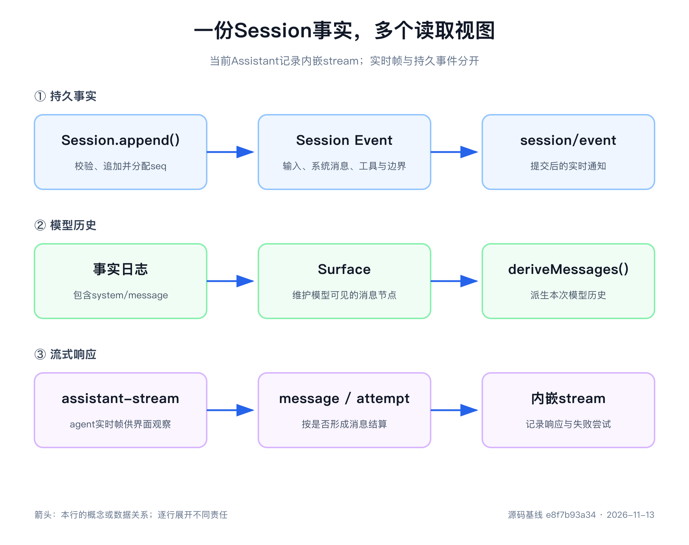

# 第7章 Session Event 是系统的事实来源

> 本章源码基线：DeepSeek Harness `0.2.2-rc.2`，提交 `e8f7b93a344964de3dca1ace9e72b6e4d6de87cb`。本次核对 Session 类型、Surface、追加与流式结算源码，未重跑旧实验。当前项目要求 Node.js `>=24.9.0`。

前几章解决的是能力怎样装载、协作和退出。现在要回答另一件事：能力运行以后，系统凭什么知道刚才发生了什么？

保存一个 `messages` 数组很容易。用户说一句，压入 user message；模型答一句，压入 assistant message。可 Agent 会调用工具、重试请求、取消半截输出，还会改变系统提示词和可用工具。如果只留下最后的聊天气泡，恢复进程就必须猜测已经丢失的过程。

DeepSeek Harness 先记录会话事实，再派生不同用途的视图。第一次阅读请分清四层：Session Event 是持久事实，Surface 是当前模型历史选择，`Message[]` 是投影结果，Cordis Event 是当前进程里的通知。信息存在于日志、模型当前能看见它、界面刚收到它，分别是三件事。



## 消息数组回答不了的五个问题

设想一次天气查询：用户提问，模型流式说明准备查询，提出 `weather` 调用，工具返回小雨，模型建议带伞。聊天记录很短，但至少还有五个问题。

第一，取消发生时，已经显示的半句话是否会成为下一轮历史？第二，调用块、执行动作与工具结果如何配对，怎样避免把调用重复发给模型？第三，下一次请求的系统规则、工具 Schema 和模型配置改变后，旧请求还能解释吗？第四，失败尝试的流式内容怎样保留，又怎样避免混进成功回答？第五，模型只看摘要时，人类还能追溯原始交互吗？

这些问题说明，模型消息是一种消费格式，无法单独承担完整运行记录。设计自己的 Agent 时，应先列出恢复、诊断和后续决策需要的事实，再决定模型需要看哪部分。

## 事实类型表允许扩展，也要求读者理解

[`SessionEventMap`](https://github.com/deepseek-ai/deepseek-harness/blob/e8f7b93a344964de3dca1ace9e72b6e4d6de87cb/packages/core/session/src/types.ts)是“事件名称—数据”的类型映射。核心定义 Turn、Step、消息、工具和请求状态；插件可以通过 TypeScript 声明合并增加自己拥有的事件，例如 Inbox 的变更记录。

每条 `SessionEvent` 至少有四个字段：

| 字段 | 含义 | 阅读时关注 |
|---|---|---|
| `type` | 事件判别字段 | 谁拥有它的字段与兼容语义 |
| `seq` | Session 内连续序号 | 顺序、引用与缺口 |
| `time` | Unix 毫秒时间 | 观察时间，不能代替 seq |
| `data` | 与类型对应的 JSON 数据 | 恢复和后续行为依赖什么 |

当前 `SessionSeq` 和日志偏移 `SessionLogOffset` 使用不同的品牌类型。它们都可能以数字表示，却不能因为底层形式相同就互换。事件序号用于引用事件，存储偏移用于定位后端记录，混用会把“类型能读懂”变成“指向错误位置”。

扩展性也不意味着可以忽略所有陌生事件。当前事件信封允许 `ignorable: true`：未知但明确可忽略的附加记录可以跳过；没有该标记的未知类型必须拒绝读取，避免新版本的重要事实被旧读者静默丢弃。

另外，`plugin:*` 记录由独立的 `PluginRecordMap` 和存储归属管理。不要把它们当成任意扩展 `SessionEventMap` 的别名；生产者和读取方仍要对自己的数据做验证。

## 核心事件按职责阅读

| 职责 | 事件 | 主要用途 |
|---|---|---|
| 工作区间 | `turn/start`、`turn/end` | 打开 Turn，记录结束原因 |
| 步骤区间 | `step/start`、`step/end` | 界定一次逻辑 Step |
| 模型规则与输入 | `system/message`、`developer/message`、`user/message` | 保存进入消息历史的内容 |
| 成功或可见中断输出 | `assistant/message` | 稳定消息、内嵌 stream、用量与中断标记 |
| 不进入历史的尝试 | `assistant/attempt` | 保存失败、重试或无可见内容的尝试流 |
| 工具事实 | `tool/call`、`tool/result` | 原始参数、结果、错误身份与展示元数据 |
| 请求状态 | `request/header`、`request/context` | 配置、工具声明和路由能力 |
| 继承前缀 | `session/end-seed` | 标明构造时继承的历史 |

这里有一项影响全书的版本变化：当前没有持久 `assistant/chunk` 事件。流式实时通知仍逐片产生，但最终持久化为一条 `assistant/message` 或 `assistant/attempt` 内的 `stream`。旧基线的“每个 chunk 一条 Session Event”不能直接套到当前源码。

Turn 和 Step 也不是排版分隔符。它们决定消息和工具结果能否在当前位置成立，开放调用怎样结清，崩溃尾部怎样修复。第9章会把这些事实放回驱动状态机。

## `append()` 在接受位置固定事实

[`Session.append()`](https://github.com/deepseek-ai/deepseek-harness/blob/e8f7b93a344964de3dca1ace9e72b6e4d6de87cb/packages/core/session/src/index.ts)会检查可序列化数据、Surface 意图、来源引用和其他不变量，建立脱离调用方的快照，再提交日志与通知。`BigInt`、函数、循环引用、非有限数字、稀疏数组和进程资源不能成为稳定 JSON 事实。

复制和冻结不是样式偏好。假如工具追加一个对象以后继续修改它，内存观察者和持久化后端可能读到不同内容；一份会随外部引用变化的日志不能承担事实来源。当前事件和已取出的历史快照不应被调用方修改；取得的旧快照也不会自动增长。

当前还支持 `append(inputs: readonly SessionEventInput[])` 原子批量追加。所有输入先准备、验证，失败时不会只留下批次前半段；提交成功后，观察者能看到完整批次和最终 Surface。这适合多个事实必须共同成立的操作，不能用“循环调用单条 append”假装同样的提交保证。

接受事实与落盘仍是不同时间点。内存提交不等于磁盘已经完成耐久写入；JSONL、SQLite 等后端还拥有自己的写入和 `flush()` 责任。观察者异常也不能把已经接受的事实倒回为“没有发生”。

## Surface 当前有五种消息节点

完整日志不能直接交给模型。边界、错误身份和诊断有恢复价值，却不都是对话内容。Surface 表示当前可以投影为模型历史的有序节点，当前 `SurfaceEventType` 有五种：

```text
system/message
developer/message
user/message
assistant/message
tool/result
```

这些事件必须带明确的 `surfaceOp`。`append` 加入当前历史；`replace` 用新节点遮蔽指定范围。`tool/call` 不单独进入 Surface，因为调用块已经在 assistant message 中；再次投影会重复提出调用。`assistant/attempt` 不进入 Surface，因为失败尝试不是下一轮模型应当当成已经完成的回答。

[`surface.ts`](https://github.com/deepseek-ai/deepseek-harness/blob/e8f7b93a344964de3dca1ace9e72b6e4d6de87cb/packages/core/session/src/surface.ts)负责折叠这些操作和基础消息投影，`Session.deriveMessages()` 结合当前节点、消息投影扩展与缓存生成历史。某些节点可以保留在 Surface 中却不产生消息，例如被清空的后续 system 节点。节点数不必等于最终 `Message[]` 长度。

```text
Session Event 日志
      ↓ 折叠 append / replace
当前 Surface 节点
      ↓ 基础投影 + 注册的消息投影
模型请求的 Message[]
```

普通追加与替换的缓存失效方式也不同。阅读时应同时观察节点变化和 `contentGeneration`，不能仅凭日志长度判断模型历史是否保持同一前缀。

## 用一个示意轨迹区分事件与消息

下面是用于阅读的示意顺序，不是本次运行输出；实际序号会受插件扩展和请求状态变化影响。

```text
turn/start
step/start
system/message       → 系统规则
user/message         → 用户问题
request/header       → 配置与工具声明
request/context      → 路由容量和更新能力
assistant/message    → 文本 + weather 调用块；同条事件内含 stream
tool/call            → 原始 name、arguments、callId
tool/result          → weather 结果
step/end
```

在这个片段中，基础投影通常产生系统规则、用户问题、assistant 消息和工具结果四条消息。Header、Context、Turn、Step 不直接变成消息；独立 `tool/call` 不重复投影。

这里的工具结果采用共享 LLM 表达：user role 中的 tool-result block。具体 Adapter 再翻译成提供方要求的 wire 格式。不要因为共享角色为 user，就把结果理解成用户本人输入的普通文本。

## 流式通知与持久结算各有表示

[`AssistantStreamAttempt`](https://github.com/deepseek-ai/deepseek-harness/blob/e8f7b93a344964de3dca1ace9e72b6e4d6de87cb/packages/core/agent-loop/src/assistant-stream.ts)同时维护流式累积器和 `BlockAssembler`。收到 chunk 后，它捕获带时间的快照，交给累积与组装，再发出 `agent/assistant-stream` 通知。实时 frame 有 start、chunk、end，并带进程内 attempt id、revision 和片段位置，便于 UI 追踪当前尝试。

持久记录采用紧凑 `stream`，不能把记录数量等同于网络 chunk 数量。成功尝试把稳定消息和该尝试的 stream 一起写入 `assistant/message`。失败或需要重试的尝试写入 `assistant/attempt`，不会把部分内容混入成功消息。

取消时要看是否已有安全可见前缀。有文本等可保留内容时，Loop 写入带 `interrupted: true` 的 `assistant/message`；没有可见内容时，写入 `assistant/attempt`。未完成调用块不会因为 UI 收到过几个参数字符就成为可执行调用。

实时 end frame 在对应持久事件成功提交之后才报告 committed，并指向该事件 seq。若无法提交，则报告 abandoned。于是界面可以区分“收到过临时分片”与“这次输出已经有可恢复结算”。但这项内存结算依然不能替代存储后端的落盘检查点。

当前 `assistant/message` 明确禁止 `sourceEventSeqs`。它的流来源已经在同条事件的 `stream` 内，不再通过引用许多 chunk 事件表达。旧稿关于“空来源数组代表空流”的说法不适用于当前类型。

## replace 改变模型所见，保留原始历史

压缩上下文时，可以追加一条摘要，再用 replace 遮蔽旧 Surface 范围。日志增加，模型历史可能缩短，原始事件仍然存在。人类 transcript、审计与模型当前输入因此可以有不同视图。

来源引用有明确约束：提供 `sourceEventSeqs` 时，应给出已知、完整、非空且指向更早事实的来源；replace 还要满足被替换范围的来源要求。它不是一个随意附加的调试数组，更不能给所有事件机械加上空数组。

消息投影扩展可以根据当前节点、既有事件和先前投影消息生成替代视图，但它们不能改写原始事实。为自己的 Agent 实现摘要时，先做到“摘要替代模型输入，原文仍可追溯”，再讨论压缩算法。

## 系统提示词已经进入消息历史

当前“模型可见即已记录”的重建关系如下：

| 输入或路由事实 | 记录位置 |
|---|---|
| 系统规则 | Surface 上的 `system/message` |
| 工具增删说明 | `developer/message`，工具增加时关联 Header |
| 用户、动态上下文与助手历史 | 相应消息事件及 Surface |
| 工具声明 | `request/header.tools` |
| provider、model、effort、max tokens 等 | `request/header.config` |
| 模型容量、系统提示词更新能力 | `request/context` |
| 尝试过程 | `assistant/message.stream` 或 `assistant/attempt.stream` |

`request/header.system` 已退休，类型写成 `system?: never`。系统提示词第一次在首个用户输入之前建立头部 system 节点；支持 in-history 更新的路由可在同一请求系列中追加变化，其他情形通过记录替换规范化已有节点。具体规则在第8章展开。

动态 runtime context 仍通过带来源的 `user/message` 进入历史。它是当前环境快照，可以说明自己取代较早快照；不应偷偷改一个日志之外的字符串。

工具增删说明也要区分角色：`developer/message` 可以告诉模型可用能力发生变化，而完整工具 Schema 仍来自 Header。看见一条说明文字不能证明注册表当前允许实际执行。

## 继承、分叉与实时订阅不能混用

Session 可以由 Seed 构造，`session/end-seed` 标记继承前缀。当前类型还带继承标志，Fork 的标记位置与合成关闭记录也有专门规则。前缀并不是一次新的工具执行，不能把继承事件重新广播成刚发生的操作。

只订阅 `session/event` 的 Consumer 只能知道订阅后的提交。要接管既有 Session，必须按当前投影接口处理历史快照与后续事件的衔接，避免读取与订阅之间漏掉新事件。不要把“先读全部、稍后再订阅”写成天然无竞态的通用算法。

恢复、Fork 和持久化还要遵守当前 Session 格式版本规则。陌生事件是否可忽略、遗留开放调用如何修复、继承标记怎样截取，都应读拥有该操作的模块；不能简单复制数组以后改一个 id。第12章继续讨论后端和恢复。

## 给迷你 Harness 加一份追加日志

第一版不必复刻所有类型。先实现一个拥有消息结算和失败尝试的教学联合：

```ts
type DemoEvent =
  | { type: 'user/message'; seq: number; text: string }
  | { type: 'assistant/message'; seq: number; text: string; stream: string[] }
  | { type: 'assistant/attempt'; seq: number; stream: string[] }

function project(log: readonly DemoEvent[]) {
  return log.flatMap(event => {
    if (event.type === 'assistant/attempt') return []
    return [{ role: event.type === 'user/message' ? 'user' : 'assistant', text: event.text }]
  })
}
```

这段代码是教学类型，不是 DSH API 示例。尝试中的分片先在执行对象中累积；成功时与最终文字一起提交，失败时只提交 attempt。增加失败尝试会增加日志，却不会增加一条假 assistant message。

随后加入 JSON 快照与深冻结、连续 seq、批量接受，再加入独立 Surface。验证外部对象修改不会改变已接受事件，失败批次不会留下前半段，replace 后旧事件仍可读取。先验证语义再选择数据库，能少走很多弯路。

## 从异常现象反查事实来源

排查时按以下顺序缩小范围：

1. 找到原始事件及其 type、seq、Turn、Step 或 call id。
2. 判断它是否属于五类 Surface 事件，检查 append 或 replace。
3. 检查当前节点和消息投影，确认模型实际会读到什么。
4. 涉及尝试过程时查内嵌 stream；涉及实时 UI 时查 frame 与 settlement。
5. 涉及配置、工具声明和路由能力时查 Header、Context 与 developer message。
6. 涉及磁盘和恢复时，再查持久化提供方与 flush 证据。

例如取消后界面有半句话，下一轮却没有：先查是否产生中断消息，再查 Surface 与投影。如果只有实时 frame，没有持久结算，应该追结算失败；如果已经有中断消息却被后续摘要替换，则应追 Surface。

## 本章源码阅读路线

1. [`types.ts`](https://github.com/deepseek-ai/deepseek-harness/blob/e8f7b93a344964de3dca1ace9e72b6e4d6de87cb/packages/core/session/src/types.ts)：事件类型、来源约束、Header 与未知类型语义。
2. [`surface.ts`](https://github.com/deepseek-ai/deepseek-harness/blob/e8f7b93a344964de3dca1ace9e72b6e4d6de87cb/packages/core/session/src/surface.ts)：五类节点、replace 与基础投影。
3. [`index.ts`](https://github.com/deepseek-ai/deepseek-harness/blob/e8f7b93a344964de3dca1ace9e72b6e4d6de87cb/packages/core/session/src/index.ts)：单条与批量追加、消息投影注册和缓存。
4. [`assistant-stream.ts`](https://github.com/deepseek-ai/deepseek-harness/blob/e8f7b93a344964de3dca1ace9e72b6e4d6de87cb/packages/core/agent-loop/src/assistant-stream.ts)：实时 frame、紧凑 stream 与持久结算。
5. [`runtime-context.ts`](https://github.com/deepseek-ai/deepseek-harness/blob/e8f7b93a344964de3dca1ace9e72b6e4d6de87cb/packages/core/agent-loop/src/runtime-context.ts)：system 和动态上下文怎样提交。
6. [`fork.ts`](https://github.com/deepseek-ai/deepseek-harness/blob/e8f7b93a344964de3dca1ace9e72b6e4d6de87cb/packages/core/session/src/fork.ts)、[`repair.ts`](https://github.com/deepseek-ai/deepseek-harness/blob/e8f7b93a344964de3dca1ace9e72b6e4d6de87cb/packages/core/session/src/repair.ts)：继承前缀和开放尾部的处理。

第4周配套实验保留的是 `dsh-v0.1.2-alpha.1` 的历史实现，包含已退休的 `assistant/chunk`，不能直接运行来验证本章当前类型。旧记录中的12条事件、3条消息和162项测试只是旧基线证据；本次没有重跑这些脚本，也没有据此声明 JSONL、SQLite、真实模型或 Web 已通过验证。

## 动手练习

### 练习一：增加实时分片

在自己的教学 Session 中把两段流改成三段，最终文字保持不变。确认一条 message 的 stream 变化，持久消息数量不因分片数直接增加。

### 练习二：分开失败与成功

先提交一次失败 attempt，再提交成功 message。投影只能产生成功回答；失败的流仍能从日志定位。

### 练习三：验证批量接受

准备两个需要共同提交的教学事件，让第二个验证失败。检查日志和 Surface 都没有只接受第一个；修正后再一起提交。

### 练习四：实现只读投影

从日志计算各类型计数，丢弃投影后重新计算。计数不应成为另一份权威事实，也不需要把运行中的 Promise、连接或 AbortController 放进日志。

## 本章回顾

Session 保存可恢复、可解释的 JSON 事实，Surface 选择当前模型历史，消息投影生成请求输入，Cordis Event 提供进程内协作。当前 Surface 有 system、developer、user、assistant 和工具结果五类节点；流式过程结算为 message 或 attempt 的内嵌 stream，实时 frame 不等于独立持久 chunk。

理解这几层以后，下一章就可以逐字段追踪一次模型请求：提示词怎样进入历史，工具怎样被本 Step 准入，调用配置怎样确定，Adapter 又怎样把响应交回事实日志。
