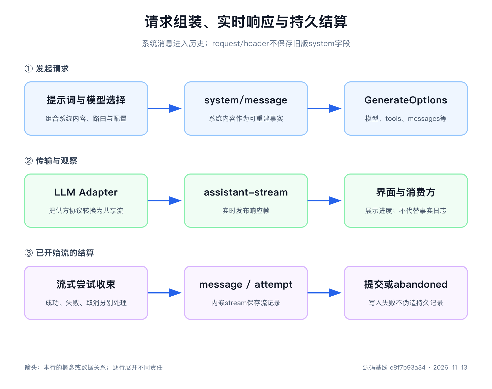

# 第8章 模型请求不是在一个函数里拼出来的

> 本章源码基线：DeepSeek Harness `0.2.2-rc.2`，提交 `e8f7b93a344964de3dca1ace9e72b6e4d6de87cb`。本次完成请求、提示词和流式结算源码核对，未重跑旧 Mock 脚本，也未验证真实 DeepSeek HTTP/SSE。当前项目要求 Node.js `>=24.9.0`。

第7章已经说明，`messages` 只是 Session Event 的一种投影。一次调用还需要 provider、model、tools、max tokens，可能还有 reasoning effort、temperature 和 stop sequences。当前 Loop 把系统规则作为 messages 中的 system role 历史发送，不填写顶层 `system`；公共 `GenerateOptions.system` 仍供手工一次性调用使用。

于是，一个新的误解很容易出现：既然字段都在同一个对象里，项目里总该有一个函数负责把它们全部拼出来。

DeepSeek Harness 中没有这样一个“总装函数”。不是源码藏得太深，而是这些字段本来就属于不同能力：System Prompt Registry 决定模型这一步应该知道什么，Session 决定它记得什么，Agent 的选择与 Waterfall 决定请求发给谁，LLM Runtime 解析精确模型能力，Adapter 最后把共享请求翻译成提供方协议。

这是一件好事。若所有字段都由 Agent Loop 硬编码，增加工具、切换模型、注入工作区规则或替换提供方都要修改循环。把责任拆开以后，循环只负责在正确时间收集结果、记录事实并推动生命周期。

读完本章，你应该能拿到一份 `GenerateOptions`，逐字段反查它来自哪个插件；也能解释请求为什么要在发送前冻结，流式 chunk 怎样变成最终 assistant message，以及请求失败为什么不等于 LLM Runtime 自己会自动重试。

第一次阅读只走两条主线。请求向前走：Step 固定模型选择与工具准入，Prompt Assembly 提供内容，`agent/request` 与 `prepareCall()` 确定配置，消息和请求事实提交后再冻结发送；响应返回：Adapter 产生 chunk，Loop 同时累积紧凑 stream、组装消息并发布实时 frame，最后持久结算。Header 的 reason、Adapter 注册代次和错误恢复策略可以放到第二遍。

## 先把请求拆成四类输入

一次模型请求可以先分成四类：

| 输入 | 例子 | 主要所有者 |
|---|---|---|
| 行为规则 | system-role message 中的身份、角色、工具使用说明 | `SystemPrompt` 的有序 section 与 Loop 投影 |
| 当前能力 | `tools` 中的名称、描述和 JSON Schema | 工具提供方与 `SystemPrompt.tools()` |
| 历史事实 | `messages` 中的 system、developer、用户、assistant 与工具结果 | Session Surface 与 `deriveMessages()` |
| 调用控制 | provider、model、effort、max tokens 等 | Agent 选项、`agent/request`、`LlmRuntime.prepareCall()` |

这四类输入的变化节奏并不相同。用户消息几乎每个 Step 都会增加，system 和工具集合可能长期稳定，provider 可能被用户切换，max tokens 又可能是 Adapter 为精确模型补出的默认值。

若一个函数同时拥有全部决定，它既要知道工具注册表，又要知道 Session 投影，还要知道每个模型的能力目录和提供方协议。这样的函数不是“方便统一管理”，而是把所有扩展都变成修改同一个中心。

DeepSeek Harness 的请求路径更接近下面这张图：



```text
Prompt sections / contexts / tool schemas
                    ↓ assemble
              PromptAssembly
                    ↓
Session Surface → Agent Loop ← agent/request Waterfall
                    ↓
             LlmRuntime.prepareCall
                    ↓
       system/message + 其他输入消息
       request/header + request/context
                    ↓
           frozen GenerateOptions
                    ↓
                Adapter stream
                    ↓
StreamChunk → 紧凑 stream + BlockAssembler + 实时 frame
                    ↓
       assistant/message 或 assistant/attempt
```

> **核心建议**：阅读模型调用时，先列出请求字段，再逐项寻找所有者。只搜索 `stream()`，你会看见最后一次调用，却看不见请求为什么会变成现在这样。

## System Prompt 是注册表，不是一段全局常量

[`packages/core/system-prompt/src/index.ts`](https://github.com/deepseek-ai/deepseek-harness/blob/e8f7b93a344964de3dca1ace9e72b6e4d6de87cb/packages/core/system-prompt/src/index.ts)里的 `SystemPrompt` 同时管理四类贡献：section、动态 context、工具 Schema provider 和变量 provider。

先看 section。每个 `PromptSection` 至少包含名称、顺序和文本。文本可以是字符串，也可以是每次 assembly 时重新求值的函数。组装时按 `order` 从小到大排列；order 相同时，再按名称做稳定的 code-unit 排序。

名称不只是为了日志好看。全局 section 与 Agent 作用域 section 使用同名时，局部贡献可以遮蔽全局贡献。例如部署级 persona 使用固定名称 `deployment:persona`，某个 Agent Preset 可以在自己的作用域提供同名 section，而不是在全局文本后面再重复一段角色说明。

注册表还允许一个 section 声明 `complete: true`。它表示这一个贡献拥有完整系统提示词；组装 Waterfall 仍会运行，以便工具、上下文和变量得到解析，但最终 system section 会恢复为这一项。若同一作用域中有两个有效 complete section，assembly 明确失败，而不是猜谁覆盖谁。

项目为第一方 section 预留了稀疏 order，例如 Harness identity 在很靠前的位置，工具说明和结构化输出规则位于后面。稀疏编号让新增组别可以插入中间，不必重排所有现有值。外部插件仍可使用任意有限数值，确定性排序保证同一组合在不同机器上得到相同顺序。

这一设计比“让每个插件修改一个全局字符串”多了几个重要能力：贡献有名字，可以撤销；顺序有规则，可以测试；作用域可以覆盖；重复名称和多个完整提示词会明确失败。它把 system 从一块文本变成了可组合输入。

## 变量只在渲染阶段替换

section 的文本允许使用 `{{name}}`。变量由 `SystemPrompt.variable()` 注册，提供方在每次 assembly 时求值；作用域内的变量可以遮蔽全局同名值。

变量替换发生在 `renderPrompt()`，不是注册时。这样，同一个 section 模板可以在不同 Agent、不同工作区或不同请求时得到不同值。配套实验注册：

```text
plant = 一号车间
```

并增加 section：

```text
你负责{{plant}}的质量异常分析。先引用已知数据，再给出建议。
```

渲染后得到：

```text
你负责一号车间的质量异常分析。先引用已知数据，再给出建议。
```

这里没有“找不到就留空”的宽松行为。变量名称必须匹配规定格式；完整引用若未注册、当前没有值或写法错误，渲染都会失败。替换后的值不会再次被扫描，所以一个变量值里恰好包含 `{{other}}`，也不会触发第二轮递归展开。

严格失败比悄悄生成残缺 prompt 更适合 Agent。系统提示词影响模型行为，却很难从最终回答反推哪个变量漏了值；在请求发出前指出 section 名和变量名，问题更容易定位。

空 section 会在渲染时删除，其余 section 用空行连接。旧 Mock 实验中 persona 为空，因此 assembly 中可见该名称，最终文本却只有 Harness identity 和质量分析 section；这只是理解“注册项”与“实际文本”区别的历史示例。

## 动态 Context 为什么不是 System 文本

`SystemPrompt.context()` 注册的是动态运行上下文，例如工作区状态、当前目录规则或其他会随步骤变化的事实。它也按 order 排序并支持变量，但不会直接拼进 system。

Agent Loop 在每个 Step 的 `preStep()` 中完成 assembly，通过 `renderContextSections()` 生成命名上下文贡献。当前快照由 [`RuntimeContextProjection`](https://github.com/deepseek-ai/deepseek-harness/blob/e8f7b93a344964de3dca1ace9e72b6e4d6de87cb/packages/core/agent-loop/src/runtime-context.ts)判断是否需要形成带来源的 user message；真正请求前还会刷新 context，避免异步准备期间使用已经过时的环境快照。

为什么要多走这一步？因为行为规则与环境快照有不同更新语义。system 现在也已记录为消息，但动态 context 仍有自己的来源、快照和取代规则。把环境变化记录为 `user/message`，可以明确它何时进入历史，并保留各命名贡献，而不是让插件直接改一段日志之外的字符串。

快照文本还明确说明它取代较早的 runtime-context snapshots。投影层可以避免相同内容反复追加，内容改变时再产生新记录。这样，模型看到的动态事实满足“模型可见即已记录”，却不会让 system 成为无边界的状态容器。

当命名贡献变为空集合时，投影可以发出明确的清空提醒，防止较早快照或摘要继续被当成当前状态。是否向模型贡献状态，与拥有这些状态的服务是否存在，仍是两个不同决定。

## 工具 Schema 与提示词一起组装，却不是提示词文本

工具名称、描述与参数 JSON Schema 会影响模型能否正确提出调用，所以它们属于同一次 Prompt Assembly。但在 `PromptAssembly` 中，`tools` 是独立数组，不会被渲染进 system 字符串。

Step 准备先执行 `tools.resolve({ agent, modelSelection, signal })`，取得 `ResolvedToolSet`，再把它交给 assembly。工具提供方通过 `SystemPrompt.tools()` 投影这份准入集合的 Schema。组装时，参数对象脱离提供方的可变引用；多个提供方的结果再按配置规则排序。

这个集合把声明与执行联系起来。带 `when(context)` 的注册只在 Step 准备时判断，false 的工具既不声明也不允许分发；判断失败会中止准备。Step 中途新增的注册不会突然进入已准入集合，但移除或限制仍能撤销尚未分发的能力。只读注册表的当前全量 Map，不能代替本 Step 的准入结果。

默认情况下，工具按名称稳定排序。配置 `toolOrder` 后，列表必须包含一次特殊的 `<unlisted-tools>` 位置，未显式列出的工具在该位置按名称排序插入。配置引用不存在的工具会在 assembly 时失败；某个已知工具因当前作用域限制而不可见，则可以合法缺席。

这个顺序不仅影响可读性，也影响请求 Header 是否相等。`headerEquals()` 按顺序比较工具 Schema；工具集合相同但顺序改变，会被视为请求 Header 改变并留下新快照。

到了 Adapter，system 与 tools 才被翻译成提供方 wire 字段。提供方可能对 system role、工具格式或 JSON Schema 支持有自己的规则，但这些差异不应该反向污染 Agent Loop 的公共请求类型。

## 每个 Step 都重新 Assembly

`ReactLoopAgent.preStep()` 在模型请求获准前调用 `systemPrompt.assemble()`。这件事发生在每个 Step，不是 Agent 创建时只做一次。

每步重新组装有三个直接后果。

第一，工具调用后的第二个 Step 可以看到工具或上下文在运行期间发生的变化。第二，Agent 作用域中的插件卸载后，它贡献的 section、变量或工具 Schema 会从下一次 assembly 消失。第三，请求取消信号可以传入本次 assembly，让异步贡献在 Turn 取消时及时结束。

不过，“每步重新组装”不等于结果一定变化。稳定 section 不必反复制造 system 更新，相同工具和调用配置也不需要每次复制 Header。是否记录变化，要分别按消息投影和 Header 比较判断。

Agent 的模型选择也与 assembly 对齐。当前 `preStep()` 先从 `agent.model.current()` 捕获选择，再让工具条件、Prompt Assembly 和本 Step 请求共同使用它。`prepareRequest()` 明确拒绝 `agent/request` 悄悄改掉 provider、model 或 reasoning effort；要切换应在下一次准备前通过 `agent.model.select()` 记录。[`installModelSelection()`](https://github.com/deepseek-ai/deepseek-harness/blob/e8f7b93a344964de3dca1ace9e72b6e4d6de87cb/packages/core/agent/src/model-selection.ts)现在负责必要的模型切换提醒，不再是旧实现中的选择捕获器。

这是一类很实用的并发设计：不要让多个阶段分别读取一个随时变化的全局值，先在明确时间点捕获，再让后续阶段使用同一份快照。

## `agent/request` 决定调用配置，不允许偷偷改消息

Prompt Assembly 完成以后，Agent Loop 先准备 `LlmCallConfig`，并绑定 Adapter，再提交本次系统提示词和输入消息。这样，准备失败不会把尚未成立的输入处理成一次已经发送的请求。调用配置包含固定的 provider、model，以及 reasoning effort、max tokens、temperature、stop 等字段。

第一次请求的基础值来自 Agent Options。后续请求会参考日志里最近的 Header，但先移除标记为 Adapter 默认的字段，让当前精确模型重新解析自己的默认值。否则，从一个 provider 切换到另一个 provider 时，旧 Adapter 补出的上限可能被错误继承。

随后，`agent/request` Waterfall 可以替换调用配置。它不能直接修改 messages；需要改变模型可见内容的插件，必须使用提示词、runtime context 或其他已记录渠道。这个限制让请求配置可扩展，又不破坏第7章建立的事实来源。

进入准备以前必须已有完整模型选择；Waterfall 返回后还要与本 Step 的固定选择一致。这个检查保证工具条件和提示词针对模型 A 准备后，请求不会被一个后置插件改发给模型 B。输出控制可以在自己的配置范围内调整，路由切换则有专门的记录入口。

## `prepareCall()` 把模型名称变成精确能力

provider 与 model 不是一回事。provider 是 `LlmRuntime` 注册表中的路由键，用于找到哪个 Adapter 实例；model 是交给该 Adapter 解释的精确模型 id。

一个 Adapter 可以服务多个 provider route，也可以接受目录里未列出的 model id。模型列表主要用于展示和发现，不应仅凭“列表里没有”就拒绝请求。真正的调用准备由 Adapter 对精确 provider/model 完成。

[`LlmRuntime.prepareCall()`](https://github.com/deepseek-ai/deepseek-harness/blob/e8f7b93a344964de3dca1ace9e72b6e4d6de87cb/packages/llm/llm/src/index.ts)先取得当前 provider 的 Adapter 注册，再调用 Adapter 的 `prepareCall()`。返回的模型信息可以包含上下文窗口、默认 max tokens、输入模态和可选 reasoning efforts。

Runtime 会验证这些信息。例如上下文窗口必须是正整数，默认 max tokens 必须是正安全整数，显式 reasoning effort 必须属于该模型公布的集合。若调用方没有填写 max tokens，而精确模型提供默认值，Runtime 会把它具体化到本次 config，并在 `adapterDefaults.maxTokens` 中标记来源。

准备结果还绑定一次 Adapter 注册代次与一次性的 stream 入口。即使 HMR 在准备和发送之间替换路由，这次调用也不会用旧模型能力配上新 Adapter 连接。一个 prepared call 只能发送一次，配置若在准备后被改动也会明确失败。

旧基线 Mock 实验中的 `ScriptedAdapter` 曾为 `mock/mock-quality` 返回：

```text
contextWindow = 8192
defaultMaxTokens = 64
```

旧实验收到的6次请求因此都带 `maxTokens: 64`。这个数字是历史观察值；当前源码仍保留 `adapterDefaults.maxTokens` 等来源标记，恢复后可以区分 Adapter 补出的默认值与调用者明确选择。

## Header 与 Context 在发送前进入日志

Agent Loop 根据准备后的 config、Adapter 默认来源与工具数组创建 `EpochHeader`，并规范化空工具集合与标记。当前 Header 不保存 system，`system?: never` 明确禁止旧字段。

系统提示词由 [`SystemPromptProjection`](https://github.com/deepseek-ai/deepseek-harness/blob/e8f7b93a344964de3dca1ace9e72b6e4d6de87cb/packages/core/agent-loop/src/runtime-context.ts)提交为 `system/message`。第一次渲染即使为空，也预留头部节点；支持 `systemPromptUpdate: 'in-history'` 的连续请求可以追加变化后的非空文本。路由不支持、提示词被清空，或新系列需要不同文本时，则通过记录替换规范化头部并清空后续有效 system 节点。文本未变时不会为了移动位置而扰动前缀。

Header 与 Session 中的最近快照比较后，有四种记录原因：

| reason | 什么时候出现 |
|---|---|
| `initial` | 日志中还没有 Header，本次是第一份 |
| `resume` | 当前 Loop 实例第一次请求，但 Seed 中已有 Header |
| `change` | config、Adapter 默认来源或有序 tools 发生变化 |
| `series` | Header 未变，但开始一段明确的新消息系列或 Surface 替换后重新锚定 |

`request/context` 单独保存 provider、model、可选 context window 和 `systemPromptUpdate`。它在这些路由能力变化时追加，不参与 Header 相等比较。工具集合增删还可能生成 `developer/message`；新增工具时用 `headerSeq` 指向包含新增 Schema 的 Header，以便消息投影取得正确声明。

写入顺序也很重要。Header 和 Context 在 Adapter dispatch 之前进入 Session。这样，即使提供方随后报错，日志仍能说明失败请求使用了什么配置，而不是只有成功回答才留下请求状态。

稳定请求可以复用最近 Header 与 Context；新增用户和 assistant 消息由 Surface 继续增长。system 的变化现在由自己的消息事件说明，不应再以“Header 没变”推断提示词一定没变。

## 冻结请求是为了锁定这一次调用

准备结束后，Agent Loop 创建 `GenerateOptions`。它包括 Header 的调用配置、当前派生消息、工具历史 `toolHistory`、tools、Session id 和本 Turn 的 AbortSignal。系统规则已经在派生消息中，Loop 不填写顶层 `system`。

请求对象会被深度冻结，但 AbortSignal 本身保留活的取消通道。冻结的目的不是防止恶意网络响应，而是保证同进程内的插件和 Adapter 不能在请求记录与实际发送之间改写字段。

假设一个 `llm/stream` 中间件把 `messages` 尾部再塞一条文字，日志中的 Surface 就无法重建提供方实际看到的内容；假设 Adapter 修改 `maxTokens`，Header 与 wire 请求又会分叉。冻结让这类隐式改写立即暴露。

需要改变请求的能力，应在自己的明确入口完成：section 与 tools 在 assembly；调用配置在 `agent/request`；模型能力默认值在 `prepareCall()`；提供方序列化只负责翻译，不重新决定公共语义。

`GenerateOptions` 还支持手工构造的一次性调用。只有 Agent Loop 构建的请求才必然遵守本章的完整记录路径；直接调用 `ctx.llm.stream()` 的调用者需要自己承担上下文来源与结果保存，不应把 LLM Runtime 误认为 Session 的替代品。

## Adapter 是协议翻译器，不是 Agent Loop

[`LlmAdapter`](https://github.com/deepseek-ai/deepseek-harness/blob/e8f7b93a344964de3dca1ace9e72b6e4d6de87cb/packages/llm/llm/src/index.ts)的核心方法是 `stream(options)`。一个提供方插件创建 Adapter，再调用 `ctx.llm.registerAdapter([provider], adapter)` 注册路由。注册返回 disposer，因此提供方随插件生命周期撤销。

Adapter 负责三类事情：解释精确模型能力，把公共 `GenerateOptions` 转换成提供方请求，以及把提供方响应翻译成共享 `StreamChunk`。它不负责决定工具是否获准执行，也不负责在工具结果回来后自动调用下一轮模型。

当前 API Key 提供方 [`llm-deepseek-api-key/src/index.ts`](https://github.com/deepseek-ai/deepseek-harness/blob/e8f7b93a344964de3dca1ace9e72b6e4d6de87cb/packages/llm/llm-deepseek-api-key/src/index.ts)注册 `deepseek-official` 路由；账户鉴权有独立的 [`llm-deepseek-account`](https://github.com/deepseek-ai/deepseek-harness/blob/e8f7b93a344964de3dca1ace9e72b6e4d6de87cb/packages/llm/llm-deepseek-account/src/index.ts)。公共 [`llm-deepseek`](https://github.com/deepseek-ai/deepseek-harness/blob/e8f7b93a344964de3dca1ace9e72b6e4d6de87cb/packages/llm/llm-deepseek/src/index.ts)导出 Adapter、配置、凭据解析与模型目录等共享实现，不能再把它的 index 当成唯一提供方插件入口。准备后的调用绑定连接与模型能力，避免在途请求混用两次设置。

真实 Adapter 还要处理认证、HTTP 错误、SSE、超时、图片和提供方字段，远比 Mock 复杂。但它接入循环的方式没有特殊通道：同样注册 provider，同样返回精确模型信息，同样产生 `StreamChunk`。

本次只核对注册与源码路径，没有发起真实 DeepSeek HTTP 请求。SSE 字段映射、真实 token 用量、网络重试时间和服务端 KV Cache 命中都不能由源码或旧 Mock 结果代替。

## StreamChunk 是提供方无关的流式协议

[`packages/llm/llm/src/types.ts`](https://github.com/deepseek-ai/deepseek-harness/blob/e8f7b93a344964de3dca1ace9e72b6e4d6de87cb/packages/llm/llm/src/types.ts)定义的 `StreamChunk` 不是“每次返回一段字符串”。它要表达可以交错出现的内容块、使用量和结束原因：

| chunk | 作用 |
|---|---|
| `block-start` | 声明 index 上开始一个 text、reasoning 或 tool-call 等块 |
| `text-delta` | 为某个 index 追加文本 |
| `reasoning-delta` | 为某个 index 追加推理文本 |
| `tool-call-delta` | 追加调用 id、名称和原始 JSON 参数片段 |
| `block-end` | 用完整权威 block 关闭某个 index |
| `usage` | 提供本次调用的 token 统计 |
| `finish` | 说明 stop、tool-calls、max-tokens、error 或 aborted 等终态 |

index 让多个块可以交错输出。工具参数保留为原始 JSON 字符串，不在 Adapter 流里强行解析；真正执行时，工具流水线再按 Schema 验证。

Adapter 可以抛异常，但 `LlmRuntime` 的最终 Adapter 边界会把路由、dispatch、迭代器构造和迭代期间的提供方失败归一化为终止 `finish` chunk。中间件自身的错误、消费方处理 chunk 的错误和清理错误仍保持抛出，不会全部被伪装成提供方失败。

这种区分让 Agent Loop 可以用统一方式处理不同 Provider 的成功与失败，同时保留错误真正来自哪一层。

## BlockAssembler 把分片变成稳定消息

Agent Loop 为每次尝试创建 [`AssistantStreamAttempt`](https://github.com/deepseek-ai/deepseek-harness/blob/e8f7b93a344964de3dca1ace9e72b6e4d6de87cb/packages/core/agent-loop/src/assistant-stream.ts)。每个 chunk 被捕获为带时间的快照，同时交给紧凑流累积器、[`BlockAssembler`](https://github.com/deepseek-ai/deepseek-harness/blob/e8f7b93a344964de3dca1ace9e72b6e4d6de87cb/packages/llm/llm/src/assembler.ts)和实时 frame 发布器；不再逐条追加持久 `assistant/chunk`。

Assembler 按 index 建立 partial block，累积文本或工具参数。`block-end` 的完整块具有权威性；一个 index 关闭后，后来到达的增量被忽略，避免异常 Adapter 继续增长已完成内容。

流结束后，Assembler 提供 blocks、usage、finish 和可选 replay state。成功时，Loop 将稳定消息与本次 `stream` 一起提交为 `assistant/message`；失败或重试时，提交不进入 Surface 的 `assistant/attempt`。当前 assistant message 禁止 `sourceEventSeqs`，来源通过同条事件中的 stream 表达。

若 finish 为 `max-tokens`，未完成的工具调用会从最终块中移除，因为执行一段被截断的 JSON 参数不安全；文本与推理内容仍可结算。若取消切断流，`interruptedBlocks()` 只保留非空 text 与 reasoning 前缀，工具调用全部省略。

实时 end frame 在持久结算成功以后才指向对应 seq。流式显示、尝试结算与后端落盘因此有三个明确时间点，不能互相替代。

## 旧实验怎样迁移为当前尝试模型

第5周旧基线实验运行4个 Turn，Mock Adapter 一共收到6次请求。下面的 seq 表只记录 `dsh-v0.1.2-alpha.1` 的旧布局，不是当前类型或本次运行结果：

| Turn / Step | chunk seq | 最终消息 seq | 内容 |
|---|---|---:|---|
| 1 / 1 | 7～12 | 13 | 已收到第一条请求 |
| 2 / 1 | 21～29 | 30 | 查询说明与 `lookup_quality` 调用 |
| 2 / 2 | 35～40 | 41 | B-17复检建议 |
| 3 / 1 | 50～55 | 56 | 限流后重试成功 |

旧日志中有29条持久 chunk、4条成功 message，并以 seq 引用关联。当前重建这个实验时，应改为检查各 message 或 attempt 内的 stream，不再寻找 chunk 事件。

迁移后最重要的不变量是：每条结算只拥有自己的尝试流；失败 attempt 不进入成功 message；改变网络分片粒度不会机械增加 Session 事件数。旧配套脚本仍保留作历史材料，直接运行它不能验证新实现。

Turn 2最能展示职责分工。第一次请求返回文字和 `lookup_quality({"batch":"B-17"})`。Agent Loop 先保存完整 assistant message，再由工具流水线记录调用与结果。工具结果进入 Session Surface 后，循环打开同一 Turn 的第二个 Step；第三次 Adapter 请求已经能读到工具调用和结果，于是返回复检建议。

Adapter 只报告“模型请求调用这个工具”。是否允许、怎样执行、结果如何进入 Session、是否需要下一 Step，都不在 Adapter 内部完成。第10章会展开工具流水线，本章到 `tool/result` 进入下一次请求为止。

## 请求错误由 Agent 承担恢复决定

以旧实验中的 `RATE_LIMIT` 场景说明当前机制：LLM Runtime 将提供方失败归一化为终止 finish，Loop 先把本次 stream 结算为 `assistant/attempt`，再把结构化 failure、provider 和准备结果携带的 retry policy 交给 `agent/request-error` Waterfall。

监听器返回 `{ kind: 'retry' }` 时，循环在同一 Turn、同一 Step 内重新准备并发送。成功结算只包含第二次尝试的 stream，不包含第一次失败的流。

若 `AUTH` 等错误没有恢复监听器接管，attempt 已保留，Loop 不创建假成功 message，Turn 以结构化 error 结束。

这里要分清三层：Adapter 或网络产生失败；LLM Runtime 把失败归一化为流协议；Agent 的 `agent/request-error` 扩展点决定重试还是结束。注册表里的 retry policy 是交给恢复监听器的事实，不代表 `ctx.llm.stream()` 会自行无限重试。

同一个 Step 可以因此包含多次 Adapter 尝试。Step 表示一次需要获得并处理模型输出的逻辑工作，不应把每次提供方重试都误记成新的用户步骤。第9章会继续解释这一点。

> **踩坑提醒**：看到 `retryPolicy` 不要直接写“LLM 服务自动重试”。先找到谁监听 `agent/request-error`、什么错误满足策略、取消怎样打断等待；没有监听器接管时，失败就是终态。

## 稳定前缀有价值，但不能把它写成缓存命中

旧 Mock 实验的6次请求拥有相同规则、工具和调用配置，变化主要来自历史追加。当前源码也尽量保留稳定前缀，但系统规则更新、工具能力变化与 Surface 替换会按各自协议影响请求系列。

稳定输入前缀有利于提供方缓存，也让请求重建更简单。但“Harness 生成了相同前缀”与“真实 DeepSeek KV Cache 命中”不是同一个结论。真正命中还取决于 Adapter 序列化、提供方协议、服务端策略和请求时间。

同理，Mock Adapter 报告的 token usage 只是实验数据，不能外推为真实模型计费。出版前若要讨论缓存与费用，需要使用真实 API、保存 wire 级对照和提供方返回指标。

在没有这些证据时，只能判断输入与记录是否稳定。检查模型所见时，要同时看 Header、system/developer 消息和 Surface，不能只比较 Header。

## 一次请求变化，先判断改变了哪一层

调试“模型这一轮怎么突然不一样”时，最费时间的做法是把整份请求 JSON 逐字符比较。更有效的方法是先按变化来源分层。

如果只多出一条 user、assistant 或 tool-result message，优先检查 Session Surface。它通常代表历史正常增长，不需要新 Header。若旧消息突然被一条摘要替代，再检查 Surface replace 与新的 request series，不要怀疑 Adapter 随机删了上下文。

如果 system 改变，回到 section、变量和 assembly Waterfall。记录 section 名称比只保存最终长字符串更容易发现是 persona、工作区规则还是某个 Agent 局部贡献发生变化。

如果 tools 改变，先比较名称、顺序和参数 Schema，再检查工具提供方的作用域与生命周期。运行实现仍在，并不保证其 Schema 对当前 Agent 可见；反过来，Schema 仍在而实现已经卸载，会让模型提出一个无法执行的调用。

如果 provider、model、effort 或 max tokens 改变，比较 `agent/request` 前后的 config、精确模型信息和 `adapterDefaults`。尤其要区分用户明确填写的值与 Adapter 本次补出的默认值，二者在切换路由时应有不同继承行为。

如果公共请求完全相同，只有 wire 行为不同，才进入具体 Adapter：序列化、连接配置、凭据、超时和提供方响应属于这一层。此时仍要保留一个可能性——配置在两次 `prepareCall()` 之间发生了合法更新；不要把每个差异都归因于模型随机性。

这套分层也适用于改代码。增加角色规则，修改 System Prompt；改变下一步模型，通过 `agent.model.select()`；调整允许修改的输出控制，使用 `agent/request`；接入新提供方，实现 Adapter。让变更落在拥有该决定的位置，验证范围自然会更小。

## 给迷你 Harness 写一个 Mock Adapter

理解请求组装的最好方法，是先用可控 Adapter 代替网络。下面的简化示例只处理文本：

```ts
interface DemoRequest {
  provider: string
  model: string
  messages: Array<{ role: 'system' | 'developer' | 'user' | 'assistant'; text: string }>
  tools?: Array<{ name: string; parameters: object }>
  maxTokens?: number
  signal?: AbortSignal
}

interface DemoAdapter {
  resolveModel(model: string): Promise<{ contextWindow: number; defaultMaxTokens: number }>
  stream(request: Readonly<DemoRequest>): AsyncIterable<
    | { type: 'text-delta'; index: number; text: string }
    | { type: 'finish'; reason: 'stop' }
  >
}
```

再把请求构建拆成四个函数：`assemblePrompt()`、`deriveMessages()`、`resolveCallConfig()` 和 `freezeRequest()`。每个函数只拥有一类决定，主循环按顺序调用它们。

这是自建教学接口。让 Mock Adapter 断言 request 和 messages 已冻结，再返回两个 text delta 与一个 finish。成功时只提交一条带 stream 的 assistant message；改变系统规则时检查 system message，改变 tools 时检查 Header 与必要的 developer message；只追加用户消息时，不应复制相同 Header。

然后让 Adapter 第一次返回结构化限流错误，恢复监听器决定是否再调用一次。把“生成失败”和“要不要重试”写成两个对象，你就复刻了本章最重要的责任分离。

## 模型请求组成清单

排查请求与预期不一致时，可以按下面顺序逐项核对：

| 检查项 | 首要证据 | 常见误读 |
|---|---|---|
| section 顺序 | `PromptAssembly.sections` 的 name 与 order | 只看渲染后的大字符串 |
| 变量值 | assembly variables 与出错 section | 假设缺值会自动留空 |
| runtime context | 带来源的 `user/message` | 当成 system 的隐式变化 |
| 工具 Schema | assembly tools 与 `request/header.tools` | 只检查工具实现是否注册 |
| 历史消息 | `session.surface.nodes` 与 `deriveMessages()` | 从原始事件全量拼消息 |
| provider/model | `agent/request` 最终 config | 用 model 名猜 provider |
| Adapter 默认值 | `request/header.adapterDefaults` | 当成用户显式配置 |
| 上下文容量 | `request/context` | 当成提供方必然固定值 |
| 实际请求 | 冻结的 `GenerateOptions` | 允许 Adapter 临发送前改公共字段 |
| 尝试过程 | message 或 attempt 的 `stream` | 把实时 frame 当持久事件 |
| 成功锚点 | `assistant/message` 与内嵌 stream | 把失败 attempt 混入成功流 |
| 重试决定 | `agent/request-error` | 认为 Runtime 会自动恢复 |

若只有最终回答不对，先检查成功 message 的 stream；若整个模型行为改变，同时比较系统消息、Surface 与 Header；若请求发错模型，检查 Step 捕获的选择与 model/selection 记录，不要先修改 Adapter。

## 本章源码阅读路线

1. [`system-prompt/src/index.ts`](https://github.com/deepseek-ai/deepseek-harness/blob/e8f7b93a344964de3dca1ace9e72b6e4d6de87cb/packages/core/system-prompt/src/index.ts)：阅读 `section()`、`context()`、`tools()`、`variable()`、`assemble()` 和 `renderPrompt()`。
2. [`agent-loop/src/agent.ts`](https://github.com/deepseek-ai/deepseek-harness/blob/e8f7b93a344964de3dca1ace9e72b6e4d6de87cb/packages/core/agent-loop/src/agent.ts)：只追 `preStep()`、`buildRequest()` 与 `step()`，观察 assembly、历史、Header 和 chunk 的接合位置。
3. [`llm/src/types.ts`](https://github.com/deepseek-ai/deepseek-harness/blob/e8f7b93a344964de3dca1ace9e72b6e4d6de87cb/packages/llm/llm/src/types.ts)：区分 `GenerateOptions`、`ToolSchema`、`StreamChunk` 和 `TokenUsage`。
4. [`llm/src/index.ts`](https://github.com/deepseek-ai/deepseek-harness/blob/e8f7b93a344964de3dca1ace9e72b6e4d6de87cb/packages/llm/llm/src/index.ts)：阅读 `LlmAdapter`、`registerAdapter()`、`prepareCall()` 与 `adapterStream()`。
5. [`llm/src/assembler.ts`](https://github.com/deepseek-ai/deepseek-harness/blob/e8f7b93a344964de3dca1ace9e72b6e4d6de87cb/packages/llm/llm/src/assembler.ts)：阅读 `push()`、`blocks()`、`interruptedBlocks()` 和 `finish`。
6. [`llm-deepseek-api-key/src/index.ts`](https://github.com/deepseek-ai/deepseek-harness/blob/e8f7b93a344964de3dca1ace9e72b6e4d6de87cb/packages/llm/llm-deepseek-api-key/src/index.ts)与[`llm-deepseek/src/adapter.ts`](https://github.com/deepseek-ai/deepseek-harness/blob/e8f7b93a344964de3dca1ace9e72b6e4d6de87cb/packages/llm/llm-deepseek/src/adapter.ts)：区分提供方注册与共享传输，不把源码检查写成网络验证。
7. [`agent-loop/src/assistant-stream.ts`](https://github.com/deepseek-ai/deepseek-harness/blob/e8f7b93a344964de3dca1ace9e72b6e4d6de87cb/packages/core/agent-loop/src/assistant-stream.ts)与[`runtime-context.ts`](https://github.com/deepseek-ai/deepseek-harness/blob/e8f7b93a344964de3dca1ace9e72b6e4d6de87cb/packages/core/agent-loop/src/runtime-context.ts)：读取尝试结算与系统提示词更新；第5周实验记录仅作旧版对照。

旧脚本与旧记录中的254项测试没有在本次更新重跑。迁移验证应分别保存请求字段、system/developer 消息、Header、尝试结算和同 Step 重试证据。源码核对不证明真实 DeepSeek HTTP/SSE、token 用量、网络取消时延、KV Cache 或 Web 流式展示。

## 动手练习

### 练习一：移动一个 Section

在自己的教学 assembly 中修改一个 section 的 order，打印 section 顺序、渲染文本和最终 system-role message，说明为什么 Header 不再负责保存系统文本。

### 练习二：改变工具顺序

再注册一个只读工具，分别使用默认名称排序和显式 `toolOrder`。确认工具实现没有变化，但 Header 相等判断会把顺序改变识别为新请求状态。

### 练习三：切换 Adapter 默认值

让 Mock Adapter 对两个模型分别返回64和128的默认 max tokens。切换 model 后检查新 Header 的 config 与 `adapterDefaults`，证明旧模型的默认值没有被继承为显式配置。

### 练习四：把重试改成终态

让 `agent/request-error` 对 `RATE_LIMIT` 调用 `next()`，观察 attempt 与 `turn/end`。再恢复 retry，比较同一 Step 的两个独立 stream 结算，确认成功消息没有混入失败流。

### 练习五：记录真实提供方待验证项

若你有可用 API Key，在隔离的 `DSH_HOME` 和测试账户中运行项目自带 e2e，记录真实请求的 provider、model、finish、usage 和错误类型。不要把凭据、完整敏感 prompt 或业务数据写进书稿；没有执行时继续标记“待验证”。

## 本章回顾

一次模型请求不是 Agent Loop 内部的一块固定 JSON。`SystemPrompt` 组装有序 section、变量、动态 context 和工具 Schema；Session Surface 提供历史；`agent/request` 决定调用配置；`LlmRuntime.prepareCall()` 解析精确模型能力与 Adapter 默认值；Agent Loop 记录 Header 和 Context，冻结 `GenerateOptions`；Adapter 再把公共请求翻译为提供方协议。

返回路径同样分层：Adapter 产生 `StreamChunk`，LLM Runtime 归一化提供方失败，Loop 累积 stream、组装消息并发布实时 frame，最后持久结算为 message 或 attempt；是否重试由 Agent 扩展点决定。系统规则在消息历史中，工具准入在 Step 准备时固定，Header 保存调用配置与工具声明。

现在我们已经知道一份请求从哪里来，也知道一次流怎样成为事实。还剩下最关键的问题：这些动作在什么时间发生，普通 followup、steering 与工具结果怎样决定继续还是停止？第9章将进入 `ReactLoopAgent`，把 Turn、Step、Inbox 和取消放进同一台状态机。
