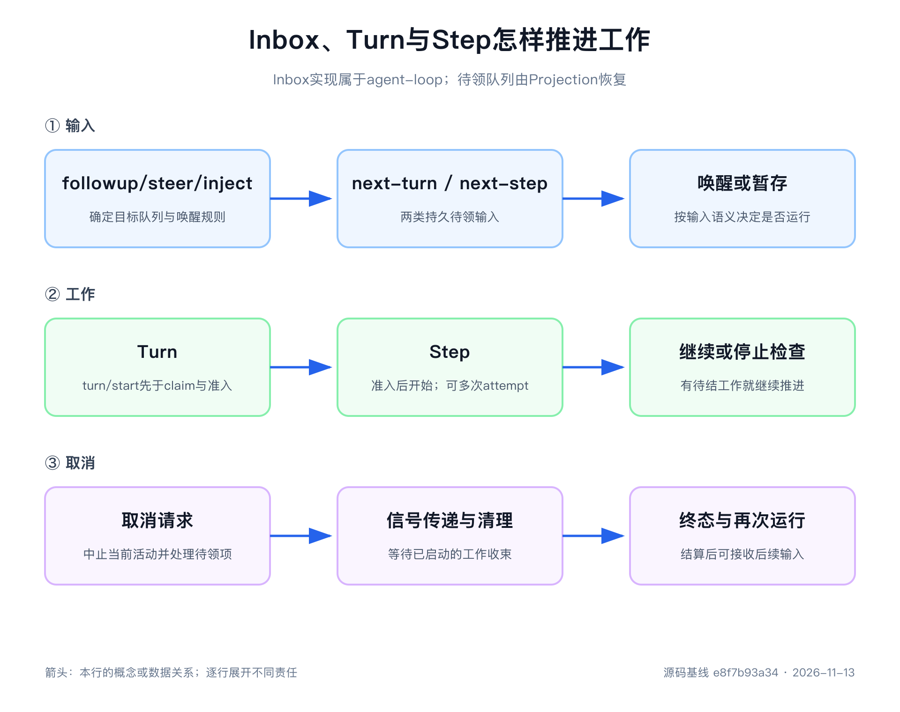

# 第9章 Agent Loop 的 Turn、Step 与 Inbox

> 本章源码基线：DeepSeek Harness `0.2.2-rc.2`，提交 `e8f7b93a344964de3dca1ace9e72b6e4d6de87cb`。本次核对驱动状态机、Inbox 投影、请求与批量工具结算源码，未重跑旧实验。当前项目要求 Node.js `>=24.9.0`。

很多人第一次写 Agent，都会得到一段看起来很合理的循环：调用模型；如果模型返回工具调用，就执行工具；把结果加进 messages；继续调用模型，直到没有工具。

这段代码能跑通演示，却没有回答真正困难的问题。

用户在工具执行期间补充一句话，这句话应该进入当前请求、下一个 Step，还是下一个 Turn？一条背景信息只想让模型下次看见，是否值得立刻唤醒 Agent？模型已经流式输出半句话，此时用户取消，日志要保留什么？一次限流重试算新的 Step 吗？系统以为任务完成时，插件能否在关闭前追加最后一项工作？

这些问题不能只靠 `while (hasToolCalls)` 解决。Agent Loop 真正管理的不是“还要不要再调一次模型”，而是一份尚未结清的工作：Inbox 里有什么输入还没有被领取，当前 Step 是否留下工具结果需要解释，当前 Turn 是否还有 steering，取消后哪些事实已经交付、哪些工作必须作废。

DeepSeek Harness 用 Turn、Step、Inbox 和 Session Event 把这份工作账拆开。读完本章，你应该能够逐段阅读 [`ReactLoopAgent`](https://github.com/deepseek-ai/deepseek-harness/blob/e8f7b93a344964de3dca1ace9e72b6e4d6de87cb/packages/core/agent-loop/src/agent.ts)，沿一次输入解释状态怎样从 idle 到 running，再回到 idle；也能用事件序列判断一个异常发生在入队、准入、请求、工具、停止还是取消阶段。

第一次阅读先抓三种“还欠什么”：Inbox 里的输入还欠领取，工具结果还欠模型解释，准备结束的 Turn 还欠最后一次停止检查。先用本章后半部分的五条路径理解这些欠项怎样被结清，再回头读 maintenance、`keepInbox` 和取消竞态，会比从 `agent.ts` 第一行顺读轻松得多。



## 先把三个概念说清楚

Turn、Step 和 Adapter attempt 经常被混成“轮次”。在进入源码前，先给它们一个可操作的定义。

| 概念 | 本书解释 | 可能有几个 |
|---|---|---|
| Turn | 从 Agent 领取一项普通工作开始，到系统确认当前工作不再欠后续处理的一段结算区间 | 一个 running 活动可以连续处理多个 Turn |
| Step | Turn 内一次获得并处理模型输出的逻辑工作单元，包含该输出要求的工具执行 | 一个 Turn 可以有零个、一个或多个 Step |
| Adapter attempt | 为当前 Step 向提供方发起的一次流调用 | 可恢复请求错误会让同一 Step 出现多次 attempt |

普通问答通常是一个 Turn、一个 Step、一次 Adapter attempt。模型调用工具后再总结，通常是一个 Turn、两个 Step。`agent/pre-step` 拒绝输入时，Turn 已经打开，却没有任何 Step。限流后原地重试，则是一个 Turn、一个 Step、两次 Adapter attempt。

这三个计数必须分开，否则日志和指标会失真。把重试记成新 Step，会让人误以为模型获得了新的工具结果或用户输入；把工具后的总结记成新 Turn，又会把同一项用户工作拆成两段不相干任务。

> **核心建议**：阅读 Agent Loop 的每个分支时，问一句：“走完这里以后，系统还欠谁什么？”Inbox 欠输入领取，工具结果欠模型解释，停止监听器可能欠一条 steering。只看循环条件，很难读出这些责任。

## Agent 接口不承诺“一问一答”

[`packages/core/agent/src/runtime-types.ts`](https://github.com/deepseek-ai/deepseek-harness/blob/e8f7b93a344964de3dca1ace9e72b6e4d6de87cb/packages/core/agent/src/runtime-types.ts)为 `Agent` 增加运行期方法：`followup()`、`steer()`、`inject()`、`cancel()`、`whenIdle()` 和维护任务入口。它们都围绕一个长寿命 Agent，而不是返回某条消息结果的聊天函数。

最明显的证据是 `followup()` 没有返回 assistant message。它只把带身份和来源的 `UserMessage` 放进 Inbox 并唤醒驱动器。结果可能经过多个 Step、工具调用、steering 和插件输入，最后以一组 Session Event 结算。

`whenIdle()` 也只承诺整个 Agent 达到停稳，不承诺“这是刚才那条 followup 的答案”。如果第一条消息处理期间又排队第二条 followup，驱动器可以在同一个 running 区间继续处理第二个 Turn，`whenIdle()` 会等它们全部结束。

这种接口看上去没有聊天 API 直观，却更符合 Agent 的现实。一项任务可能在运行过程中吸收新条件、创建工具工作、被取消或转为后台任务。把结果强行绑到某个 `send()` Promise 上，反而容易掩盖中途协作。

如果外部系统确实需要“一项请求—一个结果”的 RPC 语义，应在更高层定义自己的工作 id、开始水位和完成条件，再从 Session Event 中投影结果。Agent 核心不替所有产品表面猜同一种因果关系。

## `ReactLoopAgent` 先维护 Phase，不先维护消息

`ReactLoopAgent` 内部的 `phase` 有三种：

```text
idle(lastTurn)
maintenance(abort, lastTurn, wakeRequested)
running(abort, turn, step, wakeRequested)
```

`idle` 表示没有驱动 Turn 的活动；`running` 持有当前 AbortController、Turn/Step 位置和唤醒锁存；`maintenance` 为压缩等非 Turn 工作预留一个独占执行位置。

公开 `status` 只有 `idle` 与 `running`。maintenance 对外仍显示 idle，因为它不在执行用户 Turn，但 `whenIdle()` 仍会等待维护任务结束。第12章的手动 Compaction 就需要这种“没有 Turn，却不能同时开始另一项维护”的位置。

构造 Agent 时，循环从 Session 中最后一条 `turn/start` 找到已有 Turn 编号，创建 Agent 作用域和 Inbox 投影。新实例不会因为内存字段从0开始，就把恢复后的下一 Turn 又编号为1。

状态变化由 `setPhase()` 统一发布 `agent/status`。只有 idle 与 running 之间真正变化时才通知；Step 开始和结束不会不断切换 status。一次 running 可以覆盖多次请求和多个连续 Turn。

这让外部观察者能够回答“Agent 是否还在处理工作”，但不能仅凭 status 判断当前是第几个 Step、是否正在调用工具或哪条消息即将完成。更细事实必须回到 Session Event。

## Inbox 不是一个先进先出数组

[`packages/core/agent-loop/src/inbox.ts`](https://github.com/deepseek-ai/deepseek-harness/blob/e8f7b93a344964de3dca1ace9e72b6e4d6de87cb/packages/core/agent-loop/src/inbox.ts)实现驱动器拥有的 Inbox 命令接口与持久投影，维护两个列表：

| 列表 | 保存什么 | 领取方式 |
|---|---|---|
| `next-turn` | 普通 followup，每条应拥有自己的 Turn | 新 Turn 第一次 claim 最多取一条 |
| `next-step` | steering、注入上下文和最近步骤要看的补充输入 | 每个 Step 边界一次领取当时全部内容 |

为什么不能只用一个 FIFO？假设模型正在执行一项长工具，用户一边补充“建议控制在一句话”，一边又提交“接着分析另一台设备”。前者应影响当前工作最近的下一 Step，后者应等当前 Turn 结算后开启新 Turn。若放在同一队列，只按到达顺序消费，很容易把下一项任务偷进当前模型请求。

新 Turn 的第一次 `claim('next-turn')` 有一个重要顺序：先取完 `next-step`，再从 `next-turn` 取一条。于是，Agent idle 时提前注入的背景信息会排在唤醒它的普通问题之前。

后续 Step 使用 `claim('next-step')`，只取补充输入，不碰排队 followup。当前 Turn 无论持续多久，后面的普通任务都不会悄悄变成它的上下文。

Inbox 还用消息 id 防止同一条待处理输入重复出现。`append()`、`prepend()`、`replace()`、`remove()` 和 `clear()` 最终都归一化为 splice；这使插入、替换、领取与取消共享一套可恢复表达。

## Inbox 的变化先成为持久事实

两个数组只是当前投影，真正的事实是 `agent/inbox/spliced` Session Event。事件记录目标队列、起始位置、删除数量、新插入消息，以及删除是否属于取消。

`ReactLoopInbox.mutate()` 先验证并归一化 splice，再把它追加到 Session。当前列表由注册的 `inboxProjectionDefinition` 折叠事件得到，命令接口不另维护一份可变数组；追加成立后才发布插入或丢弃通知。持久 splice 自身也会在恢复折叠时验证范围和重复 id，不能把坏日志当成普通数组操作继续执行。

实时通知分成三种：

| 通知 | 含义 |
|---|---|
| `agent/inbox/inserted` | 一条消息已经进入当前 Inbox |
| `agent/inbox/claimed` | 消息在某个 Turn 中被步骤边界领取 |
| `agent/inbox/discarded` | 消息尚未运行就被删除或取消 |

claimed 不等于已经成为 `user/message`。循环领取以后还要经过 Prompt Assembly、runtime context 投影和 `agent/pre-step`。若准入被拒绝，已领取消息不会写入模型历史；实时 claimed 仍能说明它在哪个 Turn 被取走。

恢复 Inbox 时，由投影管理机制按 Session 历史和继承规则建立状态，再给命令接口一个读取投影的函数。事件是权威输入，Projection 是可重建结果；不要再按旧实现去寻找构造器中手工回放数组的逻辑。第12章会从跨进程恢复继续展开。

> **踩坑提醒**：不要只观察 `agent/inbox/inserted` 就断言模型已经看见输入。至少还要检查对应删除 splice、claimed 通知、`agent/pre-step` 决定，以及最终是否出现 `user/message`。

## `followup()`、`steer()` 和 `inject()` 只差两个决定

三个公开方法最终都调用 `send()`，差别是进入哪个队列，以及是否唤醒驱动器。

| API | 目标队列 | idle 时唤醒 | running 时的意义 |
|---|---|---:|---|
| `followup(message)` | `next-turn` | 是 | 等当前 Turn 结束，单独开启后续 Turn |
| `steer(message)` | `next-step` | 是 | 在最近的后续 Step 改变当前工作方向 |
| `inject(message)` | `next-step` | 否 | 暂存下一 Step 要看的背景，不单独触发模型 |

idle `inject()` 会立即写入持久 Inbox，却不会把 Agent 变成 running。背景信息本身通常不是一个值得模型回答的任务。等后续 followup 或 steer 唤醒，或者当前工具流程本来就要进入下一 Step，它才会被领取。

idle `steer()` 则会打开 Turn。它虽然目标是 next-step，但带 wakeup；新 Turn 的第一次 claim 先取 next-step，所以这条 steering 可以成为该 Turn 的输入。

running 状态下，steer 与 inject 都不会修改已经构建的当前请求。`preStep()` 在明确边界一次性 claim 输入，之后到达的 next-step 消息留给下一次 claim。请求因此不会在 Adapter 已经读取一半时突然增长一个 message。

取消之后还有一个细节。带唤醒的输入若到达一个已经 aborted、尚未完全退回 idle 的活动，`send()` 会把它归到 next-turn，并锁存一次后续唤醒。这样，新工作不会加入正在取消的 Turn，也不会因为驱动器尚未退出而永久停在队列。`disposed` 取消例外：正在销毁的 Agent 不应再自动开启新工作。

第一轮阅读可以先记住普通路径，再把这个取消收敛规则当作并发补充。它解释了为什么 `send()` 在插入前就要读取当前取消状态，而不是插入后再判断。

## `wakeDriver()` 预留整个运行活动

Agent idle 时收到带 wakeup 的输入，`wakeDriver()` 会同步建立新的 running phase、创建 activity Promise，并安排 `kick()`。status 在方法返回前已经是 running，调用方不会看见“消息已入队但驱动器仍声称 idle”的空窗。

如果 Agent 已经 running，普通新输入不需要再启动第二个驱动器；现有驱动器会在合适边界读取队列。若处于 maintenance，或者当前 activity 已取消但尚未退出，唤醒会记录在 `wakeRequested`，等拥有当前 phase 的任务结算后再启动。

`kick()` 自身很短：

```text
while (await turn()) {
  // 仍有待处理 Turn，继续
}
```

真正的复杂度不在这个 while，而在 `turn()` 返回值的含义。返回 `true` 表示刚结束一个 Turn 后 Inbox 仍有工作，驱动器已为下一 Turn 换上新的 AbortController；返回 `false` 表示当前活动可以结束。异常与取消在驱动器位置被收敛，finally 最终把 phase 切回 idle。

因此，不要把 `kick()` 短小理解成 Agent Loop 简单。状态机的责任被分散在 Inbox、turn、preStep、step、工具执行和事件扩展点中，短 while 只是把它们串起来。

## Turn 在领取输入之前打开

`turn()` 先计算下一个 Turn 编号，再追加 `turn/start`，然后才调用 `preStep()` 领取 Inbox。这条顺序说明 Turn 记录的是一次工作尝试，不是一次成功模型调用。

为什么先开 Turn？领取输入、Prompt Assembly 和准入本身都可能失败或被取消。若只有模型请求成功以后才写 `turn/start`，这些失败会失去所属工作区间，恢复也无法判断输入已经被哪次尝试消费。

Turn 首次把 claim 目标设为 `next-turn`。后续只要当前工作还欠 Step，就改为 `next-step`。每次循环都计算下一个 Step 编号，但只有准入决定 enter 且确实需要调用模型时，才追加 `step/start` 并更新 phase.step。

Turn 的结束原因是可以通过映射扩展的联合类型。核心包括 completed、blocked、aborted、error、max-tokens，以及恢复和分叉分别使用的 interrupted、forked。每条 `turn/end` 都带对应 reason；不能把恢复合成的关闭当成当前 Loop 又执行了一次工作。

`max-tokens` 还是粘性的：只要一个 Step 达到输出上限，即使插件让 Turn 继续、后续 Step 正常完成，最终 Turn 也不能降级为 completed。日志需要保留这次任务曾被截断的事实。

## `preStep()` 决定有没有资格开始 Step

`preStep()` 的顺序值得逐句读：

1. 从 Inbox 领取本次边界的消息。
2. 捕获 `agent.model.current()`；缺失完整选择时失败。
3. 调用 `tools.resolve()`，按模型选择和取消信号固定本 Step 的 `ResolvedToolSet`。
4. 将同一选择与工具集合交给 System Prompt assembly。
5. 调用 `agent/pre-step` Waterfall，默认分支投影动态 context。
6. 返回 reject，或返回 messages、assembly、selection、toolSet 和可选 series 标记。

默认决定是 enter，并把 runtime context 放在已领取消息之后。Waterfall 监听器可以调用 `next()` 取得下游决定，也可以返回新的 messages；它还可以 reject 整个拟议 Step。工具条件判断和 assembly 都可能异步，signal 在关键返回点重新检查，失败时释放 toolSet，不能发布半份准入。

这里有两个容易混淆的结果。

第一，reject 会让 Turn 以 blocked 结束，但没有 `step/start`、`step/end` 或模型请求。已在这次 claim 中取走的消息不会自动退回 Inbox，也不会形成 `user/message`。若策略需要以后重试，应由拥有策略的能力明确设计新的输入或恢复行为，不能指望 Loop 猜测。

第二，新 Turn 的唤醒消息可能在驱动器 claim 前被取消或删除，Waterfall 也可能把 enter messages 改为空。此时 Turn 仍然存在，因为一次唤醒已经拥有边界，但它以 completed 结束并且没有 Step。

所以，Turn 可以有零个 Step。这不是异常数据，而是生命周期真实表达。

## Step 从写入输入开始，到工具处理结束

准入通过且确实需要模型工作以后，循环追加 `step/start`，再进入 `step()`。当前实现先完成 `prepareRequest()` 绑定调用配置与 Adapter，然后协调 system message，刷新 runtime context，再写入准入输入。直到 `user/message` 被接受，Inbox 输入才正式进入模型历史。

第8章已经展开后面的请求路径：记录 Header、必要的工具增删 developer message 和 Context，从 Session 派生历史并冻结请求；消费 stream 时同时累积、组装与通知，最后结算 message 或 attempt。Step 已打开并不代表 Adapter 一定收到请求，准备或提交仍可能失败。

若成功消息没有工具调用，`step()` 返回 completed。Turn 暂时有了可结算结果。

若成功消息包含工具调用，Loop 调用 `ctx.tools.execute()`，一次交付原始 calls、signal、Agent、Turn/Step、并发上限与本 Step 的 toolSet。选中的 ToolExecutor 拥有参数解析、调度及 call/result 持久记录；Loop 等完整批次结算，不再自己逐条执行与记录。

工具全部处理后有两种结果。某个工具结果明确 `concludesTurn` 时，`step()` 返回 completed；否则返回 `null`。`null` 不是失败，而是“模型还欠一次后续处理”。Turn 循环会再走一遍 `preStep('next-step')`，打开下一个 Step。

即使 Inbox 中没有任何 next-step 消息，也会继续。原因是 `tool/result` 已经进入 Session Surface，模型需要在新请求中读取并解释它。续步的依据不是只有“队列非空”，还包括上一个 Step 返回的工作债务。

每个已打开 Step 在 finally 中追加 `step/end`，外层随后追加 `turn/end`，并在 Step 结束后释放 toolSet。Loop 还用 `ToolCallRecovery` 观察本 Step；批量执行内部失败时先等待执行器停稳，再为仍开放的调用记录保守恢复结果。若连恢复记录也无法接受，则同时保留原错误与恢复错误，不能宣称日志已完整修复。

## 工具结果与补充输入保持可解释顺序

以下用第6周旧基线实验的库存场景说明仍然成立的时序，不是本次运行结果。模型调用 `lookup_stock({"sku":"A-17"})`，工具执行期间发送：

```text
inject：补充背景：明天计划领用 5 件。
steer：建议控制在一句话。
```

两条消息立即进入 `next-step`，但当前 Step 已经 claim 完输入，所以它们不会插进正在运行的请求。工具先完成并追加 `tool/result`，Step 1 再以 `step/end` 关闭。

Step 2 的 `preStep()` 一次领取两条 next-step 输入，将它们写成 `user/message`。第二次模型请求最终看到：

```text
user       查询 A-17 库存并给建议。
assistant  我先查询库存。 + lookup_stock(...)
user       tool-result: A-17 库存18件，安全库存12件
user       补充背景：明天计划领用 5 件。
user       建议控制在一句话。
```

工具结果先进入历史，补充输入随后进入新的步骤边界；中间仍可能有其他诊断或插件事件，不能把“模型历史有序”写成“原始日志必然紧邻”。下一次请求还包含已有 system 和可能的 developer message，上面的列表只展示与此场景相关的对话段。

最终日志只有1个 Turn，却有2个 Step 和2次 Adapter 请求。普通 followup 若在工具期间到达，会留在 next-turn，等这一整个 Turn 结束后再开始另一项工作。

## 可恢复请求错误不增加 Step

`step()` 内部还有一层请求 attempt 循环。若 LLM Runtime 返回 error 或 aborted finish，Agent Loop 调用 `agent/request-error` Waterfall。

监听器返回 `{ kind: 'retry' }` 时，代码继续同一个 `while (true)`：再次准备请求，创建新的 `AssistantStreamAttempt`。Turn 和 Step 编号不变；准入消息不因重试而重复提交，动态 context 则可在重新准备时刷新。

失败尝试以 `assistant/attempt` 保存自己的 stream，不进入模型 Surface；成功 message 保存后来那次尝试的 stream。两者不会靠混合一个 chunk seq 列表来区分。重试可能重新解析 Adapter 默认值，但不能越过本 Step 固定的模型选择与工具准入。

若监听器不接管，循环抛出 `LlmError`。Step 的 finally 仍写 `step/end`，Turn 把结构化 failure 写入 `turn/end.reason.error`，驱动器再通过 `agent/error` 实时通知报告错误。

请求重试和工具续步因此有完全不同的计数：重试留在同一 Step，工具结果要求新的 Step。前者重新尝试取得这一份模型输出，后者让模型基于新增事实继续工作。

## `turn-stopping` 是关闭前的最后检查

一个 Step 返回 completed 或 max-tokens，且 `next-step` 暂时为空时，循环不会立刻追加 `turn/end`。它先按顺序等待 `agent/turn-stopping` 监听器。

监听器若认为工作尚未结束，可以调用 `agent.steer()`。事件返回后，Turn 重新读取 Inbox；只要出现新的 next-step 输入，就进入另一个 Step。若没有任何监听器添加数据，Turn 才真正关闭。

这个设计没有让监听器返回一个抽象的“继续”布尔值。继续与否由 Inbox 中是否真的出现工作决定，多个监听器的顺序不会因为谁最后返回 true 而覆盖前面的决定。

工具的 `concludesTurn` 走相反方向：它表达工具结果认为模型无需再为调用本身总结。但它不会跳过已经提交的 next-step 输入。如果工具同一时刻附加 context，或者用户 racing steer，Turn 仍会先把 Inbox 排空。

项目基线没有在 Loop 中硬编码一个最大 Step 数。扩展持续产生工具调用或 stopping steering 时，Turn 可能长时间不结束。自己的 Agent 需要预算时，应通过明确、可配置的生命周期策略实现，并在达到限制时留下可解释结果；不要在 while 里藏一个无人知道来源的数字。

## 取消要结清五类状态

`cancel()` 绝不只是对当前 HTTP 请求调用 `abort()`。一次可靠取消至少要处理：未领取 Inbox、当前 AbortSignal、进行中的流式尝试、可能的工具调用、Step 与 Turn 结束事实。

默认调用 `cancel(cause)` 时，Agent 先清空 `next-step`，再清空 `next-turn`。每个实际删除都写入 outcome 为 `canceled` 的 `agent/inbox/spliced`，并发布 discarded 通知。`keepInbox: true` 才保留这些未开始工作。

随后，当前 phase 的 AbortController 接收类型化 cause，例如 `{ kind: 'user' }`、`parent`、`hook` 或 `disposed`。清空队列置于 try、abort 置于 finally，即使持久队列修改失败也会中止已准入活动。完全 idle 时没有当前活动可 abort，但默认取消仍可清空预先 inject 的待处理输入；它不会武装影响未来工作的永久取消标志。

若取消发生在模型流中，`step()` 从当前 attempt 的 assembler 取得安全前缀。有可见内容时，把前缀、stream 和 `interrupted: true` 一起提交为 `assistant/message`；没有可见内容时，提交 `assistant/attempt`。尚未完成或未分发的调用不会作为可执行块保留。

随后，Step finally 写 `step/end`；Turn 捕获到 signal aborted，把原因保存为 `turn/end { kind: 'aborted' }`；`kick()` 最终把 Agent 收敛到 idle。只在内存里抛出 `AbortError`，无法完成这些责任。

当前取消路径可以按下面的示意顺序阅读；它不是本次实测输出：

```text
agent/assistant-stream chunk frames（实时）
next-step canceled
next-turn canceled
assistant/message interrupted:true，内含 stream（持久）
agent/assistant-stream end:committed（实时）
step/end 1.1
turn/end 1:aborted
```

中断消息可保留“已经处理到一半”这样的前缀，不再引用独立 chunk 事件。取消后发送新 followup，可以开启后续 Turn；只要这条中断消息仍在 Surface，新请求就能看见此前已交付内容。

为什么让模型也看见半句话？因为用户已经看见了。若后续模型以为上一轮什么都没说，可能重复承诺、重复工具计划或把用户的回应理解错位。`interrupted` 标记则防止系统把残缺前缀冒充完整成功回答。

> **踩坑提醒**：取消的验收标准不是“网络请求停了”。要同时检查 Inbox 是否按策略保留或取消、工具是否结算、可见前缀是否记录、Step 是否闭合、Turn 是否带原因结束，以及 Agent 是否最终停稳。

## `keepInbox` 保留工作，不负责重新唤醒

`cancel(cause, { keepInbox: true })` 只保留待处理队列并中止当前活动。它不承诺所有保留输入会自动立刻运行。

这一节与后面的五个异步等待点属于第二遍内容。第一次阅读只需记住：保留数据不等于恢复执行，真正重新启动仍需要明确唤醒；跨进程恢复与崩溃尾部会留到第12章。

取消会让当前 driver 退出；仅仅保留取消前已经排队的输入，不会自动为它们制造一次新的唤醒。若带 wakeup 的输入在活动已经 aborted、尚未完全退回 idle 时到达，`wakeRequested` 才会锁存后续启动。尤其是 `disposed`，新工作应停留而不是再次唤醒即将销毁的 Agent。

使用 `keepInbox` 的产品层必须明确回答：保留给谁、由什么事件再次唤醒、用户如何看见“已保留但尚未运行”。只设置一个布尔值而没有恢复入口，会把取消变成隐藏的暂停队列。

第一轮实验可以在取消完成后主动发送一条新 followup，观察被保留的 next-step 与 next-turn 分别在哪个 Turn 被领取。不要仅检查数组长度就宣布恢复策略正确。

## 五个异步等待点，分别由谁负责退出

`ReactLoopAgent` 难读，不是因为用了某一种高级语法，而是一次 Turn 会跨过多个 `await`。每个等待点都要有取消信号、错误归属和最终结算位置。

Prompt Assembly 可能调用动态 provider。它收到当前 Turn 的 signal，取消后应尽快停止；若 assembly 失败，Step 尚未开始，Turn 记录 error 或 aborted。这里不能伪造 `step/start`，因为模型请求从未获准。

`agent/pre-step` Waterfall 也被等待。监听器可以检查策略或改写输入，但不能无限占有 Turn。取消发生时，返回以后再次调用 `signal.throwIfAborted()`，阻止已经过期的决定继续进入 Step。

模型 stream 是最明显的长等待。LLM Runtime 把 signal 交给 Adapter，Loop 负责累积当前尝试，并在取消时结算安全前缀或无可见消息的 attempt。网络停止和会话结算是两个所有者，缺一不可。

工具执行可能比模型更久。工具流水线要把同一个取消意图传给运行主体，并区分已经开始和尚未分发的取消；进程崩溃后的结果未知由恢复层另行结算。Agent Loop 等待本次工具处理结束后才写 `step/end`，第10章会展开这部分。

最后，`agent/turn-stopping` 也是一个真实 await。它发生在当前工作看似完成以后，却仍处于 Turn 关闭以前。监听器失败会让 Turn 进入 error，监听器 steering 会让循环继续。把它写成不等待的 emit，会让 `turn/end` 与后来输入发生竞态。

阅读任何新增 await 时，都应写下三句话：谁提供 AbortSignal，失败归入哪个事件或错误通道，哪一层 finally 保证边界闭合。回答不了，就意味着这段异步工作可能在取消或卸载后成为孤儿。

## `whenIdle()` 等的是整个 Agent 停稳

`whenIdle()` 看上去只是 `await activityDone`，实现却使用循环：等待当前 activity Promise 后，再检查它是否仍是最新值；若退出前有替代工作创建了新的 Promise，就继续等待。

这解决了一个细小但危险的竞态。旧驱动器正在 finally 退出时，新唤醒可能已经锁存或启动替代活动。只等待旧 Promise，会让关闭流程误以为 Agent 已经停稳，随后销毁仍在运行的新工作。

但这也再次说明，`whenIdle()` 不是单条消息的结果句柄。它可能等待多个 Turn、maintenance 和在旧活动之后立即接上的新活动；返回值只是 `void`。

测试 teardown、会话切换和应用关闭适合使用 `whenIdle()`。业务调用若需要某项工作的结果，应基于消息 id、任务 id、Session 水位或领域 Projection 建立更精确的等待条件。

## 用五条路径读懂整台状态机

与其从 `agent.ts` 第一行读到最后一行，不如用五条可运行路径建立坐标。

| 路径 | Turn | Step | Adapter attempt | 关键结算 |
|---|---:|---:|---:|---|
| 单步直接回答 | 1 | 1 | 1 | assistant message，completed |
| `pre-step` 拒绝 | 1 | 0 | 0 | claimed，但无 user message，blocked |
| 工具后总结 | 1 | 2 | 2 | tool result 推动下一 Step |
| 限流后重试 | 1 | 1 | 2 | 失败 attempt 与成功 message 各有自己的 stream |
| 流式取消 | 1 | 1 | 1个未完成 | interrupted message，step/end，aborted |

旧基线第6周脚本覆盖前3条与取消路径，第5周脚本覆盖限流重试；它们当时使用仓库运行组件与 Mock Adapter。当前 API 已变化，阅读这些旧记录时要区分历史行为与本章对最新源码的解释。

观察每条路径时，建议同时打印三组数据：live 通知、原始 Session Event 和 Adapter 收到的 requests。只看其中一组都可能误判。

live 通知告诉你状态何时变化、消息何时被领取；Session Event 告诉你什么事实可以恢复；Adapter requests 告诉你模型实际收到了哪些 messages 与配置。三者按同一 Turn/Step 对齐，异步循环就不再是一团 Promise。

## 给迷你 Harness 写一份工作账

下面是迷你 Harness 的教学伪代码，不是可复制的 DSH API。它只表达工作推进，真实实现仍要保留取消检查、toolSet 释放与 finally 关闭：

```text
send(message, target, wakeup):
  append durable inbox splice
  if wakeup and idle:
    reserve running activity
    start driver

driver:
  while runOneTurn() says more pending work:
    continue
  settle idle

runOneTurn:
  append turn/start
  target = next-turn
  repeat:
    claimed = inbox.claim(target)
    decision = preStep(claimed)
    if reject: close blocked turn
    if first input is empty: close zero-step turn

    append step/start
    result = runOneStep():
      prepare route and output controls
      commit system and admitted user messages
      request, settle attempt, execute complete tool batch
    append step/end

    if result can close and next-step is empty:
      await turn-stopping
    if result can close and next-step is still empty:
      break
    target = next-step
  append turn/end
```

教学接口可以用 completed、max-tokens 和 needs-another-step 表示三种结果；当前 DSH 的 `step()` 实际返回前两类原因对象或 `null`，其中 null 表示需要续步。请求 retry 留在同一 Step 内，不能照教学名字去搜索不存在的返回类型。

第一版不要急着加入并发工具、持久化或多个 Agent。先让日志断言五件事：Turn 在 claim 前开始；reject 不产生 Step；工具结果能在 Inbox 为空时推动第二个 Step；新 followup 不进入当前 Turn；取消总能补齐关闭事件。

这份工作账正确以后，再接第8章的请求组装与第10章的工具流水线。否则，能力越多，未结清状态越难发现。

## 从“Agent 卡住了”开始排查

“卡住”不是一个足够具体的错误。使用下面这张异步状态机阅读表，把现象缩小到一个阶段。

| 观察问题 | 首要证据 | 可能原因 |
|---|---|---|
| 输入是否真正入队 | `agent/inbox/spliced` inserted | 消息 id 重复、发送前失败 |
| 为什么没有唤醒 | API 是 followup/steer 还是 inject，当前 phase | inject 本来不唤醒、maintenance 锁存、Agent disposed |
| 输入是否被领取 | 删除 splice 与 `agent/inbox/claimed` | 仍在另一个队列、前一个 Turn 未结束 |
| 为什么模型没看到 | `agent/pre-step` 决定与 `user/message` | reject、消息被改写、取消发生在 Step 前 |
| 请求是否真正开始 | `step/start`、`request/header`、Adapter 记录 | provider/model 缺失、Prompt Assembly 失败 |
| 为什么同一 Step 调了两次模型 | error finish 与 `agent/request-error` | 恢复监听器选择 retry |
| 为什么工具后没有下一 Step | tool result、`concludesTurn`、next-step | 工具结束 Turn，或执行失败 |
| 为什么 Turn 迟迟不结束 | step 返回值、next-step、`turn-stopping` | 工具债务、持续 steering、监听器重复注入 |
| 取消后为什么有半句话 | interrupted assistant message | 已交付前缀的正常结算 |
| `whenIdle()` 为什么仍在等待 | activityDone 是否被替换 | 后续 Turn 或 maintenance 仍然活动 |

还有一个很实用的做法：为每个异步等待点写下它持有的 AbortSignal 和退出后必须追加的结束事件。若某个 await 不响应取消，整个 Turn 可能无法到达 finally；若某个分支抛错前没有所有者补齐事件，恢复会把它识别为崩溃尾部。

## 读 `ReactLoopAgent` 的正确顺序

不要按文件行号顺读。建议按运行主线分六轮：

1. 先读 [`runtime-types.ts`](https://github.com/deepseek-ai/deepseek-harness/blob/e8f7b93a344964de3dca1ace9e72b6e4d6de87cb/packages/core/agent/src/runtime-types.ts) 中 Agent 方法和 `agent/pre-step`、`agent/request-error`、`agent/turn-stopping` 的公开约定。
2. 再读 [`inbox.ts`](https://github.com/deepseek-ai/deepseek-harness/blob/e8f7b93a344964de3dca1ace9e72b6e4d6de87cb/packages/core/agent-loop/src/inbox.ts) 的投影定义、`claim()`、`mutate()` 与 `clear()`，手画两个队列。
3. 回到 [`agent.ts`](https://github.com/deepseek-ai/deepseek-harness/blob/e8f7b93a344964de3dca1ace9e72b6e4d6de87cb/packages/core/agent-loop/src/agent.ts)，只追 `send()`、`wakeDriver()`、`whenIdle()` 和 `kick()`，理解活动怎样开始与结束。
4. 第二遍只读 `turn()` 与 `preStep()`，标出零 Step、blocked、completed、aborted 和 error 的关闭位置。
5. 第三遍只读 `step()`，把请求 retry、成功 message、工具执行与 `null` 返回值分开。
6. 最后把 [`dispatch.ts`](https://github.com/deepseek-ai/deepseek-harness/blob/e8f7b93a344964de3dca1ace9e72b6e4d6de87cb/packages/core/agent/src/dispatch.ts) 的作用域事件分发和 [`runtime-context.ts`](https://github.com/deepseek-ai/deepseek-harness/blob/e8f7b93a344964de3dca1ace9e72b6e4d6de87cb/packages/core/agent-loop/src/runtime-context.ts) 的上下文投影接回来。

每一轮都只回答一个问题。第一次就同时追工具并发、取消竞态、请求 Header 和作用域事件，很容易把局部变量当成全局状态。

配套材料包括第6周学习笔记、来源判断表和状态图。

## 运行实验并对齐三种证据

本次更新没有运行旧 `agent-loop-tutorial` 或 `llm-request-tutorial` 脚本。旧记录中的状态码0和181项测试仅证明旧基线，当前需先迁移 Inbox 归属、toolSet、执行器与 stream 结算再运行。

迁移后的最低观察目标是：idle inject 不单独调用模型；pre-step 拒绝拥有 Turn 而没有 Step；工具结果能在同 Turn 推动下一 Step；重试保持 Step 编号；取消结算前缀与结束事实。脚本通过以后，仍不能据此宣称真实网络取消、外部进程终止、跨进程恢复或 Web 展示已验证。

实验时至少保存下面六列：

| 字段 | 示例 |
|---|---|
| 输入 API | followup / steer / inject / cancel |
| 入队目标 | next-turn / next-step / 无 |
| 持久 seq | splice、Turn、Step、message、tool、结束事件 |
| live 通知 | status、inserted、claimed、discarded、error |
| Adapter 次数 | 当前 Turn/Step 发生几次 attempt |
| 最终状态 | Inbox 长度、Turn reason、Agent status |

只要这六列能对齐，你就能从现象回到源码分支，而不是靠增加日志猜 Promise 在哪里停住。

## 动手练习

### 练习一：把 inject 改成 steer

在 idle 状态分别调用 `inject()` 和 `steer()`。记录 status、Inbox、`turn/start` 和 Adapter 请求数，解释目标队列相同但唤醒行为为什么不同。

### 练习二：让 Turn 只有边界

使用 `agent/pre-step` 拒绝第一批消息。确认日志有 `turn/start`、领取 splice 和 blocked `turn/end`，没有 `step/start` 与 `user/message`。再解释已领取输入为什么不能由 Session Surface 找回。

### 练习三：只靠工具结果续步

在工具实验中删除 inject 和 steer。确认 Step 2仍会出现，并说明它的新信息来自 `tool/result`，不是 Inbox。随后让工具结果 `concludesTurn`，比较 Step 数。

### 练习四：在 stopping 时追加一次 Steering

注册 `agent/turn-stopping` 监听器，只在第一次触发时调用 `steer()`。让模型直接回答，观察本可结束的 Turn 怎样增加第二个 Step。务必设置“一次”条件，避免监听器让 Turn 永不结束。

### 练习五：比较 Retry 与新 Step

让 Adapter 第一次以 `RATE_LIMIT` 失败，监听器选择 retry；再让另一路径返回工具调用。分别记录 Turn、Step 与 Adapter attempt 数，写出两者为何不能用同一个“轮次+1”表示。

### 练习六：取消并保留 Inbox

把默认取消改为 `{ keepInbox: true }`。检查 canceled splice 是否消失、两个队列保留什么，再发送新的 wakeup 输入。观察 next-step 与 next-turn 的领取顺序，并写清你的产品是否真的希望这种恢复语义。

### 练习七：为 Agent 增加步数预算

不要修改 Agent Loop 内部 while。使用现有生命周期扩展点记录当前 Turn 已完成 Step 数；达到可配置上限时，选择 steer 一条解释性收尾要求，或取消并留下明确原因。为正常、工具循环和用户取消各写一条测试。

## 异步状态机检查表

以后阅读或设计 Agent Loop，可以用下面十项验收：

| 检查项 | 必须回答的问题 |
|---|---|
| 输入身份 | 每条待处理消息怎样去重和追踪来源？ |
| 队列时机 | 新输入属于当前最近 Step，还是独立下一 Turn？ |
| 唤醒规则 | 哪些输入启动驱动器，哪些只暂存？ |
| 准入位置 | 输入何时从 pending 变成模型可见事实？ |
| 请求计数 | provider retry 与新 Step 怎样区分？ |
| 工具债务 | 工具结果回来后，谁决定模型是否还欠回答？ |
| 停止检查 | 自然结束前，插件怎样追加真实工作？ |
| 取消结算 | Inbox、可见前缀、工具、Step 和 Turn 分别怎样结束？ |
| 停稳语义 | 等待函数针对单项消息，还是整个 Agent 活动？ |
| 可恢复记录 | 进程退出后，哪些状态能从 Session Event 重建？ |

若其中任何一项只能回答“代码运行到那里自然就结束”，说明生命周期还没有被设计成明确状态。异步代码最危险的不是 Promise 多，而是完成条件只存在于作者脑中。

## 本章回顾

Agent Loop 不是一个围绕工具调用的简单 while。Inbox 用 `next-turn` 与 `next-step` 区分独立工作和当前工作的补充输入，并把每次变化记录为持久 splice；Turn 在领取以前打开，负责一次工作尝试的最终结算；Step 在准入以后开始，负责一次模型输出及其工具处理；Adapter attempt 则允许同一 Step 内恢复请求错误。

`followup()`、`steer()` 和 `inject()` 的差别落在队列与唤醒时机。工具结果即使没有 Inbox 输入，也能让循环欠下下一 Step；`agent/turn-stopping` 在自然关闭前给插件最后一次追加真实工作的机会；取消则必须处理队列、AbortSignal、已交付前缀和完整结束事件。`whenIdle()` 等整个 Agent 停稳，不属于某条消息。

到这里，一次任务的核心循环已经能够读懂。我们看见模型提出工具调用，却还把 `tools.execute()` 当成黑盒。下一章将拆开注册表与执行器：工具怎样被本 Step 准入，调用怎样经过策略、审批与并发调度，失败、超时和结果又怎样回到同一个 Session。
