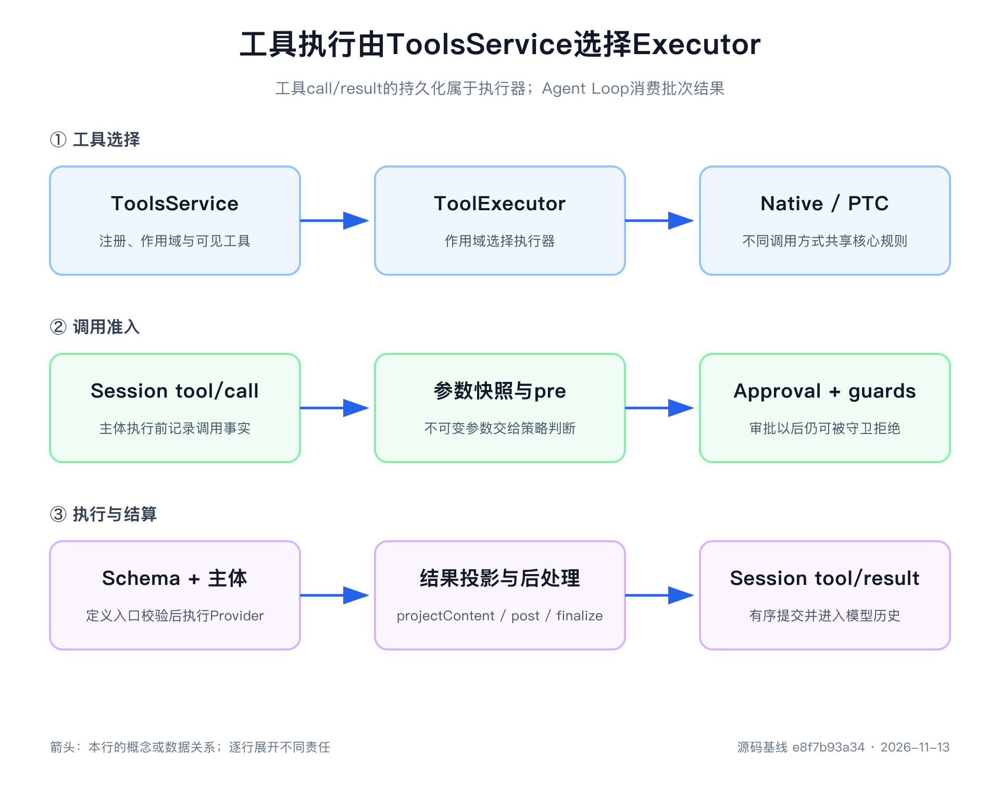

# 第10章 一个工具调用真正经历了什么

> 本章源码基线：DeepSeek Harness `0.2.2-rc.2`，提交 `e8f7b93a344964de3dca1ace9e72b6e4d6de87cb`。本次核对工具定义、注册、原生与 PTC 执行器、批量调度及结果结算源码，未重跑旧实验。当前项目要求 Node.js `>=24.9.0`；真实模型选择与 Web 展示未验证。

第9章结尾，我们停在一个很容易被低估的调用上：`ctx.tools.execute()`。

模型已经返回工具名称、调用 id 和一段 JSON 参数，接下来似乎只剩三件事：找到同名函数，调用它，把返回值加入消息历史。如果只看一个天气查询 Demo，这个理解没有明显问题。

可一旦工具会写文件、启动进程或调用业务系统，问题马上变了。参数不是合法 JSON 怎么办？同名工具对不同 Agent 是否可见？策略拒绝以后还要不要留下结果？两个只读调用能否同时执行？B 比 A 先完成，历史应该按完成顺序还是模型顺序记录？用户在审批期间取消，工具主体到底有没有运行？工具成功以后，模型为什么还会得到下一次 Step？

这些问题共同说明：模型输出的 tool call 只是一个候选动作，不是已经获得授权的函数调用。

DeepSeek Harness 把候选动作变成可执行、可结算事实的过程分给不同所有者：`ToolDefinition` 描述能力，`ToolsService` 管注册与作用域，插件提供 `ToolExecutor`，共享流水线处理策略与执行，执行器拥有整批调度及 call/result 持久提交。Agent Loop 交付批次并等待结果，不再自己逐条执行。

读完本章，你应该能够沿一个 call id 解释工具从模型输出到下一次模型请求的全部阶段；能够判断一项规则应该放在 Schema、`pre-execute`、guard、`execute` 还是 `post-execute`；也能设计一个在成功、拒绝、异常、超时和取消时都能结算的工具。

## 第一次阅读，只抓四个阶段

工具流水线里的名称很多，第一次阅读不必马上记住每个事件。先把一次调用压缩成四段：定义决定模型能提出什么动作，准入决定这一次候选动作能否继续，执行把允许的动作交给具体实现，结算把成功或失败变成可恢复事实。

| 阶段 | 先问什么 | 主要源码位置 | 结束标志 |
|---|---|---|---|
| 定义 | 模型能看见什么输入，程序承诺什么输出 | `ToolDefinition`、Schema、作用域注册表 | 当前 Agent 得到一份模型可见 Schema |
| 准入 | 这一次调用是允许、拒绝还是询问 | `tool/call`、pre、Approval、guard | 得到可分发调用或前置错误结果 |
| 执行 | 谁运行主体，超时、取消和并发怎样处理 | `tools/execute`、`execute()`、调度器 | 主体停稳并产生规范结果 |
| 结算 | 结果怎样处理、记录、展示并推动后续工作 | post、finalizer、`tools/result`、`tool/result` | Session 持有可重放的调用结果 |

本章用旧基线实验的 `approval-allow` 作为贯穿示例 call id。它调用 `write_maintenance_note`，参数要求写入 `approved-note.txt`。模型提出它时还没有写文件；只有准入阶段得到一次性批准、后续 guard 继续放行，执行阶段才会进入工具主体；最终同一个 id 出现在 `tool/result` 中，文件系统里也只出现获准目标。

先用这四段回答“调用走到哪里”，再在第二遍区分 Waterfall、finalizer、Presenter 和调度屏障。这样读源码时不会被相似名称带离主线。

## 工具定义的不只是一个函数

先看 [`ToolDefinition`](https://github.com/deepseek-ai/deepseek-harness/blob/e8f7b93a344964de3dca1ace9e72b6e4d6de87cb/packages/core/tools/src/contracts.ts)。它至少同时描述四件事：模型怎样知道这项工具，运行时怎样执行，成功值怎样验证并渲染，以及界面怎样展示调用。

| 部分 | 典型字段 | 主要消费者 |
|---|---|---|
| 模型可见输入 | `name`、`description`、`parameters` | System Prompt 与 LLM Adapter |
| 规范输出 | `output.schema`、`output.render()` | `ToolExecutionPipeline` 与模型历史 |
| 执行行为 | `execute()`、`timeoutMs`、`isConcurrencySafe()` | 流水线、策略插件与执行器调度器 |
| 展示行为 | `presentCall()`、`presentResult()`、`presentationMeta()` | Host 与 Web 客户端 |

这张表最值得注意的是输入、规范值和展示内容的分离。工具主体返回的是经过声明约束的 JSON 值；`output.render()` 再把这个值投影成模型可见的 `ContentBlock[]`；`presentationMeta()` 可以生成可持久化的私有展示数据。程序、模型和界面不必争着解析同一段随意文字。

例如，一个设备状态查询可以这样定义：

~~~js
const readEquipmentState = defineTool({
  name: 'read_equipment_state',
  description: 'Read the current state of one equipment item.',
  parameters: {
    equipment: { type: 'string', required: true },
  },
  output: {
    schema: {
      type: 'object',
      additionalProperties: false,
      properties: {
        equipment: { type: 'string', required: true },
        state: { type: 'string', required: true },
      },
    },
    render: (_args, value) => [{
      type: 'text',
      text: `${value.equipment}: ${value.state}`,
    }],
  },
  isConcurrencySafe: () => true,
  async execute(args, exec) {
    exec.signal.throwIfAborted()
    return { equipment: args.equipment, state: 'warning' }
  },
})
~~~

模型可见投影主要包含名称、说明和参数 Schema，也可包含当前协议支持的 `deferLoading` 标记；它不包含 `execute()`、超时预算、并发分类器和 Presenter。`ToolsService.schemas()` 使用白名单投影，调用方检查用的参数对象会脱离注册表引用；实际模型声明再由选中执行器的 `describe()` 决定。

`output.schema`也不会发给原生工具调用接口；它由 Harness 用来验证工具成功值。换句话说，参数 Schema 约束“模型交进来的值”，输出 Schema 约束“实现交回去的值”。两端都需要验证，才能把错误留在工具边界，而不是让错误数据进入后续模型历史。

> **核心建议**：设计工具时先写规范输入和规范输出，再写执行函数。若你只能说“它最后返回一段文字”，通常还没有分清程序结果、模型内容和界面展示。

## Schema 能证明可解释，不能证明可执行

[`defineTool()`](https://github.com/deepseek-ai/deepseek-harness/blob/e8f7b93a344964de3dca1ace9e72b6e4d6de87cb/packages/core/tools/src/schema.ts)提供了一套带 TypeScript 推断的 Schema DSL。`required`、`enum`、数组、对象和 `oneOf` 等声明会被编译成 JSON Schema，模型获得这份参数说明，运行时也用同一份规则验证实际参数。

不过，Schema 只适合表达结构约束。下面这些判断仍然属于工具或 Provider：

- 字符串虽然非空，但设备编号是否存在。
- `start` 早于 `end` 这类跨字段关系是否成立。
- 当前用户是否有权读取这台设备。
- 业务记录当前状态是否允许修改。
- 同一个幂等键是否已经完成写入。

还要留意一个容易从函数名猜错的时序。批量执行器的 [`parseArguments()`](https://github.com/deepseek-ai/deepseek-harness/blob/e8f7b93a344964de3dca1ace9e72b6e4d6de87cb/packages/core/tools/src/batch.ts)会先尝试解析模型给出的 JSON；空字符串变成 `{}`，无法解析的文本则原样保留。`ToolExecutionPipeline`先对这个候选参数做无损 JSON 快照并冻结，`pre-execute`与 guard 因而能够观察原始候选调用。

真正的参数 Schema 校验发生在 `defineTool()` 包装的 `execute()` 入口。无效参数可能已经过 pre、guard 和 `tools/execute` 环绕层，但不会进入用户写的工具主体。旧基线“缺少 device”的实验曾观察到主体次数为0、错误码 `INVALID_ARGS`；本次依据当前包装器源码核对时序，没有沿用旧阶段计数作为最新测试结果。

为什么不在所有策略之前就拒绝？因为工具注册表还支持不是由`defineTool()`构造的定义，参数校验是具体定义的责任；调度器只保证参数快照可序列化。与此同时，`defineTool()`包装的`isConcurrencySafe()`会先软校验参数，无效参数直接返回 false，所以它不会因为错误分类器而加入并行组。

这给源码阅读者一个提醒：不要把“参数已解析”“参数已冻结”和“参数已通过工具 Schema”写成同一件事。它们发生在不同位置，保护的也是不同性质的问题。

## 注册表、Step 准入与执行器各有职责

把定义交给 `ctx.tools.register()`，是在当前 Cordis Effect 生命周期内贡献一项能力。返回的 disposer 撤销贡献；同层重复名称失败，Agent 作用域定义可以遮蔽全局同名定义。`tools.restrict()` 只在作用域内过滤全局工具，多个限制取交集，不删除局部定义。

最新注册还可以提供 `when(context)` 条件。`preStep()` 捕获模型选择后调用 `tools.resolve()`，把条件结果汇总为 `ResolvedToolSet`，随后声明与分发使用同一集合。false 的工具既不发送 Schema，也不能执行；条件拒绝会以 `TOOL_ACTIVATION_FAILED` 中止 Step 准备。取消或错误不应暴露半份集合。

这个集合固定的是本 Step 准入的定义，不是永不撤销的权限。中途新增的注册不会进入已准入集合；原注册被移除或作用域被收紧时，尚未分发的调用仍可能失去能力。Step 结算以后释放集合。缺少 toolSet 的普通服务调用只能使用无条件注册，不能绕过条件判断。

还有一项相较旧稿很大的变化：`ToolsService` 不再通过 `config.mode: native | ptc | both` 选择执行方式。当前 `mode` 字段明确被禁止；应挂载 [`tool-executor-native`](https://github.com/deepseek-ai/deepseek-harness/blob/e8f7b93a344964de3dca1ace9e72b6e4d6de87cb/packages/core/tool-executor-native/src/index.ts) 或 [`tool-executor-ptc`](https://github.com/deepseek-ai/deepseek-harness/blob/e8f7b93a344964de3dca1ace9e72b6e4d6de87cb/packages/core/tool-executor-ptc/src/index.ts) 插件，由 `setExecutor()` 在部署或 Agent 作用域选择执行器。

原生执行器将可见定义投影为工具 Schema，并通过共享批量调度器执行。PTC 执行器提供保留的 `run_code` 传输，生成代码内的能力调用再走子调用流水线。`run_code` 不能由普通工具注册或遮蔽，能力限制应指向实际工具。执行器失效后不会静默改用另一个提供方接手在途调用。

因此，排查“模型看不见工具”时，应依次检查定义生命周期、作用域限制、when 条件、本 Step 准入集合，以及当前选中执行器怎样描述能力。只打印进程全量 Map，无法回答这一个请求到底能调用什么。

## 先画出完整流水线

项目生成的[`Tool Execution Pipeline`](https://github.com/deepseek-ai/deepseek-harness/blob/e8f7b93a344964de3dca1ace9e72b6e4d6de87cb/docs/tool-execution-pipeline.md)给出了完整流程。第7周的学习图把主线、失败支路和安全职责放在了一张图中：

把 PTC 子调用暂时放到一边，一次模型直接调用可以压缩成下面九步：

~~~text
assistant tool-call block
  → Session: tool/call
  → 参数快照与取消检查
  → tools/pre-execute
  → Approval ask（如果策略要求）
  → monotonic guards
  → tools/execute → ToolDefinition.execute
  → projectContent → tools/post-execute → finalizeContent → tools/result
  → Session: tool/result → 下一 Step
~~~

每一层拥有不同决定：执行器拥有批次与持久顺序，pre 策略可以允许、询问、拒绝或取消，guard 只能拒绝，execute Waterfall 包装分发，工具主体产生领域值，projectContent 准备供 post 检查的内容，post 处理结果，finalizer 最后固定内容，`tools/result` 只观察权威结果。

选择扩展点时，先问规则需要发生在主体之前还是之后，是否允许改写，是否需要异步，以及它是否必须不受其他插件顺序影响。答案会自然缩小到一两层。

## `tool/call` 必须先于真实执行

模型返回的是`ToolCallBlock`：调用 id、名称和原始参数字符串。以 `approval-allow` 为例，执行器的批量调度器开始处理它时，先向 Session 追加`tool/call`，记录当前 Turn、Step、call id、工具名`write_maintenance_note`和原始参数，再进入 `ToolExecutionPipeline` 的 prepare 阶段。

这个顺序让界面可以先显示 pending 卡片，也让一次崩溃留下“已提出并开始处理的动作”。如果主体先运行、成功后才补日志，进程在两者之间退出时，文件可能已经改变，Session 却像什么也没发生。

不过，不能把普通 call/result 配对夸大成所有故障下都已确认副作用。参数错误、策略拒绝、审批拒绝、工具异常、超时与普通取消会形成规范结果；执行器内部失败则停止启动、等待在途工作停稳，并用 `ToolBatchExecutionError.partial` 保留已经提交的结果与上下文。Loop 再通过 `ToolCallRecovery` 为仍开放调用补保守结果后闭合 Step。这种恢复结果说明执行未可靠完成，不证明外部写入从未发生。

进入 `ToolExecutionPipeline.createExecution()` 后，解析参数要通过无损 JSON 快照并深冻结。call id、root call id、Agent、父执行 token 和调用方 signal 共同组成执行身份。`finalizeContent`回调也在调用开始时捕获，避免注册变化让已经开始的调用在最后阶段换用另一份内容规则。

这里并没有把所有运行状态交给插件任意修改。`tools/execute`包装器可以为自己的委托周期替换`exec.signal`，但不能改变调用 id、名称和参数；流水线还会把原始调用方 signal 与替换 signal 重新融合，避免一个超时插件无意中切断用户取消。

## pre 策略可以问，guard 只能拒绝

`tools/pre-execute` 是一个 Waterfall。监听器可以返回四种决定：

| 决定 | 含义 |
|---|---|
| `allow` | 当前策略允许继续，随后仍要经过 guard |
| `deny` | 跳过分发主体，把理由变成错误结果 |
| `ask` | 通过 Approval Service 请求一次性决定，只有 `allowed-once` 继续 |
| `cancel` | 取消本次尚未分发的调用，以 `ABORTED_BEFORE_DISPATCH` 结算 |

不处理当前调用的监听器必须调用`next()`。直接返回`allow`会截断后续 Waterfall 监听器，却不能绕过 guard；这正是下一层采用“单调拒绝”的原因。

`ctx.tools.guard()`注册的是同步检查函数。它只能返回拒绝理由或`undefined`，没有 force allow，没有改写，也不能弹出审批。在 pre Waterfall 和必要审批完成以后，流水线先检查全局 guard，再按 Agent 作用域链检查；任何一项拒绝，后续 guard 和工具主体都不能把它重新放行。

因此，可扩展部署策略适合放在 pre，例如“这类写操作在交互模式中需要询问”；工具所有者不可被顺序推翻的不变量适合放在 guard，例如“参数涉及受保护厂区时一律禁止”。把二者都塞进一个有序 Waterfall，后注册的插件就可能因为一次短路改变安全含义。

pre 返回`ask`时，流水线尝试取得`ctx.approval`。`approval-allow`就在这里形成`approval/asked`，Mock 应答者返回`allowed-once`以后再形成`approval/decided`，随后继续进入 guard。没有 Approval Service、没有可路由的 Agent、没有应答通道、用户拒绝、问题被取消或应答者返回无效结果，都会失败关闭。第11章再深入审批的持久审计与权限策略；本章只需记住：`allowed-once`是继续当前调用的唯一批准结果，不是永久权限。

前置拒绝不会跳过后续所有结算。它仍然进入`tools/post-execute`，让统一的结果策略观察错误；但它不会进入`tools/execute`和工具主体。若 pre 自己抛出异常，流水线 会把它归一化为 final result，绕过 post，避免一个已经破坏流水线的策略继续获得结果处理机会。

## `tools/execute` 包装的是分发，不等于工具主体

准备阶段放行后，`tools/execute` Waterfall 包在真实主体外层。超时、重试和耗时指标适合放在这里，因为监听器可以在`next()`前后工作，也可以用一个规范结果短路主体。

默认的`next()`最终进入`dispatchToolBody()`。流水线 再按当前作用域解析工具，标记主体已经开始，调用定义的`execute()`。对 `approval-allow` 来说，真正写入 `approved-note.txt` 的动作直到这里才发生。主体返回以后，流水线 对返回值做四步处理：

1. 建立无损 JSON 快照，拒绝函数、循环引用或其他不能稳定记录的值。
2. 按`output.schema`验证规范值，不匹配时产生`INVALID_TOOL_OUTPUT`。
3. 调用`output.render()`生成模型可见内容。
4. 对原生调用与嵌套调用计算可选 `presentationMeta()`，保留可重放展示数据；它不会因为处于子调用就失去规范输出投影。

工具抛出的异常也不会直接穿透 Agent Loop。流水线 把它规范化为`isError: true`的结果；若异常属于`HarnessError`，稳定的`name`与`code`会进入结构化错误信息。模型仍获得可读内容，Session 和调用者则可以按错误码判断类型。

`timeoutMs`在这里有一个很重要的边界。`ToolDefinition.timeoutMs`只是协作式预算声明，真正设置截止时间的是`dsh-tool-call-timeout-policy`对`tools/execute`的包装。若部署没有组合该插件，声明不会自己开始计时；若工具主体完全忽略`exec.signal`，同进程 JavaScript 也不会被硬杀。

超时包装器触发 signal 后仍会等待工具 Promise 停稳，再把下游已经规范化的结果——无论原本成功还是错误——替换成`TOOL_TIMEOUT`。这比“时间一到立即返回”更慢，却避免旧主体在 Turn 已经结束后继续修改状态。第11章会看到，Shell 与 Subprocess 能把 signal 转成进程树终止；普通同进程函数只能靠实现主动配合。

## post 可以改结果，不能撤销副作用

分发返回以后，定义的 `projectContent()` 可以先把规范结果投影为需要供策略检查的内容；该回调在调用开始时捕获，只在进入 post 的路径运行一次。然后 `tools/post-execute` 得到规范结果，可以接受、替换成功值或 content、附加上下文，或返回 block。accept 不能同时替换 value 和 content，也不能为失败结果替换成功值。

替换 value 时必须再次遵守输出 Schema 并重新渲染；替换 content 只改变模型内容。block 会丢弃主体 defer 的上下文，只保留阻断决定明确提供的上下文，避免被拒绝结果还暗中携带后续输入。

post 的能力很强，但时间点决定了它不能做什么。工具主体已经运行，文件、数据库或外部 API 的副作用可能已经发生。post 把成功改成错误，只能阻止这个结果被正常使用，不能把刚才的写入自动回滚。

所以，“输出中不能出现敏感字段”可以在 post 处理；“禁止写到某目录”必须在工具主体执行前由 guard、能力 Provider 或沙箱落实。结果策略不是事务管理器。

post 之后，定义拥有的`finalizeContent()`得到最后一次只改`content`的机会。它同步运行，对正常结果和部分绕过 post 的流水线失败都适用，不能改写错误标记、规范值或其他字段。流水线 再次物化并冻结最终结果，然后同步通知`tools/result`观察者；观察者异常被隔离，不能反过来改变权威结果。

这里要区分两个名字相似的事实：`tools/result` 是进程内观察事件，`tool/result` 是执行器批量结算追加的持久 Session Event。前者适合指标和插件观察，后者才进入恢复、模型历史与界面重放。

## async 不代表可以并行

一条 assistant message 可以同时包含多个工具调用。DeepSeek Harness 没有简单使用`Promise.all()`，也没有把所有工具强制串行，而是让每个定义用`isConcurrencySafe(args)`明确分类。

只有返回值严格等于`true`的调用可以加入并行组。方法缺失、返回其他值、抛异常、工具不可见或参数未通过`defineTool()`的软校验，全部失败关闭为`exclusive`。

判断标准不是函数是否写了`async`，而是与兄弟调用重叠是否改变语义。两个相互独立的只读查询通常可以并行；写同一文件、消费同一游标、改变 Session 状态或依赖前一个调用副作用的动作应当独占。

执行器使用的共享批量调度器还有三项比“并发或串行”更细的规则。

第一，只有`tools/execute`包装层和主体允许重叠。prepare 中的 pre、审批和 guard 按模型顺序完成，post、finalize 与持久提交也按模型顺序完成。

第二，并行组使用`maxParallelToolCalls`限制滚动池大小。一个调用完成后，调度器才补入后续调用，不会因模型一次输出很多 call 就无限创建 Promise。

第三，独占调用形成屏障。它必须等待前面的并行调用全部停稳才开始；后面的并行调用也不能越过它。调度器在真正开始后续调用前会重新读取分类和注册表，因此运行期间的作用域变化可能把尚未开始的调用变成新的屏障。

旧基线实验曾让 A、B 两个读取主体同时开始，峰值为2；B先结束，A后结束；独占 C 直到二者都停稳才启动。Session 中的结果仍是 A、B、C，而不是 B、A、C。

有序提交不是浪费并发。主体可以利用等待重叠缩短总时间，模型历史仍与它提出调用的顺序一致。否则同一批调用只因网络抖动就可能产生不同消息排列，重放和调试都会变得不稳定。

## 取消必须结算已开始和未开始两类调用

用户取消时，调度器先停止补充新分发，再等待已经开始的调用停稳。两类调用得到不同错误码：

- 主体已经开始，完成清理后得到`ABORTED`。
- 主体尚未分发，不运行实现，得到`ABORTED_BEFORE_DISPATCH`。

未开始的调用也会补写`tool/call`和`tool/result`。原因是 assistant message 已经提出了这些 call；若其中一部分在历史中永远没有响应，下一次模型请求会得到不完整工具协议。

取消不会掩盖所有既有失败。若工具已经产生自己的结构化错误，流水线 可能保留它；只有成功候选结果会按主体是否开始替换成相应取消结果。这里的核心不是让所有错误看起来一样，而是保证调用方知道执行是否可能已经产生过副作用。

旧基线实验中的运行中主体曾依次记录`body-start → abort-observed → cleanup-complete`，之后才出现`ABORTED`结果。排在后面的工具主体执行次数为0，结果码为`ABORTED_BEFORE_DISPATCH`，Turn 最终以 aborted 结算。

## 结果怎样推动下一次 Step

流水线返回的规范成功结果包含 value、模型内容和可选 meta；批量执行器用 `createToolResultMessage()` 写入与 call id 对应的结果，不把执行期内部 value 机械塞进聊天历史。`tool/result.data.error` 可保存 name、code 与用户可见 reason 等结构化信息，它们与给模型的 content 分开；meta 随结果保存供回放。

`tool/result`通过`sourceEventSeqs`引用自己的`tool/call`序号。Session 不变量会检查结果处于开放 Step 中、call id 在当前 Step 已经出现且配对关系有效。这样，调用与结果不只是靠文本位置猜测，而是有显式关联。

一个工具还可以通过`exec.deferContext()`附加后续模型需要的新用户上下文。执行器先按调用顺序提交本批结果并返回 `additionalContexts`，Loop 再把它们放入 next-step Inbox。内部失败时，已经提交结果对应的上下文也由 partial 保留。顺序不能反过来，否则模型可能先读到“根据刚才结果……”的补充说明，却还没有读到结果本身。

工具成功时也可以调用`exec.concludeTurn()`，在自己的结果上留下`concludesTurn`。批次中只要有权威成功结果要求结束，Agent Loop 就不再因为普通工具调用自动欠下一次模型回答。失败结果不能宣告 Turn 完成，嵌套组合工具也必须从权威子调用转发这个标记。

通常工具结果意味着当前工作仍需模型解释，于是第9章 `step()` 返回 `null`。下一 Step 从 Surface 派生历史，结果自然进入请求。工具不需要直接调用模型，执行器也不拥有 Turn 循环。

PTC 还要区分外层 `run_code` 与程序内子调用。二者使用相同策略流水线，子调用携带父 token，并以 `tool/ptc-dispatch` 保存专门记录，不各自伪装成一组顶层模型 call/result。子调用不把 additionalContexts 随意插进外层历史；输出、拒绝与程序绑定异常仍有各自拥有者。学习原生路径后，再读这条嵌套路径更容易把执行身份与模型消息分开。

## UI 展示是纯投影，不是另一份工具逻辑

`ToolDefinition.presentCall()`负责 pending 状态，输入是调用参数；`presentResult()`负责 completed 状态，输入是同一参数和持久结果投影。它们返回 generic、terminal、diff、search、read 或 web 等展示意图，由 Host 和客户端选择具体组件。实时界面与恢复界面都应通过 `approval-allow` 找到同一调用及其结果，而不是重新执行工具来“补一张卡片”。

Presenter 必须是纯函数，因为同一张卡片既可能在实时流中创建，也可能在进程重启后根据 Session 日志重放。它不能读取只存在于调用时内存里的临时对象。需要在结果时展示的结构化信息，应由`output.presentationMeta()`生成并随`tool/result.meta`持久化，例如文件修改的 diff。

回放还要面对旧 Schema 或损坏参数。`defineTool()`包装的 Presenter 会软校验参数：不匹配就返回`undefined`，客户端退回通用卡片，而不是因为一条旧会话记录让整个页面崩溃。执行路径则相反，参数不合法必须硬失败。

本章只核对了 Presenter、持久 meta 和客户端消费源码，没有运行 Web UI 真人审批与工具卡片，因此不能把源码可达性写成界面已经实测。出版前还应录制成功、pending、拒绝、超时和恢复重放五种卡片状态。

## 用三组路径把流水线变成证据

配套第7周实验保留的是 `dsh-v0.1.2-alpha.1` 历史实现。本次未重跑，旧记录中的9条调用、峰值2、406项测试和状态码0不能作为最新版本验证。直接运行前必须先迁移 ToolsService、执行器选择、toolSet 与流式结算接口。

迁移时仍可以保留三组有价值的行为目标。

第一组覆盖单调用分支：正常读取、无效参数、pre deny、pre cancel、guard deny、post block、审批允许与拒绝、主体异常和协作式超时。每条都记录主体是否运行、结果错误身份和是否可能已有副作用。pre/guard 拒绝应证明主体次数为0；post block 则不能证明没有写入。

第二组控制 A、B 两个并行安全读取和独占 C 的完成时间。即使 B 先完成，持久结果仍应按模型顺序 A、B、C；C 只能在前面主体停稳后开始。还应移除一个尚未分发的注册，验证 Step 准入不会使已撤销定义继续可执行。

第三组在主体运行时取消。主体观察 signal、执行清理后才允许批次停稳，尚未分发的调用必须保持未运行并产生不同取消码。内部调度故障则检查 partial 结果、已收集上下文及 Loop 的开放调用修复，不能只覆盖正常取消。

这三组应同时核对 call/result 身份、主体开始与结束、规范结果与持久提交。Mock 只能证明接到确定调用以后怎样处理，不能证明真实模型会稳定选择这些调用，也不能代替 Web 卡片与真人审批验证。

## 从异常现象反查所有者

| 现象 | 第一检查点 | 不要先做什么 |
|---|---|---|
| 模型看不到工具 | 作用域、when、toolSet 与执行器 describe | 先修改 Agent Loop |
| `INVALID_ARGS` | 参数原文与`defineTool()` Schema | 把业务授权塞进 Schema |
| 审批后仍被拒绝 | 后续 guard 与 Provider 规则 | 假定审批能覆盖所有限制 |
| `timeoutMs`不生效 | 超时策略是否组合、主体是否观察 signal | 认为元数据会硬杀函数 |
| B先结束但结果排在 A 后 | call id 与模型调用顺序 | 把有序提交当成卡死 |
| post 已 block 但文件改变 | 工具主体和执行前限制 | 指望 post 回滚副作用 |
| 取消后迟迟不结束 | 已启动工具是否真正停稳 | 在外层丢弃 Promise |
| UI 回放退回通用卡片 | Presenter 参数与持久 meta | 让 Presenter 读取临时内存 |

排查时最好为每个 call id保存四列：模型原始参数、进入过的流水线阶段、工具主体次数、持久结果码。再加主体开始/结束顺序与 Session 提交顺序，就能区分策略问题、执行问题和调度问题。

## 可靠工具设计检查表

| 检查项 | 必须回答的问题 |
|---|---|
| 能力可见性 | 哪些 Agent 能看见和执行这个工具？ |
| 参数 | Schema 约束什么，哪些跨字段规则由实现检查？ |
| 规范输出 | 主体返回的 JSON 值由什么 Schema 验证？ |
| 模型内容 | 规范值怎样渲染，错误是否给出可执行补救？ |
| 前置策略 | 哪些调用允许、拒绝或需要询问？ |
| 所有者拒绝 | 哪些不变量必须由单调 guard 或 Provider 坚守？ |
| 并发 | 哪些参数组合可以与兄弟调用重叠？ |
| 超时与取消 | 谁产生 signal，主体怎样停稳？ |
| 结果策略 | post 可以替换什么，已经发生的副作用怎么办？ |
| 持久事实 | call、result、错误码和展示 meta 是否可重放？ |
| 续步 | 结果、附加 context 或 concludeTurn 怎样影响下一 Step？ |
| 展示 | 实时与恢复是否从同一持久数据得到一致卡片？ |

如果一项写工具无法回答“拒绝时主体次数是否为零”，就还不能称为受控动作；如果一项异步工具无法回答“取消后什么时候真正停稳”，就还没有完整生命周期。

## 本章源码阅读路线

1. [`contracts.ts`](https://github.com/deepseek-ai/deepseek-harness/blob/e8f7b93a344964de3dca1ace9e72b6e4d6de87cb/packages/core/tools/src/contracts.ts)：定义、结果、四类 pre 决定与内容投影。
2. [`index.ts`](https://github.com/deepseek-ai/deepseek-harness/blob/e8f7b93a344964de3dca1ace9e72b6e4d6de87cb/packages/core/tools/src/index.ts)：作用域注册、条件准入、限制和执行器选择。
3. [`executor.ts`](https://github.com/deepseek-ai/deepseek-harness/blob/e8f7b93a344964de3dca1ace9e72b6e4d6de87cb/packages/core/tools/src/executor.ts)：整批输入、输出与 partial 失败保证。
4. [`tool-executor-native/src/index.ts`](https://github.com/deepseek-ai/deepseek-harness/blob/e8f7b93a344964de3dca1ace9e72b6e4d6de87cb/packages/core/tool-executor-native/src/index.ts)：最短执行器实现。
5. [`batch.ts`](https://github.com/deepseek-ai/deepseek-harness/blob/e8f7b93a344964de3dca1ace9e72b6e4d6de87cb/packages/core/tools/src/batch.ts)：滚动池、独占屏障、call/result 与取消结算。
6. [`pipeline.ts`](https://github.com/deepseek-ai/deepseek-harness/blob/e8f7b93a344964de3dca1ace9e72b6e4d6de87cb/packages/core/tools/src/pipeline.ts)：prepare、dispatch、complete 与内容处理。
7. [`tool-executor-ptc/src/index.ts`](https://github.com/deepseek-ai/deepseek-harness/blob/e8f7b93a344964de3dca1ace9e72b6e4d6de87cb/packages/core/tool-executor-ptc/src/index.ts)：程序执行器如何复用能力流水线。

## 动手练习

### 练习一：观察无效参数的真实阶段

给示例只读工具删除必填字段。不要只断言`INVALID_ARGS`，还要记录 pre、guard、around、用户主体、post 和 result，解释为什么参数错误进入 around 而不进入用户主体。

### 练习二：把错误的并发声明改正确

先让一个写入计数器的工具错误地返回`isConcurrencySafe: true`，用两个调用复现竞态。再改为独占，或让共享状态使用可证明安全的实现。练习重点不是“加锁”，而是写出判断并发安全的证据。

### 练习三：比较 pre 与 guard

注册两个 pre 监听器，让第一个直接返回 allow；再注册一个 guard 拒绝同一调用。观察后续 pre 是否被短路、guard 是否仍能拒绝。把结果写成一句可迁移的规则。

### 练习四：让工具忽略超时

在专用测试里临时写一个不观察 signal 的慢工具，声明很短的`timeoutMs`。记录包装器何时触发 signal、调用何时真正返回，再改为观察 signal 并清理资源。不要把故意失控版本接入真实文件或外部系统。

### 练习五：为结果增加纯展示

让工具返回结构化设备状态，`render()`生成模型文字，`presentationMeta()`保存趋势摘要，Presenter 只根据参数与持久结果生成卡片。销毁并重建 Context 后，用同一事件验证展示仍可重放。

### 练习六：构造一个独占屏障

按 A、B、C、D 排列两个安全读取、一个独占提交和另一个安全读取。设置可控 Promise，证明 A/B 可以重叠，C 等它们停稳，D 不能越过 C，Session 仍按 A、B、C、D 提交。

### 练习七：让一个工具结束 Turn

在成功主体中调用`exec.concludeTurn()`，确认结果仍写入 Session，但 Agent Loop 不再自动产生解释该结果的新 Step。再让同一工具失败，验证失败结果不能结束 Turn。

## 本章回顾

模型输出的是候选动作。`ToolDefinition` 分开输入、规范输出、执行与展示；`ToolsService` 管注册和作用域；Step 的 `ResolvedToolSet` 让声明与分发采用同一次准入；原生或 PTC 执行器拥有完整批次与 call/result 持久提交。

共享流水线通过 pre、一次性审批与单调 guard 决定是否分发。主体返回值按输出 Schema 验证并渲染，projectContent 在 post 前准备内容，post 可以处理结果但不能撤销副作用，finalizer 最后固定 content，实时观察者看到冻结结果。

明确安全的主体可以并行，独占调用形成屏障，结果与附加上下文保持模型顺序。取消要求已开始工作停稳，内部失败保留 partial 并交由 Loop 修复开放调用。结果进入 Session 后，Loop 决定继续下一 Step，或遵从成功结果的结束标记。

到这里，我们已经知道一次工具调用怎样结算。但`execute()`里面仍然可能是一句`writeFile()`或`bash -c`。下一章继续向下追：文件系统、Shell 与 Subprocess 怎样分层，Permission Preset、Approval 与 Sandbox 各自限制哪一种风险，以及为什么用户点了“允许”仍不等于动作已经安全。
