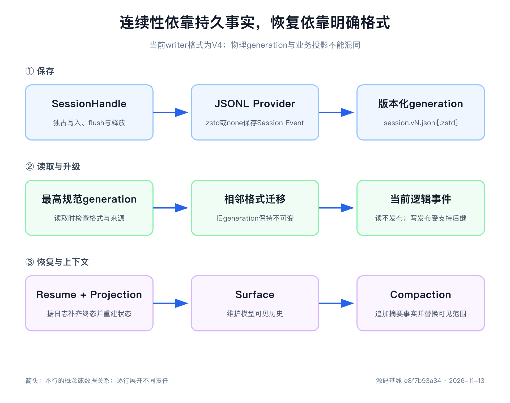

# 第12章 Session 恢复、分叉与上下文压缩

设备异常分析进行到一半，Agent 进程退出了。重新启动以后，它应该继续分析，还是重新创建维修工单？答案不能从最后一句 Assistant 回答中寻找。那句话可能只留在屏幕上，也可能已经说“正在创建”，外部系统却尚未提交；还有一种情况更棘手：工单已经创建，结果还没有写回日志。

一个可恢复的 Agent，要保存发生过的事实，重建当前状态，并明确承认外部效果未知的区间。本章沿着持久句柄、恢复入口、投影和压缩四条源码路径，解释这件事怎样实现。

> 阅读基线
> 本章按 `0.2.2-rc.2`、提交 `e8f7b93a344964de3dca1ace9e72b6e4d6de87cb` 修订。当前 Session 写格式为4，第一方持久化 Provider 只有 JSONL。第8周三套 Context 的实验属于旧基线历史材料，不作为本版运行验证。

## 先把三个问题分开

恢复设计有三个不同的问题：发生过什么，现在是什么，下一次模型应该看到什么。

| 问题 | 主要机制 | 例子 |
|---|---|---|
| 发生过什么 | Session 日志与 Persistence | 用户输入、模型消息、工具调用及结果 |
| 现在是什么 | Session Projection | 当前权限、待处理输入、已完成 Turn |
| 模型下一次看什么 | Surface 与 Compaction | 有效消息、摘要、裁剪后的工具结果 |

三者可以来自同一份事件日志，却不能互相替代。摘要丢失可以重新生成，投影缓存丢失可以重新计算；没有持久化的调用事实却不能靠模型补写。反过来，磁盘保存了全部事实，也不意味着每次请求都应该把它们全发给模型。

当前 Assistant 的已结算消息或尝试记录可以携带流式帧。界面实时收到的帧仍是暂态信息；硬崩溃可能丢失尚未结算的部分，不能把“屏幕上看见过”当作已经持久化。

## 持久化首先是一份有所有者的句柄

阅读 [`session-persistence`](https://github.com/deepseek-ai/deepseek-harness/blob/e8f7b93a344964de3dca1ace9e72b6e4d6de87cb/packages/session/session-persistence/src/index.ts) 时，先记住当前 API 的组织方式：服务负责发现和取得会话，句柄负责读写一份具体日志。

| 入口 | 责任 |
|---|---|
| `create(header, options?)` | 为新 Session 取得写句柄 |
| `open(id, 'read' / 'write', options?)` | 打开已有 Session，选择读取或独占写入 |
| `stat(id)` / `list()` | 读取元数据、版本状态与列表 |
| `handle.read(offset?, length?)` | 读取逻辑事件，返回事件的共享状态说明 |
| `handle.append(events)` | 按连续顺序接受事件批次 |
| `handle.flush()` | 等待该句柄达到耐久检查点 |
| `handle.close()` | 排空工作并释放写所有权，可重复调用 |
| 服务 `flush()` | 等待所有活动写句柄，汇总失败 |

旧版按 id 调用 `load`、`append`、`inspect`、`prepare` 的持久化接口已经不适用。`sessions.prepare()`仍属于 Session Store 的未发布构造机制，不能与持久化服务的方法混为一谈。

为什么要引入句柄？因为恢复不是无主的读文件动作。同一进程里的两个恢复请求不能同时修改同一个 Session；JSONL 还需要挡住另一个进程的写入者。写句柄把读取、后续追加、flush 和释放绑定到同一份所有权上。只读句柄不占写所有权，关闭或只读句柄上的非法写入会明确失败。

Agent Loop 创建新 Agent 时先取得写句柄，再发布实例。恢复时也先取得写句柄，再读历史和修复尾部。仅调用 `sessions.create()`，随后 `sessions.flush()`，并不能自动建立一条持久写入路线：实时事件只有在已取得的活动写句柄上才会被路由到后端。

`append()`完成表示后端接受了这批连续事件，通用约定不把它等同于耐久保证。只有完成的 `flush()`才是调用方可以依赖的耐久检查点。某个 Provider 实现得更强，也不能让上层程序把这种性质当作所有后端的保证。

## JSONL 保存格式，也管理写入竞争

当前 [`session-persistence-jsonl`](https://github.com/deepseek-ai/deepseek-harness/blob/e8f7b93a344964de3dca1ace9e72b6e4d6de87cb/packages/session/session-persistence-jsonl/README.zh.md) 是唯一第一方持久化 Provider。旧版 SQLite 持久化 Provider 已移除；源码中的实验性 SQLite 查询包用于查询，不是另一套可写 Session 持久化实现。

JSONL 要求显式配置根目录，默认采用 zstd，`compression: 'none'` 则使用便于直接查看的文本。当前逻辑格式为4，相应代际文件名为 `session.v4.jsonl` 或 `session.v4.jsonl.zstd`。不要照抄历史文档片段中出现的旧代际号，应以 `SESSION_FORMAT_VERSION` 与当前后端实现为准。

写所有权在进程内独占，并通过操作系统锁跨进程互斥：POSIX 使用 `session.lock` 的 flock，Windows 使用内核命名信号量。操作系统在进程死亡后释放锁，但共享文件系统锁的有效性及 Windows 会话范围仍有适用限制。POSIX 写路径还依赖项目的原生系统模块，不能把一份纯 JavaScript checkout 当作已经具备全部本地能力。

创建句柄可以延迟物化文件；第一次追加或显式 flush 会把空会话也落盘。读取时，Provider 负责判断物理日志是否有效：完整记录要连续，已经提交的损坏不能被默默跳过；崩溃造成的未完成末行则按其恢复规则处理。物理有效不等于运行语义已经闭合，这两类修复由不同所有者承担。

### 历史代际不会被原地覆盖

当前实现选择最高的规范代际。只读打开历史格式时，在内存中完成支持的相邻迁移，不发布新文件；写打开时，在确认来源修订未变化后，以不覆盖目标的方式发布当前代际。原代际保持字节不变。

这意味着旧文件的存在不代表系统支持回退，也不代表新代际失败后会自动降级。修改压缩方式同样不能被理解为在同一根目录里任意混写，应遵循 Provider 要求使用独立根目录。

阅读这段源码时，重点关注三个问题：谁持锁，迁移发布前怎样复核来源，目标已存在时怎样避免覆盖。它们比“JSONL 是一行一个 JSON”更接近真正的恢复设计。

## 在产生效果前保存意图

只在 Turn 最后 flush，仍会留下很大的不确定区间。当前 [`session-checkpoint-policy`](https://github.com/deepseek-ai/deepseek-harness/blob/e8f7b93a344964de3dca1ace9e72b6e4d6de87cb/packages/session/session-checkpoint-policy/README.zh.md)在三个位置设置检查点。

第一，在 `llm/stream` 真正构造 Adapter 请求之前，确认请求事实已经保存。第二，在顶层 `tools/execute` 的策略和守卫通过、工具主体开始之前，确认调用事实已经保存。第三，在 `agent/pre-step` 推导下一次请求前，保存上一轮响应与结果。

检查点失败时，依赖它的模型或工具不会继续分发；等待期间取消则按未分发处理。这个顺序让恢复程序有机会判断某项工作是否已经获得执行资格。

但保存意图仍然不是 exactly-once。假设调用事实已保存，EAM 已创建工单，进程在结果写回前退出。重启后只知道“调用可能执行过”，无法只凭本地日志证明工单存在与否。业务写工具仍需要稳定幂等键和权威系统查询；重复请求、补偿和人工介入应由业务协议决定。

## Resume 在发布以前完成恢复准备

活动 Agent 的恢复入口位于 [`agent-loop`](https://github.com/deepseek-ai/deepseek-harness/blob/e8f7b93a344964de3dca1ace9e72b6e4d6de87cb/packages/core/agent-loop/src/index.ts)：

~~~js
const handle = await ctx.agents.resume(ctx, {
  resumeSessionId: existingSessionId,
  agentOptions: {},
})
~~~

这是调用形式示意，不是完整启动程序。受支持应用仍通过 `dsh` profile 组合运行，所需的 Session、Projection、模型与持久化依赖必须由组合提供。

恢复的顺序可以压缩为：

~~~text
取得原 Session 的独占写句柄
  → 读取当前逻辑事件
  → Agent 层补齐中断 Turn 的语义闭合记录
  → 构造未发布 Session
  → 恢复投影、组合与初始化
  → 发布 AgentHandle
~~~

任何一步失败都要释放已经取得的资源，不能把只恢复了一半的 Agent 暴露给其他调用方。初始化失败不应通过删掉旧日志来“回滚”，因为那些事实本来就在恢复之前存在。

### 未开始与结果未知必须区分

如果模型已经给出候选调用，但没有持久的 `tool/call`，中断修复可以用 `TOOL_NOT_STARTED`说明没有进入分发记录。若已经有 `tool/call`，却缺少 `tool/result`，则使用 `TOOL_OUTCOME_UNKNOWN`。后者并不是一次普通工具失败，更不是允许自动重试的证据。

修复还会补齐缺失的 Step、Turn 终态。真正写入这些语义闭合记录的是恢复 Agent 的路径，持久化 Provider只交付物理有效日志。只读查询为了展示历史而做的修复留在内存，不会偷偷改写存档。

这项分工很实用：文件格式层不知道工单是否创建过；Agent 层知道运行阶段；业务 Provider才知道外部系统的最终状态。每一层只回答自己有证据的问题。

## Resume、Replay 与 Fork 保留不同的身份

| 操作 | 身份 | 目的 |
|---|---|---|
| Resume | 原 Session id | 继续一份已有持久会话 |
| Replay | 对既有事实重放或派生 | 检查历史、投影、模型输入与测试 |
| Fork | 新 Session id、固定继承前缀 | 从某个历史位置展开独立分支 |

Fork 不会让父级后续追加自动进入孩子。继承切点是快照，不是一份实时共享对话。当前 Header 用 `isSeeded`标明存在继承前缀，精确长度由 `inheritedEventCount`单独表示，旧的数字 `seedLength`已移除。普通 Fork 与 Subagent 的创建关系也不能只凭 `parentSession`存在就判断，应结合明确的 `origin`与委派记录。

`firstLiveSeq`说明当前 Session 实例何处开始新增事实；`inheritedEventCount`说明哪一段真正来自 Fork 的父级。恢复一个已经运行多轮的 Fork 时，两者通常不同。`session/end-seed`也有不同用途：带 `inherited: true`的标记属于继承切点，普通恢复标记只分隔本次重载与新增事实。投影初始化应接收明确的继承长度，不能扫描某一条 end-seed 就自行猜测。

例如，某个孩子继承了父级100条事件，之后又完成40条自己的事件。下次 Resume 装载的是孩子已有的全部日志，Fork 继承长度仍为100。若把140当作继承长度，目录、身份或权限投影就可能把孩子自己的事实错误排除。

## Projection 是由事实驱动的当前值

[`session-projection`](https://github.com/deepseek-ai/deepseek-harness/blob/e8f7b93a344964de3dca1ace9e72b6e4d6de87cb/packages/session/session-projection/README.zh.md)让领域插件声明初始状态、状态 schema、版本和同步 `apply(state, event)`。注册表统一订阅已提交事件，领域插件负责解释自己拥有的事件。

~~~text
const handle = await ctx.sessionProjections.register(definition)
const current = handle.stateOf(session)
const readCurrent = handle.readerFor(session)
~~~

新代码等待注册完成并保留返回句柄；不应继续把旧的按 key 读取当成首选 API。插件在提供同步服务方法前，先完成注册与水合。消费方调用领域服务，而不需要导入每个投影定义、重新扫描整份日志。

投影应是同步且确定的：没有关注的事件时返回原状态引用；需要客户端视图时，通过 `wire`声明经 schema 校验的完整视图。没有 wire 的状态只留在 Host，例如内部调度所需状态。客户端快照的 `asOfSeq`说明所有返回值共同反映到哪一条事实，避免 UI 把不同时间的状态拼成一份假快照。

持久投影缓存保存版本、水位和当前值，冷读可以只回放后缀。状态或折叠语义变化一般要递增 `stateVersion`；schema 接受旧值并不足以证明语义兼容。缓存版本不符、值非法或水位越过日志末端时必须重算。缓存的正确性应通过“旧检查点加新后缀”与“全量重放”一致来验证。

如果你要写设备处置 Agent，可以定义 `anomaly/state-set`保存完整业务阶段，再从日志派生设备、证据和待确认动作。不要把“正在等待审批”藏在某句 Assistant 文本里，然后靠字符串检索重建状态。

## Compaction 改变模型历史，保留原始事实

上下文压缩与删除日志不是一回事。当前压缩通常追加：

~~~text
compaction/start
compaction/summary
user/message（surfaceOp: replace）
compaction/end
~~~

`compaction/*`记录操作与计量事实，本身不进入模型 Surface；紧随 summary 的替换消息才把摘要放到有效历史中。`turn`可以是编号，也可以为 `null`，后者表示两轮之间独立进行的手动压缩。

摘要事件保存模型路由、可选 usage、被遮蔽节点、估算价格和摘要。真正通过当前 LLM seam 调用的摘要还保存 `rawOutput`并标记 `llmStreamCall: true`，使原始输出与安全摘要之间的关系可追溯。模板或远端摘要器不能伪装成一次经过本地 LLM seam 的调用。

这里有一个很容易误读的字段：`shadowedRange`是 Surface 位置区间，不是数值 seq 区间。一次替换可以把一个高 seq 的摘要放在旧位置，因此其 start seq 甚至可能大于 end seq。`shadowedSeqs`才是按 Surface 顺序列出的权威节点集合。不要写 `start <= seq && seq <= end`来猜被压缩的事实。

### 先裁剪机械内容，再做语义摘要

长上下文有时来自海量工具输出。`tool-result-pruner`可以进行不调用模型的确定性裁剪，保留调用与结果配对。当前 `compaction/prune`记录被替换内容的计量，并紧接真正的 Surface replacement。这个事件与摘要采用相同的相邻计量协议，消费者才能在不长期保存逐节点价格的条件下计算上下文成本。

如果真正需要保留的是长期推理结论、未完成事项和来源关系，才使用语义摘要。压缩后要检查关键设备、约束、幂等键和未解决问题是否仍然可得，而不只检查 token 变少。

手动压缩需要在允许的维护状态下进行，不能与活动 Step 同时修改同一份模型历史。失败还要区分摘要尚未产生、内存替换失败以及最后持久化检查点失败。若内存已经变化但 flush 没有完成，调用方就不能宣布“检查点已可靠保存”。

## 已发布格式有明确的兼容义务

旧书稿曾写“预发布阶段拒绝旧格式即可”，这个判断已经过时。当前 [`session-format-status`](https://github.com/deepseek-ai/deepseek-harness/blob/e8f7b93a344964de3dca1ace9e72b6e4d6de87cb/docs/session-format-status.md)记录最新定稿和已发布格式均为4。API 仍可变化，不代表已经发布的会话数据可以任意丢弃。

增加新一代可以采用相邻迁移，不能移动、覆盖或删除已经提交的历史代际。同一格式内，旧事件表示仍须保留正确含义。未知事件默认拒绝，只有 envelope 明确带 `ignorable: true`时，读取器才可按相应规则安全忽略；这个标记不意味着可以忽略任意嵌套字段变化。

给自己的 Agent 设计格式时，应写下三份东西：写入格式号、支持的历史读取路径、每次格式变化的实际兼容测试。不要只写一个永远递增的数字，却没有办法证明旧数据能够安全解释。

## 用实验验证关系，避免迷信计数

旧版第8周连续性实验顺序创建三套 Context，观察 JSONL 重载、投影重算、压缩及再次恢复。它在同一 Node.js 进程中主动 flush 并释放插件，未模拟操作系统硬崩溃，也未验证多进程接管。

当前版建议保留相同验证目标，按新接口迁移实验：先记录 Session id、末尾水位和派生消息；释放后重新取得写句柄恢复；比较投影、有效历史与 Turn 连续性；再压缩并恢复第二次。不要沿用旧实验“15条”“56变60条”等计数作为本版期望，新持久 inbox、请求与检查点机制会改变事件构成。

还应增加两个针对当前 API 的案例：两个写打开竞争时只能一方持有所有权；历史格式的只读打开不发布后继文件、写打开发布新代际且旧文件哈希不变。这些练习需要符合当前 Node与原生运行环境，本次修订没有声称已经执行。

## 本章源码阅读路线

先读 [`session-persistence`](https://github.com/deepseek-ai/deepseek-harness/blob/e8f7b93a344964de3dca1ace9e72b6e4d6de87cb/packages/session/session-persistence/src/index.ts) 的服务与句柄，再读 [`session-persistence-jsonl`](https://github.com/deepseek-ai/deepseek-harness/blob/e8f7b93a344964de3dca1ace9e72b6e4d6de87cb/packages/session/session-persistence-jsonl/src/index.ts) 的所有权与代际。随后进入 [`agent-loop`](https://github.com/deepseek-ai/deepseek-harness/blob/e8f7b93a344964de3dca1ace9e72b6e4d6de87cb/packages/core/agent-loop/src/index.ts) 的 `resumeWith()`，区分物理读取、语义修复、未发布构造与最终发布。

接着读 [`session`](https://github.com/deepseek-ai/deepseek-harness/blob/e8f7b93a344964de3dca1ace9e72b6e4d6de87cb/packages/core/session/src/index.ts) 的继承切点，读 [`session-projection`](https://github.com/deepseek-ai/deepseek-harness/blob/e8f7b93a344964de3dca1ace9e72b6e4d6de87cb/packages/session/session-projection/src/index.ts) 的注册与后缀恢复，最后对照 [`compaction`类型](https://github.com/deepseek-ai/deepseek-harness/blob/e8f7b93a344964de3dca1ace9e72b6e4d6de87cb/packages/compaction/compaction/src/types.ts) 和 [`compaction-basic`](https://github.com/deepseek-ai/deepseek-harness/blob/e8f7b93a344964de3dca1ace9e72b6e4d6de87cb/packages/compaction/compaction-basic/src/index.ts) 的替换事务。每读完一处，都回答“这个阶段失败，哪个事实还在，谁负责释放，下一步还能做什么”。

## 动手练习

1. 为工单写入列出四个崩溃位置：调用记录前、调用记录后、外部提交后、结果持久化后。分别说明恢复时能证明什么。
2. 从已完成 Turn 分叉，再让父子各自追加。比较 id、`inheritedEventCount`、`firstLiveSeq`和模型历史，确认父级新增不会进入孩子。
3. 让摘要遗漏一个设备幂等键。检查原始事实是否仍在，解释为何事实可追溯仍不能保证模型下一次能正确决策。
4. 构造无效投影缓存，确认从事件重算得到相同结果；再比较有效旧检查点加后缀与全量重放。

## 本章回顾

持久化用有所有者的句柄保存事实，flush 建立耐久检查点；恢复在发布 Agent 以前取得独占写权、修复中断语义并完成初始化。JSONL 是当前第一方持久化实现，历史代际通过相邻迁移保留，不能原地覆盖。

Projection 从事实得到当前值，Surface 与 Compaction控制模型上下文。`inheritedEventCount`与`firstLiveSeq`回答不同问题，`shadowedRange`也不能当数值 seq 区间解释。最关键的恢复判断仍是：没有结果不等于没有执行；不确定的外部效果要靠业务幂等键与权威系统对账。
