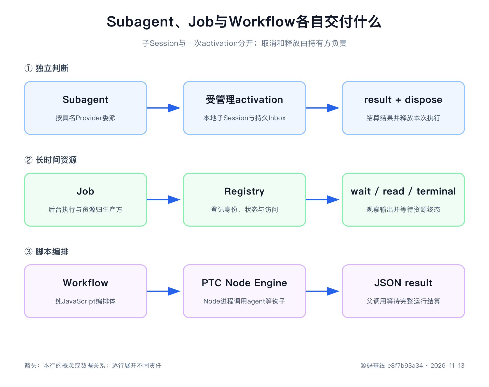

# 第13章 子智能体不是多开几个聊天窗口

主 Agent 正在分析设备振动异常：维修记录需要独立复核，高频数据下载需要几分钟，十台同类设备又需要按相同过程逐台分析。它们都可以并行，却不应该由同一种机制处理。

复核需要另一套模型判断；下载只需要后台资源；十台设备的处理需要固定编排。把三者统称为“多 Agent”，会掩盖最重要的问题：谁决定下一步，谁持有资源，结果交给谁，最后由谁等待清理完成？

本章从 Subagent、Job 和 Workflow 的所有权出发，解释怎样委派工作。任务可以交出去，所有权不能因此消失。

> 阅读基线
> 本章按 `0.2.2-rc.2`、提交 `e8f7b93a344964de3dca1ace9e72b6e4d6de87cb` 修订。当前委派采用统一 Activation，Workflow 使用 PTC Node 进程；旧版 one-shot/backgroundMode、Worker Thread 和第8周运行输出不再作为当前接口说明。本次未执行真实模型协作、平台 PTC 隔离或跨进程恢复验证。

## 先问谁决定下一步

并行只说明工作可能同时发生，没有说明谁推进它。选择机制时，先填写下面这张表。

| 机制 | 谁决定步骤 | 谁拥有运行资源 | 结果怎样交回 |
|---|---|---|---|
| 普通工具 | 当前模型已选定的确定动作 | 工具执行链与 Provider | 当前调用结果 |
| Subagent | 子 Agent 的模型循环 | 统一 Activation 管理器与受管理后端 | 完成通知，或调用方等待 `result` |
| Job | 命令或其他生产方 | 生产方持有真实资源，Registry持有身份和状态 | `wait`、`read`与完成通知 |
| Workflow | 确定性脚本 | Workflow Run、PTC 进程及所创建 Activation | 最终 JSON 结果 |

如果一次数据库查询已经能完成工作，就使用普通工具。只有需要独立判断时，才增加子 Agent 的上下文、模型费用与结果收集责任。资源要跨越当前 Step 继续运行时使用 Job；过程已经确定、需要批量扇出和聚合时再使用 Workflow。

这是对责任的选择，不是能力排名。用一个模型包装本来确定的下载函数，并不会让下载更可靠；把独立调查拆成二十个小子级，也未必比一个自足的任务更省成本。

## 统一 Activation 承担执行生命周期

[`SubagentRuntime`](https://github.com/deepseek-ai/deepseek-harness/blob/e8f7b93a344964de3dca1ace9e72b6e4d6de87cb/packages/subagent/subagent/src/index.ts)维护具名 Provider，后端可以是本地 spawn、fork，或 ACP、DSH SDK、Codex、Claude Code 等外部实现。Provider 决定怎样准备本地子级或启动外部执行，管理器统一处理准入、身份、取消、结果交付和释放。

当前核心入口是 `startActivation()`：

~~~ts
const activation = await ctx.subagents.startActivation({
  provider: 'spawn',
  label: '复核设备维修证据',
  prompt: [{ type: 'text', text: '独立核对 P-101 的维修记录与振动峰值。' }],
  parent,
  signal,
  delivery: 'caller',
})
try {
  const result = await activation.result
  if (result.stopReason === 'completed') use(result.output)
} finally {
  await activation.dispose()
}
~~~

这是服务调用示意，省略了类型导入与 profile 组合。启动成功表示子级已经接受任务，并且返回句柄能够取消这一次执行；不表示调查已经完成。调用方仍要检查 `stopReason`，不能把 Promise 兑现等同于业务成功。

`delivery`决定谁收结果：`parent`用于向父模型发送完成通知；`caller`让工作流等程序调用方等待，不再给父模型重复播报。调用方 signal 只拥有尚未发布的启动；发布以后由 Activation负责工作，释放应通过返回句柄完成。一个工具调用已经返回，不会因此取消它创建的后台 Activation。

本地 spawn、fork 支持后续消息与恢复；外部后端通常只运行一次，不能接受继续输入。统一接口并不抹掉后端能力差异：请求某项未实现能力，应在启动前明确拒绝。

`result`在执行清理和通知结束后结算。清理失败可以使 `dispose()`拒绝，并记录生命周期失败；已经捕获的执行结果仍按它本来的结果交付。设计调用方时，执行失败和清理失败都要处理，不能用其中一个覆盖另一个。

## 委派工具现在立即返回名称

当前 [`tool-subagent`](https://github.com/deepseek-ai/deepseek-harness/blob/e8f7b93a344964de3dca1ace9e72b6e4d6de87cb/packages/subagent/tool-subagent/README.zh.md)每次调用都创建受管理 Activation，然后返回 `started subagent <name>`，规范结果为 `{ kind: 'activation', name }`。它不等待最终答案，也不再用旧版 `backgroundMode`和 `run_in_background`选择三条不同路径。

运行时在子级结算后通知仍在线的直接父级。通知到达空闲父级时可以驱动新的模型工作，因此父级不需要用 sleep 等待或反复轮询。Headless 宿主仍要协调父级空闲与子树工作，不能只看到父级暂时 idle 就退出进程。

名称是便于协作的寻址方式。根名为 `lead`，子级可以叫 `reviewer`，它的孩子可以叫 `reviewer/checker`；同级名称唯一，运行时在准入时预留，防止并发启动抢到同一个名字。省略时生成 `agent-1`、`agent-2`等名称。内部仍以 Session id 标识本地成员，名称解析不能替代授权。

看到一个 id 或名称时，必须先确认它属于哪一类：Agent 名称、Session id、Job id 或 Workflow run id。它们分别对应消息、中断、输出读取与清理，不能互换。

## Spawn 与 Fork 决定初始历史

Spawn 创建全新子 Session，不继承父级对话。提示词必须自足：设备编号、问题、可用证据和输出要求都应说清楚。“再看看刚才的第三个方案”对它没有足够信息。

Fork 复制父级已经完成的 Turn 前缀，不包含发起委派的当前开放 Turn。它保留的是一次性快照；父级后来追加的消息不会自动同步。第一次委派前没有已完成 Turn 时，Fork 也没有可继承的对话。

| 方式 | 初始历史 | 适合任务 | 代价 |
|---|---|---|---|
| Spawn | 空历史加自足任务 | 独立审查、对照调查 | 重新提供必要背景 |
| Fork | 已完成父级前缀加任务 | 延续分析、共享证据复核 | 更多上下文与前缀复用条件 |
| 外部 Provider | 对应协议或产品决定 | 独立运行时、现成产品能力 | 协议能力与权限差异 |

工作目录也有明确归属：创建时捕获父级有效目录，或解析本次显式 `cwd`。孩子保留自己的目录；父级之后切换目录，不会重定向已经运行的子级。权限根目录与初始目录元数据也不能因为一次 cwd 选择就被任意扩大。

### 历史继承与权限继承分开处理

旧版“子级完全不继承父权限”的概括已经不准确。当前 [`child-agent.ts`](https://github.com/deepseek-ai/deepseek-harness/blob/e8f7b93a344964de3dca1ace9e72b6e4d6de87cb/packages/subagent/subagent/src/child-agent.ts)在委派时捕获父会话显式 Sandbox Mode覆盖，写到孩子自身日志中；不捕获部署默认值，也不继承某次一次性批准。组合了 Approval 时，孩子的 approval policy固定为 `never`，因此不能在内部请求扩大启动时确定的权限。

Auto 或 danger-full-access等明确 preset也有专门的委派记录规则。这些规则只适用于进程内 DSH 路径，外部产品保留自己的权限机制。复制对话绝不等于复制审批票据，工具可见也不等于业务身份拥有资源访问权。

子级组合由 preset决定。Spawn可选择独立 preset，模型可选范围由配置白名单限制；Fork与外部后端拒绝该选项。没有显式选择时，本地孩子使用父方当前 preset代际。冷恢复优先读孩子保存的 preset和 descriptor，而不是拿父级现在的配置随意替换。

## 持久子级与在线 Activation 是两件事

本地孩子有稳定 Session，Activation则是当前进程中的在线执行。Session可以长期存在，某个 Activation会结束和释放；以后继续工作时可以冷恢复目标。

~~~text
持久子 Session与 descriptor
        ↓
父级目录中的成员事实
        ↓
当前可选的在线 Activation
        ↓
AgentHandle与持久 Inbox投影
~~~

父 Session的 `subagent/catalog`记录成员关系，孩子自己的 `subagent/descriptor`记录继续执行需要的描述。目录不保存实时运行状态，完成不意味着从目录消失。列举后代通过目录投影与持久查询递归进行，可以发现离线孩子，却不必把每个孩子激活。

本地创建无论 `delivery`选 parent还是 caller都会进入父级目录；外部执行只有 parent交付才入目录。工作流因此可以收走本地结果，同时保留发现子 Session的能力。目录条目存在也不一定能恢复：外部叶子、历史信息不足或临时 Session都可能不具备继续条件。

本地 parent交付要求持久化；caller交付可以使用临时本地 Session。冷恢复还要求持久化与 Session查询服务。缺失这些依赖时应得到明确失败，不能用一个永远挂起的 Promise伪装成稍后可用。

### 消息可以 Steer，不再只排下一轮

当前 `sendMessage()`允许同一棵树中的在线根和可继续成员相互联系，不限于直接父子。模型消息送达下一步的 Steer输入；目标空闲时可以唤醒新 Turn。浏览器用户输入另有 Queue与Steer选择。旧版“只能 FIFO排队、不能影响当前 Turn”已不适用。

Inbox由 Agent Loop通过 `agent/inbox/spliced`事件持久表达，并由投影重建，不再只是未记录的内存 FIFO。接受消息仍不等于完成业务；本地事件提交与耐久 flush有不同时间点，也没有跨所有外部效果的 exactly-once保证。

冷投递只恢复目标，不要求把其创建祖先全部激活，但树根必须在线；最终准入会重新检查发送者、目标与树根。消息权限由树成员关系决定，中断要求祖先权限，浏览器控制还要检查目标子 Session的独立操作权限。知道名称、拥有父级访问权都不足以绕过这些检查。

## 内容消息与结算通知不要混为一谈

孩子可以主动发出一段说明，也会在 Activation结算时由运行时发完成通知。前者表达子级想传递的内容，后者说明生命周期已经结束。完成通知包含最终非空文本，但若孩子结束前已经把同样的关闭内容发给父级，运行时可以省略重复文本。

通知只给仍在线的创建者，不会为了通知唤醒已经离线的父级。需要完整过程，应打开子 Session；不能假定父级 Transcript收到了孩子每一个工具结果或每一条消息。

因此，调试“结果没回来”至少要查四件事：执行是否结算，选择了哪种 delivery，创建者是否仍在线，结果是否已经由程序调用方收走。只看父级最后一句回答，无法区分这些情况。

## 深度与容量限制解决不同问题

委派工具默认读取 Host的 `maxDepth`，初始值为1；0禁止继承此设置的工具继续委派。显式工具配置优先，外部后端也可采用它支持的 provider-managed策略。深度限制约束递归层数，不能限制同层扇出。

`maxActiveSubagents`默认8，限制一棵树中在线与正在创建的成员。新建、冷恢复前预留名额，资源释放以后归还；停止中的 Activation与有待处理输入的驻留成员仍占容量。容量耗尽直接拒绝，不排队，避免父级等后代、后代又等父级占用名额造成互等。

这不是累计token预算，也不是历史Session数量上限。做生产容量规划时，需要另外观察模型费用、输出大小、持久存储与运行时间。

## Job 管后台资源，不负责思考

[`JobRegistry`](https://github.com/deepseek-ai/deepseek-harness/blob/e8f7b93a344964de3dca1ace9e72b6e4d6de87cb/packages/jobs/jobs/src/index.ts)让命令、下载器或其他生产方跨当前 Step继续工作。生产方提供真实资源与取消、结算钩子；Registry提供稳定身份、状态、输出环和所有者校验。

当前 id采用 `<kind>-<short-uuid>`，例如 `bash-`加16位小写十六进制后缀，而不是旧实验中的 `bash-1`。授权依赖所有者Session校验，不能依赖id难猜。

~~~text
running → stopping → completed | killed | failed
~~~

`stopping`表示取消请求已送出，生产方尚未完成资源清理。生产方 `done`应该在资源释放后结算，Registry才能发布终态。`wait`超时或等待信号取消，不会停止Job；真正停止资源的是 `kill`调用生产方取消。

读取分为两种消费者：模型侧 `read()`推进唯一消费游标，完整读取或通知受字节预算控制；观察者用 `readAt()`按绝对偏移读取保留块，不消费模型输出，也不改变通知状态。stdout、stderr可进入模型，log块只供观察者。UI滚动日志不能无意把模型待读内容取走。

带所有者的Job只有在相应作用域附加控制器时才能启动，`tool-jobs`便提供这样的控制与通知入口。否则预检失败，不启动无人可收集或停止的工作。

`jobs-local`的执行仍在当前进程中。它会把有所有者Job的生命周期元数据写入Session，却不能凭这些记录跨进程重启原命令。要实现持久执行，需要重新定义身份、租约、输出、接管与重试，不能只把一张Job快照放进数据库。

## Workflow 固定过程，Subagent填补判断

Workflow接收JavaScript脚本，提供 `agent()`、`parallel()`、`pipeline()`、`phase()`与`log()`。脚本决定固定的顺序、分支和聚合，只有 `agent()`把局部判断交给模型。

~~~js
phase('Investigate')
const report = await agent('核对 P-101 的维修记录，给出有证据的结论。')
return { report, decision: 'await-human-confirmation' }
~~~

当前执行器是 [`workflow-ptc`](https://github.com/deepseek-ai/deepseek-harness/blob/e8f7b93a344964de3dca1ace9e72b6e4d6de87cb/packages/workflow/workflow-ptc/src/index.ts)，旧 `workflow-worker-thread`已移除。它复用 Node PTC运行时，在独立Node进程中执行脚本。引擎要求TypeScript/Node PTC提供方，Python PTC组合必须禁用这些Workflow条目。

运行开始时捕获调用Session的有效目录与常设文件策略，父级后来切换目录不影响脚本及其后续孩子。文件约束不限制网络。`node:vm`提供脚本求值环境，不是安全边界；真正效果取决于PTC和Subprocess提供方的操作系统约束。不能执行文件约束的运行时只允许full access，受限模式应在运行前失败。

每次 `agent()`调用都通过 `startActivation({ delivery: 'caller' })`交给统一管理器。工作流等待结果、负责释放，不向父模型重复发送子级完成通知。普通子级失败使 `agent()`得到 `null`，脚本可以降级处理；钩子误用、非法结果、进程失败或控制限制超额则使工作流失败。

跨执行环境的值必须是无损JSON。函数、循环、特殊原型、稀疏数组、非有限数和嵌套undefined不能混进最终结果。这个约束同时提高可重放性，并避免把不可传输的运行时对象泄漏给调用方。

### 没有整体截止，不等于没有限制

当前引擎向PTC请求 `timeoutMs: null`，不设置整段工作流的经过时间截止；初始同步片段仍受 `syncTimeoutMs`约束，外层工具截止与调用方取消仍然有效。并发子级数、总调用数与单次条目数也有配置上限。

这些计数器限制正常脚本的协作式扇出，不是操作系统强制的安全配额，也不是所有后代的token预算。PTC的挂起Host调用上限还会限制实际并发，配置并发数时必须给结果等待、释放与进度批次留余量。

取消立即中止受管PTC进程及待启动、活跃子级；公开释放操作要等待进程结算与子级清理两项义务，不另设一个到时放弃等待的工作流清理定时器。子级启动可能比取消晚完成，此时也必须立即释放它，不能让“取消时还不存在”成为资源泄漏理由。

Workflow没有凭空获得持久程序检查点。Session中存在观察事件，不意味着进程退出后JavaScript局部变量能从中间恢复。恢复长期流程需要额外定义阶段状态、输入输出与幂等动作。

## 取消要说清对象和完成条件

| 操作 | 主要影响 | 仍需处理的责任 |
|---|---|---|
| 取消Activation发布前的signal | 未完成的启动与准入 | 回滚未发布资源 |
| Activation `dispose()` | 该次受管理执行 | 等待清理，处理释放失败 |
| `interrupt_agent` | 获授权目标的当前工作 | 不等同于删除持久Session或排空整棵树 |
| Job `kill()` | 生产方真实资源 | 等待生产方结算后才有终态 |
| 取消Job `wait()` | 当前等待者 | Job继续运行 |
| Workflow取消与释放 | PTC与该Run创建的子级 | 两类资源都要收束 |

根宿主释放以前还需要 `drainDescendants()`等待整棵受管理树。中间创建者退出不会自动转移树根；普通成员也不应通过无限等待后代把自身结果卡住。资源归属与创建关系相互关联，却不是同一个概念。

## 当前学习实验应该观察什么

旧版第8周实验展示过Mock子级、进程内Job及Worker Thread工作流，属于旧基线材料。其 `backgroundMode`、`startContinuable()`、`followup()`和旧Job编号不再是当前版教程；本次修订没有把它们迁移运行。

按当前API重新做实验时，先用确定性Adapter固定输出，再记录：启动工具立即返回的名称；父目录与孩子descriptor；消息进入持久Inbox的事件；子级完成通知及释放；Job消费读取与观察读取；Workflow的PTC退出与孩子清理。验收的是这些关系，不能只看最终文字“分析完成”。

再加两个故障案例：容量已满时新Activation不得启动；Workflow取消时仍在准备中的子级，即使稍后发布也必须被释放。真实模型、平台约束和硬崩溃恢复应分开验证，避免一条Mock成功记录承担所有结论。

## 本章源码阅读路线

先读 [`types.ts`](https://github.com/deepseek-ai/deepseek-harness/blob/e8f7b93a344964de3dca1ace9e72b6e4d6de87cb/packages/subagent/subagent/src/types.ts) 的Activation接口，再读 [`manager.ts`](https://github.com/deepseek-ai/deepseek-harness/blob/e8f7b93a344964de3dca1ace9e72b6e4d6de87cb/packages/subagent/subagent/src/manager.ts) 的准入、目录提交、投递和结算。对照 [`child-agent.ts`](https://github.com/deepseek-ai/deepseek-harness/blob/e8f7b93a344964de3dca1ace9e72b6e4d6de87cb/packages/subagent/subagent/src/child-agent.ts) 区分历史、preset和委派权限，然后读 [`tool-subagent`](https://github.com/deepseek-ai/deepseek-harness/blob/e8f7b93a344964de3dca1ace9e72b6e4d6de87cb/packages/subagent/tool-subagent/src/index.ts)与控制工具。

Job先读 [`jobs`](https://github.com/deepseek-ai/deepseek-harness/blob/e8f7b93a344964de3dca1ace9e72b6e4d6de87cb/packages/jobs/jobs/src/index.ts)约定和 [`types.ts`](https://github.com/deepseek-ai/deepseek-harness/blob/e8f7b93a344964de3dca1ace9e72b6e4d6de87cb/packages/jobs/jobs/src/types.ts)，再读 [`jobs-local`](https://github.com/deepseek-ai/deepseek-harness/blob/e8f7b93a344964de3dca1ace9e72b6e4d6de87cb/packages/jobs/jobs-local/src/index.ts)的输出与结算。Workflow则从 [`workflow`](https://github.com/deepseek-ai/deepseek-harness/blob/e8f7b93a344964de3dca1ace9e72b6e4d6de87cb/packages/workflow/workflow/src/index.ts)进入 [`workflow-ptc/host.ts`](https://github.com/deepseek-ai/deepseek-harness/blob/e8f7b93a344964de3dca1ace9e72b6e4d6de87cb/packages/workflow/workflow-ptc/src/host.ts)，沿 `startActivation()`追踪孩子资源。

第一轮只回答四个问题：谁决定、谁拥有、谁结算、谁清理。第二轮再深入外部协议、控制帧和跨Realm物化。

## 动手练习

1. 让父级先完成一个带设备背景的Turn，比较Spawn和Fork实际收到的历史；检查显式Sandbox覆盖与固定never审批记录，确认一次性grant未被复制。
2. 为同一个本地孩子分别发送Steer消息和用户Queue输入，观察持久Inbox、Step边界与恢复后的待处理输入。
3. 给Job加入日志观察器，确认`readAt()`不会改变模型`read()`游标；取消wait后确认Job继续运行。
4. 在Workflow中让一个子级普通失败，处理null；随后取消一个仍有待启动孩子的Run，检查晚发布孩子与PTC都完成释放。

## 本章回顾

Subagent提供独立模型判断，当前统一Activation拥有准入、结果与清理；委派工具立即返回名称，本地孩子通过持久Session、目录与Inbox支持继续工作。Spawn和Fork改变初始历史，权限则沿独立且受限的委派规则处理。

Job管理后台生产方资源及输出，不自动提供跨重启执行。Workflow用PTC Node进程组织固定步骤，复用Subagent而不重复通知父模型。任何机制都必须明确结果交付、取消对象与清理完成条件；同时运行多少Agent，并不能替代这些责任。
