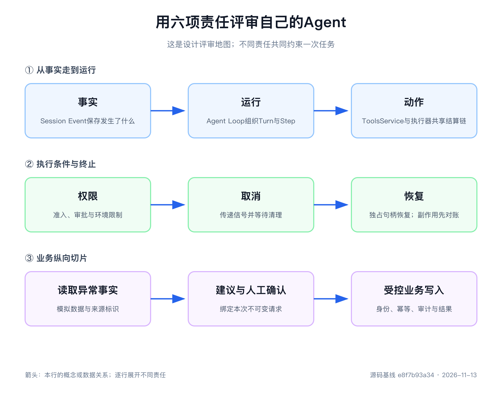

# 第14章 自己动手写一个 Agent Harness

下午两点十七分，一号车间的泵 `P-101` 发出振动报警，监测值达到 `8.2 mm/s`。

如果只是调用一次大模型，我们很容易写出下面的程序：把报警文字放进提示词，等待模型返回“检查轴承、润滑和联轴器”。这段回答也许有帮助，却还不能进入真实处置流程。模型不知道这条数值来自哪台设备，不知道最近两小时的趋势，不知道上次维修更换了什么，也无法证明自己查询过哪些系统。更危险的是，如果我们再给它一个“创建维修工单”的 HTTP 接口，它可能在证据不完整时直接写入业务系统。

真正的 Agent Harness 要处理另一组问题：谁保存已经发生的事实，谁推动一轮工作，谁把模型意图变成受控动作，谁决定动作能否继续，取消时谁负责停稳，重启后又根据什么恢复。

这六项责任分别是事实、运行、动作、权限、取消和恢复。它们比提示词更能决定一个 Agent 是否可控。

本章把前十三章的知识压缩成一个制造业异常处理 Agent的设计。我们用旧版Mock实验的成功、人工拒绝、工具异常、取消和恢复五条路径解释验收方法，再对照当前源码说明重新实现时必须采用的组合。完成以后，你得到的是一套可以迁移到自己项目里的设计方法。

第一次阅读只检查六项责任：事实是否留下，运行怎样推进，动作由谁执行，权限在哪里决定，取消何时停稳，恢复依据什么继续。代码示例、分片协议和完整评审表可以在第二遍细读。只要这六个问题始终有答案，你就不会被包名和类型数量带偏。

> 阅读基线
> 本章设计对照 `0.2.2-rc.2`、提交 `e8f7b93a344964de3dca1ace9e72b6e4d6de87cb`。制造业脚本与其代码片段属于旧基线 `cd5ef8148158c3a752a658978873241fdf8e2bbc` 的教学实验，尚未迁移为当前版可运行应用。它使用ScriptedAdapter、模拟工具与Mock Approval，不连接真实模型、业务系统或审批界面；历史断言不计作本版验证。

## 先划边界，再写代码

我们的目标很具体：接收一条设备异常，读取受控数据，形成原因假设和处置建议，并在创建业务记录前请求人工确认。

第一版明确不做以下事情：

- 不自动停机、复位 PLC、修改工艺参数或关闭质量批次。
- 不把模型输出当作维修结论、质量放行依据或安全指令。
- 不允许模型生成任意 SQL、任意 URL 或任意设备点位。
- 不把一次人工同意解释成永久授权。
- 不在书稿和实验日志中保存真实设备数据、人员信息或 API Key。
- 不声称已经连接 MES、EAM、QMS、Historian 或控制系统。

这些限制不是以后再补的免责声明，而是架构输入。只要“不得直接停机”成立，停止设备就不应该出现在模型可见的工具列表中；只要“创建工单需要人确认”成立，审批就不能只写在系统提示词里；只要“中断后可以继续”成立，输入、模型输出、工具调用和终态就必须进入持久记录。

最小主线可以写成：

~~~text
用户输入
   ↓
Session 追加事实
   ↓
Agent Loop 打开 Turn / Step
   ↓
LlmAdapter 产生流式分片
   ↓
ToolsService 选择 ToolExecutor，经共享 pipeline / batch执行
   ↓
策略判断 → 人工审批 → 业务 Provider
   ↓
执行链记录 tool/call、tool/result，Agent Loop 决定续步或结束
~~~

图里没有 UI、数据库品牌和模型厂商，因为它们都可以替换。不能丢的是每个箭头两端的责任。

## 把业务要求翻译成运行不变量

很多 Agent 项目从一张功能清单开始：“能查设备、能分析原因、能建工单、能让人确认”。这类句子适合讨论范围，却不足以指导实现。动手前还要把它们改写成无论成功或失败都必须成立的运行不变量。

“读取设备状态”可以改写为：每次查询都只能访问参数指定且当前身份有权查看的设备；查询调用和返回结果必须配对；失败时不能出现伪造状态。“创建维修工单”可以改写为：没有本次调用的明确批准，Provider 主体执行次数必须为零；重试使用同一业务幂等键；最终结果能够从权威系统重新查询。

按照六项责任继续拆分，`P-101` 的需求会变成下面这些问题：

| 责任 | 从业务句子得到的问题 | 可以写进测试的观察 |
|---|---|---|
| 事实 | 报警值、维修记录和人工决定从哪里来 | Session 中存在来源明确、先后有序的事件 |
| 运行 | 一次查询以后为什么会再次请求模型 | 同一 Turn 出现两个 Step，工具结果位于第二次请求历史中 |
| 动作 | 哪个组件真正读取或写入业务系统 | 只有选定 Provider 主体收到已校验参数 |
| 权限 | 哪些只读请求直通，哪些写动作询问 | 拒绝时写主体计数为零，批准参数与执行参数一致 |
| 取消 | 长诊断停下以后，排队工单怎么办 | 诊断完成清理，工单以未分发状态结束 |
| 恢复 | 重启以后怎样知道上一轮做到了哪里 | 原 Session 历史一致，外部写入按幂等键对账 |

这种改写会自然改变代码结构。如果“拒绝时写主体执行零次”是一条不变量，审批就必须位于 Provider 主体之前；如果“外部结果能够重新查询”是一条不变量，写工具返回值就必须包含稳定业务 id 或幂等键；如果“工具结果进入第二次请求历史”是一条不变量，工具执行就不能绕开 Session。

不变量还帮助我们判断一项功能应放在哪里。比如“回答语气更简洁”属于Persona或提示词，“最多并行查询三台设备”属于执行器或业务批处理的配置调度，“只能读取本厂区设备”属于Provider权限，“超过十分钟无人审批则取消本次动作”属于Approval流程。把四者混在一个系统提示词里，无法分别落实和验证。

对源码阅读者来说，这一步同样有用。看到一条测试时，不要只记住它调用了哪个函数，而要写出它保护的不变量；看到一个事件时，追问哪个下游消费者依赖它；看到一个 `AbortSignal` 时，继续追到资源何时真正释放。这样读源码，注意力会从语句细节转向系统责任。

## 不必复制完整的 DeepSeek Harness

旧版 `agent-spine-demo` 已从当前源码移除，不能再把它当作公共启动入口。当前受支持的Node应用只通过 `dsh` profile启动；学习时应从 [`bundle/base`](https://github.com/deepseek-ai/deepseek-harness/blob/e8f7b93a344964de3dca1ace9e72b6e4d6de87cb/packages/bundle/base/cordis.patch.yml)及其overlay观察实际组合，再把业务能力写成插件接入。不要给一个包增加bin，或把公共SDK当作绕开profile的argv入口。

当前最小组合应先列责任和依赖，而不是照抄旧实验里的一串 `ctx.plugin()`：

| 责任 | 必需组合 |
|---|---|
| 事实与当前状态 | Session Store、Session Projection及所需领域投影 |
| 模型 | LLM Runtime、选定Adapter与明确模型路由 |
| 工具 | ToolsService、插件拥有的ToolExecutor、业务工具与Provider |
| 运行 | Agent服务与Agent Loop，按profile提供上下文与策略 |
| 权限 | 共享Sandbox Policy、Approval及其投影依赖 |
| 恢复 | JSONL持久化与检查点策略，明确根目录与所有权 |

`ToolRuntime`在当前源码中只是 `ToolsService`的兼容别名。注册表选择当前Agent的执行器；执行器和共享pipeline/batch处理执行语义。旧 `tools.config.mode`的native/ptc/both开关已退休，执行能力由所选插件提供。当前第一方持久化Provider是JSONL，不能再列SQLite持久化作为可选实现。

这套组合有三个值得保留的特点。

第一，插件只依赖自己需要的服务。工具执行链不必知道最后查询的是内存对象、EAM还是远程服务；Agent Loop不必了解JSONL文件布局。

第二，可选业务能力按需要组合，但已经声明的服务依赖必须补齐。比如当前Approval和Agent Loop需要Session Projection，不能沿用旧脚本“没测到就不挂载”的假设。第一版不需要的Job、Subagent和Workflow可以暂不引入。

第三，生命周期有统一所有者。插件注册、事件监听和服务贡献都属于 Context 的 Fiber；`ctx.fiber.dispose()` 能沿着这棵组合树释放资源。自己拼 Harness 时，创建对象并不难，难的是确保每个注册都有撤销路径，每个长任务都能停稳。

实现顺序也应该沿着一条纵向主线推进。先让一条用户输入进入 Session，用固定 Adapter 返回一段文字，并看到 Turn 正常结束；再加入一个只读工具，让工具结果推动第二个 Step；随后加入拒绝、异常和取消；最后才挂载持久化并销毁、重建 Context。每一步都能运行，出现问题时只需检查刚增加的一个责任。

如果先写完彼此独立的模型层、工具层和数据库层，最后才接起来，很容易出现模块都有测试，整体却不知道停在哪里。Harness的难点在责任交接处：模型怎样把调用交给ToolsService所选执行器，审批怎样把决定交给Provider，执行链怎样记录Session事实，恢复怎样把历史交给新Context。纵向切片会尽早暴露这些接口。

因此，第一条实现原则是：复制责任，不复制包数量。先列出你的 Agent 必须承担的事实、运行、动作、权限、取消和恢复，再为每项责任选择实现。

## 用可控 Adapter 代替猜测

真实模型适合验证模型质量，第一版控制流则应先使用确定性Adapter。模型可能改写措辞、选择不同工具，也可能受网络和限流影响。下面保留旧实验的 `ScriptedAdapter`教学片段，用来说明“预先排列分片”的方法；它不是当前SDK可直接复制运行的完整实现。

~~~js
class ScriptedAdapter extends LlmAdapter {
  constructor(script) {
    super()
    this.script = [...script]
  }

  resolveModel(provider, model) {
    return Promise.resolve({
      provider,
      id: model,
      name: `Mock ${model}`,
      context: { contextWindow: 8192 },
      inputModalities: ['text'],
    })
  }

  async *stream(options) {
    const chunks = this.script.shift()
    if (chunks === undefined) throw new Error('script exhausted')
    for (const chunk of chunks) {
      options.signal?.throwIfAborted()
      yield chunk
    }
  }
}
~~~

它很短，却保留了真实 Adapter 的两个关键接口：`resolveModel()` 说明模型能力，`stream()` 产生 `StreamChunk`。测试可以精确安排“第一次请求要求工具，第二次请求给出总结”，也可以安排错误、取消或多工具并发。

一条完整文本响应不是直接返回字符串，而是按协议产生分片：

~~~text
block-start(text)
text-delta
block-end(text)
usage
finish(stop)
~~~

工具请求也属于内容块。它从 `block-start(tool-call)` 开始，在流式阶段追加原始 JSON 参数，最后以带有工具名、调用 id 和完整参数的 `block-end` 收束，再由 `finish(tool-calls)` 表明模型这一 Step 需要执行工具。

协议里有几条不能靠“差不多”处理的规则：每个内容块都要闭合；同一块的 `index` 必须稳定；工具参数增量是原始 JSON 文本；`usage` 位于 `finish` 之前；`finish` 是最后一个分片。真实 Provider 不支持某个选项时，应明确抛出稳定错误，而不是静默丢弃。网络请求还必须观察 `options.signal`。

为什么要先实现这层？因为 Agent Loop 不应该理解某家模型的 SSE 字段。它只消费统一的分片词汇。DeepSeek、其他 OpenAI 兼容接口或本地模型的差异，应止于 Adapter。以后替换模型时，Session、工具和权限机制不需要跟着重写。

Mock也有清楚的证据范围。旧实验观察的是Harness怎样消费固定分片，本次没有重跑；它从未验证真实DeepSeek HTTP/SSE、token统计、限流重试和回答质量。接入真实模型时，这些项目要单独验收。

## 工具不是一段随便调用的函数

模型说“读取P-101状态”时，它给出的只是候选动作。ToolsService选择执行器，执行器通过共享执行链把候选动作变成可审计的调用。

旧实验的只读工具片段保留如下，主要观察参数、规范值与render如何分开。当前实现应按第10章的ToolDefinition和执行器接口落地：

~~~js
ctx.tools.register(defineTool({
  name: 'read_equipment_state',
  description: 'Read one deterministic equipment status record.',
  parameters: {
    equipment: { type: 'string', required: true },
  },
  output: {
    schema: { type: 'string' },
    render: (_args, value) => [{ type: 'text', text: value }],
  },
  async execute(args, exec) {
    exec.signal.throwIfAborted()
    return `${args.equipment}: vibration=8.2mm/s, state=warning`
  },
}))
~~~

工具声明同时描述名称说明、参数规则、规范返回值与模型渲染。当前共享pipeline在工具主体前后分别落实参数和输出处理，ToolsService与执行器承担注册选择及批次执行。实现自己的Harness时应保留这些责任，避免把调度、参数验证和业务HTTP请求塞到同一个函数里。

因此，工具主体不应该返回一段需要调用方再次解析的随意文字。假如创建工单的成功结果需要编号、状态和幂等键，规范值应该直接是：

~~~json
{
  "orderId": "MO-20260902-001",
  "status": "created",
  "idempotencyKey": "P-101-vibration-20260902T1417"
}
~~~

面向模型的说明可以由 `render()` 生成，界面卡片可以由表现层生成，程序调用方则直接读取字段。三种消费者不必争抢同一段文本。

参数校验也不是业务授权。`equipment` 是必填字符串，只能证明模型给出了字符串，不能证明这台设备存在，更不能证明当前用户有权读取它。时间窗上限、点位白名单、数据脱敏和设备权限仍由真正拥有数据的 Provider 负责。

同样，抛出异常和返回非理想业务状态需要区分。Historian 无法连接属于基础设施失败，可以抛出异常并形成 `isError` 工具结果；“未发现这台设备的维修记录”可能是一次成功查询，应该返回结构化空结果。否则模型无法区分“确实没有数据”和“根本没查到数据”。

最后，所有可能等待网络、文件、进程或数据库的工具都要观察 `exec.signal`。只有工具主体愿意配合，取消请求才能变成真实的资源清理。

## Consumer、Provider、策略与审批各管一件事

实验里的 `execute()` 直接返回固定文本，实际上把 Tool Consumer 和业务 Provider 合并了。真实项目不宜这样做。

以创建维修工单为例，可以拆成三层：

1. Service Definition 声明 `createOrder(request, signal)` 等稳定能力。
2. Service Provider 连接 EAM，负责身份、字段映射、超时、幂等和错误转换。
3. Tool Consumer 把模型参数转换成服务请求，把服务结果转换成规范工具值。

工具之外，还会出现策略、审批和沙箱。它们看起来都在“限制动作”，实际回答的问题不同：

| 机制 | 回答的问题 | 不能替代什么 |
|---|---|---|
| 参数 Schema | 模型参数能否按声明类型解释 | 设备存在性、用户权限、业务规则 |
| `tools/pre-execute` 策略 | 这次候选调用应允许、拒绝还是询问 | Provider 鉴权与字段校验 |
| Approval | 所组合的人或机器应答者是否同意本次动作 | 永久授权、身份认证、业务幂等 |
| Provider | 调用者能否对权威系统执行这项业务操作 | 人机交互和模型风险策略 |
| Sandbox | 当前提供方能强制哪些文件效果 | 网络隔离、业务身份与审批记录 |

拒绝实验在 `tools/pre-execute` 上只拦截写工具：

~~~js
ctx.on('tools/pre-execute', async (exec, next) => {
  if (exec.name === 'create_maintenance_order') {
    return {
      kind: 'ask',
      reason: `create order for ${exec.arguments.equipment}`,
    }
  }
  return next()
})
~~~

Waterfall监听器不处理当前调用时必须执行 `next()`。旧实验中返回ask后，Mock应答者返回rejected，写入主体执行零次，工具链记录拒绝结果，模型随后说明未获批准。当前实现也应让批准参数与实际执行参数保持一致；审批审计本身只记录工具名、理由、call id等信息，并不单独保存一份完整参数票据。

这条路径比在提示词中写“创建前请询问用户”可靠。提示词只能影响模型选择，策略和审批控制的是执行入口。即使模型直接产生工具调用，写入主体也不会绕过判断。

但审批通过也不是终点。生产 Provider 仍要验证登录身份、设备范围、允许字段和幂等键。人可能批准了 `P-101` 的轴承检查，不代表工具可以把设备 id 换成别的值，也不代表网络重试可以创建两张工单。

## Turn、Step 与工具续步

现在把一轮工作串起来。

用户消息进入 Agent Inbox 后，Agent Loop 打开一个 Turn。Turn 表示“系统正在处理这批已领取输入”；Step 表示“系统欠模型一次请求以及这次请求引出的直接工作”。

成功实验有两个 Step：

~~~text
Turn 1
├─ Step 1
│  ├─ 组装系统提示词、历史和工具 Schema
│  ├─ 模型返回 read_equipment_state 调用
│  ├─ 委托ToolsService所选执行器
│  └─ 在tools.execute执行链内记录tool/call与tool/result
└─ Step 2
   ├─ 从 Session 重新派生模型历史
   ├─ 历史中已经包含工具结果
   └─ 模型返回最终建议，Turn completed
~~~

工具调用不会在模型响应旁边偷偷完成，然后丢掉过程。第一次模型请求、工具调用、工具结果和第二次模型请求都进入同一条可重建主线。只有这样，第二个 Step 才知道设备状态已经读取，恢复后的 Agent 也才能得到相同历史。

可以把自己实现的最小循环理解成以下伪代码。它用于分配责任，不是DeepSeek Harness的当前调用API：

~~~ts
while (turn is open) {
  const request = deriveModelRequest(session)
  const response = await consume(adapter.stream(request))

  if (response asks for tools) {
    await selectedExecutor.execute(response.calls) // 执行链拥有call/result
    continue
  }

  recordFinalAssistantMessage(response)
  endTurn('completed')
}
~~~

真正实现比它复杂：还要处理流式可见前缀、请求错误重试、多个工具的并发和独占屏障、Steer、Inject、取消与作用域释放。但这段伪代码保留了一个关键不变量：下一次模型请求只读取已经进入 Session 的事实。

这也是“模型可见就必须有日志”的实际含义。如果审批理由、工具结果或运行时上下文进入了模型请求，却无法从 Session 重建，同一个 Session 重启后就会变成另一段对话。

## Session 是事实日志，不是聊天数组

最小 Harness 至少要记录以下事实：

- 用户输入及其来源。
- Turn 和 Step 的开始、结束与终态原因。
- 已结算的Assistant消息或attempt及其中的流式帧；实时暂态帧不能冒充耐久事实。
- 工具调用的名称、调用 id 与参数。
- 工具结果、错误状态和稳定错误码。
- 真正进入模型请求的系统历史、运行时输入和可见工具结果；log-only审批审计不因被记录就自动进入模型历史。

追加式事件的价值不在于“日志更多”，而在于同一份事实可以派生不同视图。`deriveMessages()` 生成下一次模型请求需要的历史，Web 客户端可以生成对话和工具卡片，Projection 可以折叠业务状态，遥测可以计算耗时与失败率。

业务 Projection 与事实日志必须区分。制造业设计建议增加 `anomaly/state-set` 一类业务事件，把异常状态从 `observed` 推进到 `investigating`、`awaiting-approval`、`action-created` 或 `resolved`，再由纯函数折叠出当前视图。但随书演示没有实现这套业务事件和 Projection。

旧实验观察过Harness层的模型、工具、取消与恢复事实；本次没有重跑，“异常当前阶段”也仍是设计建议。不能因为文档里列出状态机，就宣称代码已经拥有它。

业务事件还有一个常被忽略的价值：把模型建议和业务决定分开。模型可以产生“建议检查轴承”，人工可以批准“创建检查工单”，Provider 最终可能返回“已存在同幂等键工单”。三者是三个不同事实，不能压缩成一条 Assistant 文本。

## 五条路径比一次成功演示更重要

只跑成功路径，很容易得到一个看起来能工作的Demo。历史 [`manufacturing-agent-demo.mjs`](../examples/legacy/upstream-tmp/agent-continuity-tutorial/manufacturing-agent-demo.mjs)为五条路径设置过断言，下面作为验收设计阅读，不作为当前版可运行性承诺。

若复现历史记录，应使用其旧基线及对应依赖环境。当前源码需要Node `>=24.9.0`，且工具执行器、Projection、持久化接口均已变化，旧脚本不能直接被视为当前profile应用。历史脚本只在临时目录处理模拟会话，不使用真实设备数据。

历史命令如下，当前重新实现应迁移为经 `dsh` profile启动的插件或采用仓库声明的测试启动方式：

~~~sh
node --import tsx/esm tmp/agent-continuity-tutorial/manufacturing-agent-demo.mjs
~~~

脚本状态码0表示成功、拒绝、异常、取消和恢复五组内置断言全部满足；状态码非零时，应从失败路径和原始输出定位责任，不能因为其他四条输出正常就登记为整体通过。

### 路径一：只读查询成功

模型先请求 `read_equipment_state`，工具返回 `P-101` 的固定状态，模型再建议隔离设备并由人员确认后续工单。断言确认工具主体只执行一次，`tool/result` 为成功，Turn 以 `completed` 结束。

这里验证的不是“模型诊断正确”，而是只读工具调用能够推动下一 Step，模型看到的结论来自已经记录的工具结果。

### 路径二：人工拒绝写入

模型请求 `create_maintenance_order`，策略返回 `ask`，审批应答者返回 `rejected`。断言确认写入主体执行零次，Session 中仍有对应错误工具结果，模型随后说明请求未获批准。

拒绝不是系统崩溃。它是一次预期业务结果，Harness 要把它交回模型，让模型调整计划或列出待确认事项。

### 路径三：工具异常

`read_historian` 主体抛出 `historian unavailable`。`ToolRuntime` 把异常收束成 `isError` 结果，第二个 Step 的模型回答“历史数据库读取失败，不能据此给出处置结论”。断言确认工具确实执行一次，Turn 最终仍可正常完成。

这条路径防止最危险的一类幻觉：查询失败以后，模型把“没有拿到数据”写成“趋势稳定”。工具错误必须成为模型可见事实，提示词还应要求证据不足时明确拒绝下结论。

### 路径四：运行中取消

模型一次提出两个工具调用：先运行长诊断，再创建工单。当前配置让后一个调用排在独占任务之后。长诊断启动后，实验调用 `agent.cancel({ kind: 'user' })`。

它实际经历：

~~~text
started
→ abort-observed
→ cleanup-complete
~~~

只有清理完成以后，运行中的诊断才以 `ABORTED` 结算；尚未分发的创建工单以 `ABORTED_BEFORE_DISPATCH` 结算，写入主体没有启动，Turn 最终为 `aborted`。

取消不是抛一个异常就立即结束。调用方发出请求，运行主体观察信号，主体释放资源，Runtime 记录已启动和未启动调用的不同结果，最后 Agent Loop 才能结束 Turn。

生产写操作还要考虑不可逆点。如果请求已经在 EAM 创建工单，随后收到取消，Provider 不能声称已经回滚。它应返回或查询权威业务 id，再由补偿流程决定是否撤销。

### 路径五：跨 Context 恢复

恢复实验在第一套 Context 中创建稳定 Session id `manufacturing-recovery`，完成 Turn 1，显式 `flush()`，保存派生模型历史，然后释放整套 Context。

第二套 Context 挂载同一个 JSONL 目录，用 `manufacturing-recovery` 调用 `agents.resume()`。断言确认：Session id 相同；恢复后的 `deriveMessages()` 与释放前一致；`firstLiveSeq` 位于15条持久事件之后；继续输入后，Turn 编号为 `[1, 2]`。

这证明的是事件与模型历史能够跨 Context 恢复，不是所有外部副作用都能自动恢复。假如上一轮创建工单时进程恰好中断，新 Context 必须先用幂等键查询 EAM 的权威状态，不能根据 Assistant 文本猜测“应该还没创建”，也不能无条件重试。

两套 Context 在同一个 Node.js 进程中顺序创建，脚本主动 flush 并释放第一套 Context。这里没有制造操作系统硬崩溃，也没有让另一个进程接管 Session。

五条路径可以压缩成一张验收表：

| 场景 | 必须观察的事实 | 不得发生的事情 |
|---|---|---|
| 成功 | 调用与结果配对，模型进入下一 Step | 工具重复执行 |
| 拒绝 | 决定可审计，写主体执行零次 | 把拒绝当批准或系统异常 |
| 工具异常 | 错误结果进入模型历史 | 编造未取得的数据 |
| 取消 | 主体观察信号并清理，排队动作单独结算 | 取消后继续执行写动作 |
| 恢复 | 原 id、历史和 Turn 序号连续 | 重复非幂等副作用 |

旧版准备阶段还登记过7个聚焦文件首轮部分通过、失败项独立重跑通过；相关旧示例现在已移除。这些历史成绩不计入当前验证，也不能与制造业脚本的五条路径互相替代。本次只完成源码对照与书稿修订，未运行当前版制造业集成实验。

本章还没有实现前文建议的 `anomaly/state-set` 业务事件与业务 Projection。当前脚本证明的是 Harness 层模型、工具、审批、取消和恢复事实可以被观察；`observed`、`awaiting-approval` 等业务阶段仍是设计建议，不是已交付功能。

## 调试时先看事实，再看最终回答

Agent 出错时，人最先看到的通常是最后一句回答，但它往往只是上游问题的结果。模型说“没有查到记录”，可能是模型没有选择工具，可能是参数校验拒绝了调用，可能是审批没有应答，也可能是 Provider 超时。只读最终文字，很难找到真正所有者。

更有效的调试顺序是沿 Session 反向检查：

1. 找到最后一条 `turn/end`，确认是 `completed`、`aborted`、`blocked` 还是错误终态。
2. 查看最后一个 `step/end`，确认模型请求是否完整结束，是否要求工具续步。
3. 将每条 `tool/call` 与同一调用 id 的 `tool/result` 配对，区分未分发、执行异常、拒绝和成功。
4. 查看 `assistant/message`或`assistant/attempt`内嵌的流式记录，不要寻找已经退休的独立assistant/chunk持久事件，也不要只盯控制台暂态输出。
5. 重建该 Step 的模型消息，确认提示词、历史和工具结果是否真的进入请求。
6. 最后才进入 Adapter、策略监听器或 Provider 日志，检查外部请求和资源清理。

例如，工具主体计数为零且存在拒绝结果，问题在策略或审批链，不在 EAM；有 `tool/call` 却迟迟没有 `tool/result`，要检查执行主体、超时与取消；已经有成功结果，但下一次模型请求看不到它，要检查 Session 投影和 Step 推进；恢复后 Turn 从 1 重新开始，则要检查持久化装载和恢复入口，而不是修改提示词。

这套顺序也决定了观测系统应该记录什么。每个调用要有稳定 id，每个阶段要有开始和终态，错误要保留可分类的 code，耗时要能归到模型、排队、审批或 Provider。只有一条“Agent 总耗时 35 秒”的指标，无法告诉我们时间花在了哪里。

要避免另一个极端：为了调试把所有内容都塞进日志。模型提示词、设备数据、人员身份和工具参数可能包含敏感信息。可观测性设计要同时回答“排障需要哪些事实”和“谁能看到、保存多久、怎样脱敏”。事实可重建不等于所有事实都应无限期明文保存。

## 从 Mock 换成真实系统时要补什么

随书实验刻意把模型和业务系统都替换成确定性实现。要进入生产，至少还有六组工作。

第一组是模型 Provider。实现真实 Adapter，验证 HTTP/SSE、超时、取消、限流、错误映射、usage、上下文窗口和工具参数流。再用业务样本评估证据引用率、错误拒答、越权工具选择和长上下文恢复质量。

第二组是业务 Provider。为 MES、EAM、QMS 或 Historian 定义受控请求，不接受任意 SQL 和任意接口地址。明确字段语义、设备主数据、时间窗、返回上限、脱敏、超时、重试、部分成功与补偿规则。

第三组是身份和权限。把当前用户、班组、厂区和设备范围传到Provider，由权威系统执行最终鉴权。工具执行策略负责模型调用风险，不能替代企业身份体系。

第四组是写入幂等。每个写动作携带稳定业务键、证据事件序号和目标设备。调用超时或进程重启后，先查询同一幂等键的结果，再决定重试、等待还是人工处理。

第五组是持久化和并发。当前JSONL已有进程内独占写句柄和跨进程OS锁，不能再按“没有写入互斥”的旧假设设计。它仍不自动提供分布式高可用、事务外盒或业务exactly-once。生产方案要检查锁在目标存储上的有效性、历史代际升级与外部副作用对账。

第六组是人机交互和运维。实现真实审批 UI、审批超时、交接班、多审批人、撤销与审计保留；同时补齐指标、告警、trace、敏感数据清理、容量限制和故障演练。

这六组工作没有哪一项可以靠“换一个更聪明的模型”自动完成。模型能力提升会改善判断，不会替你定义所有权。

## 与完整 DeepSeek Harness 逐项对照

现在回头看，我们的最小实现和完整项目有相同主线，但成熟度不同：

| 责任 | 本章迷你 Harness | DeepSeek Harness 中的扩展方向 |
|---|---|---|
| 事实 | 内存 Session，可选 JSONL | Surface、持久化、Projection、Fork、Compaction、客户端回放 |
| 运行 | 单 Agent 的 Turn、Step 和工具续步 | Inbox、Steer、Inject、请求恢复、并发工具、Invariant |
| 模型 | 固定脚本 `ScriptedAdapter` | Provider 路由、真实 Adapter、模型解析、重试与 replay state |
| 动作 | 三个字符串工具 | 能力 Service、Provider、Consumer、Job、Subagent、Workflow |
| 权限 | `pre-execute` 加 Mock Approval | Permission、Approval、FS 策略、Sandbox 与部署身份 |
| 取消 | 前台工具观察 `AbortSignal` | 已运行/未分发结算、任务所有权和分层释放 |
| 恢复 | 历史单机JSONL冷恢复实验 | 独占SessionHandle、代际迁移、检查点策略、Projection、分叉与压缩 |
| 表现 | 控制台 JSON | Native、Web、SDK 和基于原始事件的工具卡片 |

对照的目的不是催促你把右侧功能全部搬进第一版。相反，它帮助你发现当前需求落在哪一项责任上。

如果需求是“展示一张更漂亮的工单卡片”，不要修改 Agent Loop；如果需求是“接入另一家模型”，不要修改 Session；如果需求是“写入前增加厂区权限”，不要只修改提示词；如果需求是“任务需要重启后继续”，不要只在内存里保存一个 Promise。

新行为优先进入已经公开的扩展点。只有当现有主线无法表达一种真正新的运行语义时，才考虑修改循环本身。

## Agent Harness 设计评审表

开始下一个 Agent 项目前，可以先用下面的问题做一次评审。任何一个“暂时不知道”，都比一句模糊的“后面再加安全”更有价值。

### 事实

- 模型本次看到的每项输入，能否从 Session 或其他权威记录重建？
- 用户、模型、工具、审批和运行时通知是否有不同来源类型？
- 业务当前状态是由事件折叠得到，还是藏在 Assistant 文本里？
- 日志中有哪些敏感数据，保留、脱敏和删除规则是什么？

### 运行

- Turn 何时打开、何时结束，Step 在什么条件下继续？
- 新输入是进入下一 Step、下一 Turn，还是只追加但不唤醒？
- 多个工具哪些可以并行，哪些必须独占？
- 模型、工具或策略失败时，谁负责形成最终状态？

### 动作

- 每个模型工具背后的真实能力所有者是谁？
- 参数 Schema 之外还需要哪些字段、范围和关联校验？
- 成功结果是否有规范 JSON 值，还是只能解析自然语言？
- 只读、写入、后台资源和独立判断是否选择了合适机制？

### 权限

- 哪些调用直接允许，哪些拒绝，哪些必须询问？
- Approval 同意的是哪一次动作，批准内容是否绑定了不可变参数？
- Provider 如何获得并验证真实身份、组织和资源范围？
- 所选Sandbox强制哪些文件效果，网络、身份与其他资源另外由谁控制？

### 取消

- 信号发给谁，工具和 Provider 是否真的观察它？
- 取消调用何时返回，是否等待资源清理完成？
- 已启动、排队中和已经提交外部事务的动作分别怎样结算？
- 取消当前等待会不会误伤应继续运行的后台 Job？

### 恢复

- 哪些事实已经持久化，什么时候 flush，崩溃窗口有多大？
- 恢复入口使用什么稳定 id，怎样避免两个实例同时拥有同一运行？
- 外部写入怎样通过幂等键和权威查询对账？
- 版本升级后，旧事件词汇和数据格式是拒绝、迁移还是兼容？

如果这六组问题都有明确答案，你已经不只是在“给模型装几个工具”，而是在设计一套运行系统。

## 亲手完成最后一次修改

迁移旧实验时，先补齐当前profile、ToolsService/ToolExecutor、Session Projection和持久句柄依赖，再按下面顺序做四次修改：

1. 把 `read_equipment_state` 的返回值从字符串改成对象，增加 `equipment`、`vibration`、`unit`、`state`，观察参数类型、规范值和 `render()` 如何分离。
2. 为 `create_maintenance_order` 增加 `idempotencyKey`，模拟“第一次已创建、第二次返回同一工单”，再写一条恢复后重试的断言。
3. 增加 `anomaly/state-set` 业务事件和纯 Projection，让控制台能够从事件折叠出 `awaiting-approval`，不要从 Assistant 文本提取状态。
4. 写一个故意忽略 `exec.signal` 的长工具，观察取消为什么不能及时停稳，再修正它并比较生命周期输出。

每次只改一个责任，保留失败断言，再运行五条既有路径。这样你会逐渐形成一种源码阅读能力：不只看“函数做了什么”，还会追问“这个事实归谁、结果在哪里、失败怎样结算、重启后根据什么继续”。

## 本章回顾

本章把前十三章的机制压缩进 `P-101` 的一次振动报警，并用成功、人工拒绝、工具异常、取消和跨 Context 恢复五条路径检查责任交接。

现在可以给 Agent Harness 一个朴素定义：它是一套围绕模型组织事实、运行、动作、权限、取消和恢复的程序。模型负责在不确定信息中提出下一步，Harness 负责让这一步可执行、可限制、可观察、可结算、可恢复。

这个制造业案例不是生产方案。它只使用 `ScriptedAdapter` 与模拟 Provider，没有验证真实 DeepSeek HTTP/SSE、MES、EAM、QMS、Historian、审批 UI 或分布式恢复。要把它带进真实业务，仍需补齐身份、授权、幂等、数据治理、监控与平台隔离。

当一个 Agent 只能成功演示时，它还是 Demo；当它能解释自己看到了什么、做了什么、为什么没有继续、取消后清理了什么、重启后依据什么恢复时，它才开始成为可以交给真实业务验证的系统。接下来的独立结语不再增加机制，而是给出从读懂源码到设计自己 Agent 的下一段路线。
