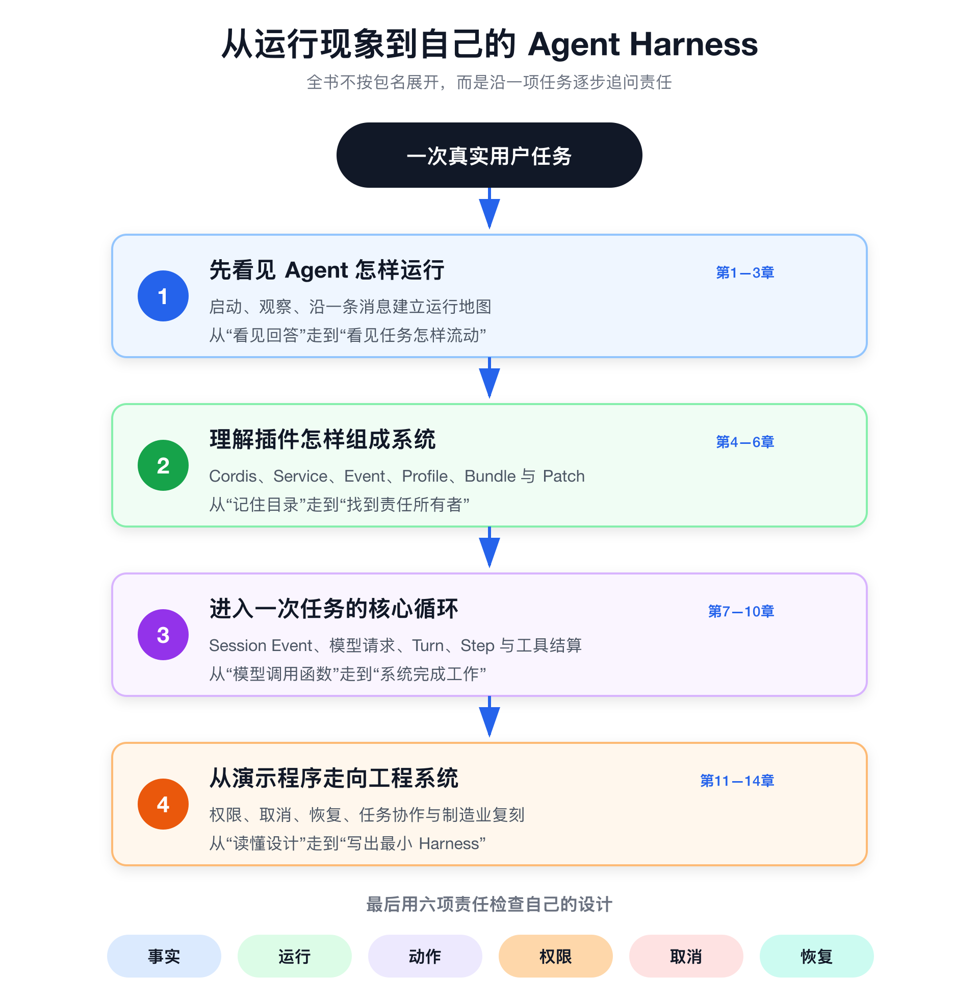

# 前言 为什么要从一个真实项目学习 Agent

很多 Agent 教程都有一个令人振奋的开场：几十行代码接上大模型，再注册两个函数，程序就能查询天气、搜索网页或读写文件。模型选择了工具，工具返回结果，模型继续回答。第一次跑通时，你很容易产生一种感觉——Agent 的核心已经掌握了，剩下的只是继续增加工具。

我也喜欢这样的最小示例。它让抽象概念迅速落地，也让人敢于动手。但最小示例有一个天然限制：它只需要证明“成功路径可以发生”，很少回答“运行系统怎样长期负责”。

当任务从查天气变成修改代码、执行命令或创建业务工单，问题会突然变多。模型提出的动作由谁校验？用户批准以后，谁保证参数没有变化？两个工具能不能并发？执行到一半取消，子进程是否真的退出？模型已经看过的信息从哪里重建？程序在外部系统写入成功、却来不及保存结果时，重启以后应该重试还是对账？

这些问题不属于某一句提示词，却决定了 Agent 能不能离开演示环境。

## 能回答问题，不等于能完成任务

聊天接口关心的是一次请求怎样得到一次响应。Agent Harness 关心的是一项工作怎样从输入开始，经过若干次模型判断和工具动作，最终到达可解释的状态。

两者都需要模型，但责任完全不同。模型擅长在不完整信息中提出候选下一步；运行系统必须保存事实、安排工作、限制动作、传递取消、回收资源，并在进程退出后恢复。把这两部分混在一个循环里，Demo 仍然可能成功，失败路径却很难解释。

这也是本书的起点：Agent 不是一次大模型调用，而是一套围绕模型组织事实、运行、动作、权限、取消和恢复的程序。

我希望你读完以后，不只会问“怎样让模型调用函数”，还会继续追问：这项事实由谁拥有，这次动作在哪里留下记录，结果怎样回到下一次模型请求，异常由谁收束，系统什么时候才算真正停稳。

## 为什么要读一个真实开源项目

自己写最小 Agent，可以帮助我们理解原理；阅读真实项目，则会迫使我们面对原理之间的连接处。

一个真实工程项目不会把所有工作放在同一个文件里。模型接口、会话、工具、权限、持久化和界面各有所有者，也各有失败方式。你会看到一个类型为什么需要分成定义、提供方和使用方，会看到一个事件为什么既要实时通知又要持久保存，也会看到“取消”不是调用一次 `abort()`，而是一条必须穿过多个组件的生命周期责任。

源码阅读真正训练的不是记忆文件名，而是建立三种能力。

第一，沿现象找到所有者。页面没有响应、工具没有执行或会话不能恢复时，你知道应该先查入口、配置、事件还是具体 Provider。

第二，沿所有者找到证据。接口说明了什么，测试证明了什么，运行实验又证明到哪一步，三者不能互相冒充。

第三，沿成功路径寻找失败责任。能跑通只是起点；拒绝、超时、取消、崩溃和恢复才会暴露设计是否完整。

## 为什么选择 DeepSeek Harness

DeepSeek Harness 适合用来学习，不是因为它提供了一份唯一正确的 Agent 答案，而是因为它把许多容易被 Demo 隐藏的责任放到了可以追踪的位置。

它使用 Cordis 组织插件生命周期，用 Profile、Bundle 和 Patch 组合不同应用，用 Session Event 保存持久事实，用 Agent Loop 管理 Turn、Step 与 Inbox，由 `ToolsService` 管理工具集合并选择执行器，执行器与共享流水线负责工具策略、调度和结算，再把审批、沙箱、持久化、压缩、子智能体、后台任务与工作流接到这些明确的扩展点上。

这些实现并不意味着你的项目必须照搬同样的包或类型。真正值得学习的是拆分问题的方法：谁拥有事实，谁推动运行，谁执行动作，谁有权批准，谁传递取消，谁负责恢复。

本次开源学习版于2026年11月13日按上游 `master` 提交 `e8f7b93a344964de3dca1ace9e72b6e4d6de87cb` 复核，仓库声明版本为 `0.2.2-rc.2`。它与同名发布标签并非同一个提交，因此源码链接固定到完整提交，不用标签代替。当前源码要求 Node.js `>=24.9.0`，声明的包管理器是 `pnpm@11.28.5`。

初稿基于 `dsh-v0.1.2-alpha.1`。旧版实验保留下来的输出、测试数量和配套脚本只证明旧提交 `cd5ef8148158c3a752a658978873241fdf8e2bbc` 的行为；本版逐章标明这些历史证据，并按新版源码修正解释。新版真实模型、完整安装构建和全部实验重跑并未因此自动完成。阅读时请把“源码已核对”和“本机已运行”分开，具体差异与验证记录随开源仓库一起提供。

## 这本书适合谁，也不适合谁

这本书首先写给有编码基础、却还没有系统阅读过大型 Agent 项目的读者。你不必熟悉 DeepSeek Harness，也不必事先掌握 Cordis。只要能够阅读 JavaScript 或 TypeScript，知道 Promise、事件和基本命令行操作，就可以跟着书中的路径向前走。

如果你已经写过“模型加函数调用”的小程序，却不知道怎样继续加入会话、审批、取消和恢复，这本书会帮助你跨过 Demo 与运行系统之间的距离。如果你主要做后端、自动化、制造业数字化或企业应用，希望判断 Agent 能否进入真实业务，这里的责任拆分和实验方法也可以直接迁移。

它不适合只想寻找提示词模板、DeepSeek API 参数速查或低代码产品操作步骤的读者，也不能作为生产部署、安全认证和模型效果评测手册。书中会说明当前源码怎样工作，却不会把一次本机实验扩大成生产保证。

## 这不是 API 手册，也不是包索引

本书不会按照仓库目录逐个介绍包，也不会抄写生成的配置、事件和工具目录。大型项目最容易写成“看起来完整、读完仍不会追踪”的资料汇编，而这恰好违背了我们的学习目标。

全书只沿一条主线前进：一条用户输入怎样进入 Agent，怎样形成 Turn 与 Step，怎样汇入模型请求，怎样产生并执行工具调用，怎样写入 Session Event，又怎样在取消、退出和恢复以后继续保持可解释性。

十四章分成四部分。它们不是四组互不相干的知识，而是一条逐步加深的认知路线：

| 部分 | 你先解决什么 | 读完发生的变化 |
|---|---|---|
| 第一部分：先看见 Agent 怎样运行 | 启动、观察并沿一条消息定位 | 从“看见回答”走到“看见一次任务怎样流动” |
| 第二部分：插件怎样组成系统 | 理解 Cordis、能力角色与应用组合 | 从“记包名”走到“寻找责任所有者” |
| 第三部分：一次任务的核心循环 | 追踪事实、模型请求、Turn、Step 与工具结算 | 从“模型调用函数”走到“运行系统完成工作” |
| 第四部分：从演示程序到工程系统 | 处理权限、取消、恢复、委派与业务复刻 | 从“读懂设计”走到“写出自己的最小 Harness” |

前面的概念会在后面的实验里重新出现，但每一章只承担自己的问题，不把后续细节提前讲完。

## 开始前只需要这些准备

你需要一台能够运行项目要求版本 Node.js 的电脑、Git、pnpm 和一个熟悉的代码编辑器。第一次开始前，按第1章确认源码提交，完成依赖安装和构建；所有随书运行数据都放在隔离目录，不把实验写进个人正式会话或生产系统。

阅读准备同样简单：新建一份源码地图、一份实验记录和一份事实核查表。源码地图只记“问题—所有者—入口”，实验记录保存命令、状态码和关键输出，事实核查表区分源码推断、测试证据、本机实验与尚未验证的结论。不要一开始就做漂亮笔记，先让每条结论可以被重复。

本书代码示例以 macOS 与类 Unix Shell 为主要叙述环境；项目本身包含其他平台能力，但平台沙箱和进程行为必须在目标系统单独验证。遇到环境差异时，先保存原始错误，再判断它属于依赖、操作系统还是正文理解问题。

## 怎样使用这本书

如果你的目标是系统学习，按前言、四个部分和结语顺序阅读。先完成本章能独立验证的阅读任务，再进入下一章。不要跳过第4—6章的组合机制，也不要在还没理解 Session Event 时直接学习恢复。旧版实验需要按标注的旧提交复现；研究新版时，从本版给出的源码入口和对应测试建立自己的证据，避免把不同版本混在一次实验里。

如果你的目标是复刻一个项目，可以先读第1—3章建立地图，再读第7—10章完成“输入—模型—工具—日志”纵向切片，用第11—12章补权限、取消和恢复，用第13章判断是否真的需要任务协作，最后以第14章的六项责任做设计评审。遇到实现缺口时，再回到第4—6章寻找合适的插件和能力位置。

我建议你把每章分成四次阅读，而不是从第一页一直划到最后一页。

第一次只读开场、白话解释和本章回顾，先知道这一章在解决什么问题。第二次打开文中的源码锚点，从公开类型和行为测试进入实现。第三次运行配套实验，比较事件序列、状态变化和失败输出。第四次完成动手练习，主动改坏一个条件，再解释为什么会失败。

源码、测试、实验和事实核查表各有用途：源码说明当前实现，测试固定可观察行为，实验建立你自己的运行证据，事实核查表则记录哪些结论已经验证、哪些仍待验证。不要因为测试通过就扩大结论，也不要把源码推断写成亲自运行过的事实。

> 核心建议
> 每学到一个机制，都用四个问题收尾：事实写在哪里，动作由谁拥有，失败怎样结算，重启以后根据什么继续。

如果你阅读大型源码的经验还不多，不必追求一次看懂所有泛型、事件声明和异步分支。先能画出调用关系，再能说出每一层的责任，最后才进入局部实现。遇到陌生包时，也不要从第一行开始硬读；先看架构文档、包 README、公开类型和行为测试，再带着具体问题进入源码。

阅读时最好保留一张自己的证据表。每条结论只写五项：想回答的问题、责任所有者、源码位置、可重复命令、尚未覆盖的边界。它会迫使你把“我大概看懂了”变成“我可以带另一个人重复得到这个结果”，也会成为以后修改代码和整理出版材料时最可靠的索引。

## 没有 API Key，仍然可以学到什么

没有 DeepSeek API Key，并不意味着这套学习无法开始。配置导出、插件生命周期、Session Event 投影、Mock Adapter、工具策略、审批、取消、持久化、压缩和任务协作，都可以在没有真实模型的情况下观察。书中的多数关键实验正是通过可控输入和断言，把模型的不确定性暂时拿掉，先验证 Harness 自己的责任。

但边界必须说清楚。无 Key 实验不能证明真实 DeepSeek 工具选择效果，不能验证 HTTP 与 SSE 行为、模型质量、真实 token 用量或提供方限流，也不能替代 Web UI 真人审批和不同操作系统沙箱的实际测试。本书会把这些项目保留为明确的待验证项，不用“源码看起来如此”冒充运行结论。

学习工程系统，知道自己还没有证明什么，与知道已经证明什么同样重要。

## 读完以后，你应该得到什么

我不希望你用“记住了多少个包”衡量这次学习。包名会变化，配置会调整，模型接口也会继续演进。更耐用的收获，是面对一个陌生 Agent 项目时，你能建立运行地图，找到事实来源，识别能力所有者，追踪一次任务的开始与结算，并用失败、取消和恢复检验设计。

更进一步，你应该能够写出自己的最小 Harness：先用可控模型和追加式日志走通一条纵向路径，再加入工具、审批、取消与恢复，最后把一个真实业务动作接进来。它不必拥有 DeepSeek Harness 的全部能力，但每一项已经拥有的能力，都应当有清楚的责任和可以重复的证据。

如果你已经准备好，我们先不急着读最复杂的循环。第1章从一件更朴素的事开始：把项目运行起来，并学会判断自己究竟看见了什么。
