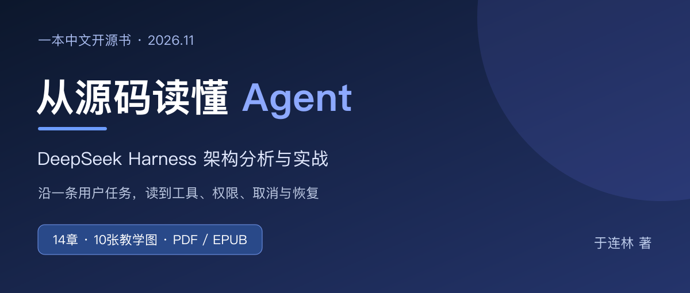
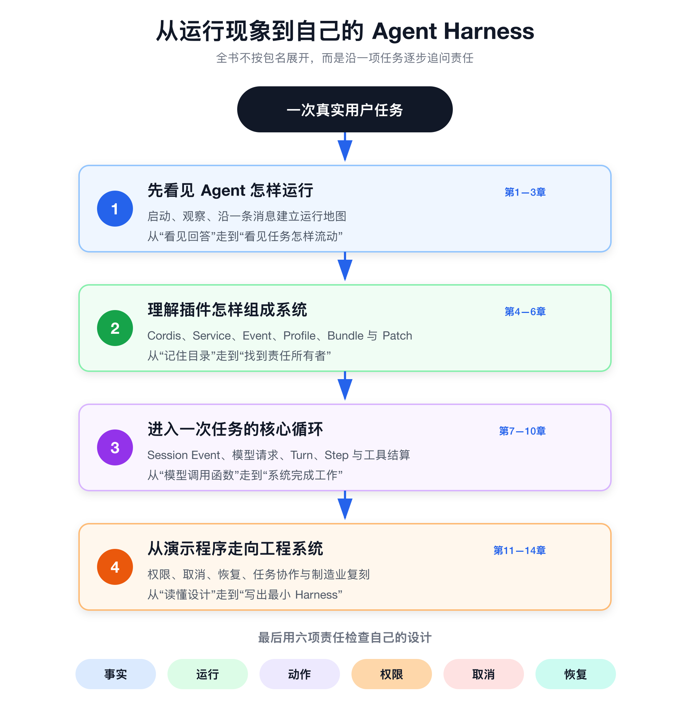

# 我把读懂 Agent 源码的过程，写成了一本开源书

文 / 于连林

把模型接进程序，让它调用一个工具，第一次跑通的时候，很容易觉得Agent已经懂得差不多了。输入问题，模型选函数，程序执行，再把结果交回去。屏幕上有了回答，也就有了完成感。

可一旦把“查天气”换成“修改文件”或者“创建工单”，事情就开始变复杂。工具执行一半取消，进程有没有停？用户批准的是哪一份参数？外部系统已经写入，本地记录还没保存，重启后能不能再执行一次？这些问题，几十行的示例往往还没来得及回答。

我想系统弄明白的，就是这部分。于是，我沿着DeepSeek Harness的源码，把一次用户任务从输入、模型判断、工具动作，一直追到取消和恢复，整理成了《从源码读懂Agent》。现在把书稿开源，PDF和EPUB也一起放出来，方便大家阅读和挑错。

项目地址：[https://github.com/yll2wcf/deepseek-harness-book](https://github.com/yll2wcf/deepseek-harness-book)

## 读源码最难的，常常是找不到第一步

有编码基础，并不意味着第一次打开大型仓库就能顺利读下去。目录很多，包名很多，接口后面还有接口。一个函数看懂了，切到下一个文件，又不知道它在整套系统里负责什么。

我不想把这本书写成包清单。按文件夹逐个介绍，看起来覆盖得很完整，读者合上书却未必知道，一条消息究竟从哪里进入，为什么会接着执行第二个工具。

所以我换了一个起点：先跟着一条消息走。谁接收它，谁把它放进队列，谁决定发起模型请求，谁执行工具，谁保存结果。每多读一个模块，都先把它放回这次任务里。

这样读，陌生类型就有了位置。你不必一开始吃透所有泛型，也不必记住几百个包名。先知道自己在找哪一项责任，再去看接口和测试，压力会小很多。

书的前几章就在做这件事。先建立运行地图，再学习怎么读公开类型、怎么用行为测试判断自己的理解，最后带着明确的问题进入实现。这个方法可以继续用在别的开源项目上。

## 我最在意的是，程序开始做事以后由谁负责

对我来说，学习Agent最有价值的一步，是从“它能回答什么”，走到“它做过的事怎样解释”。模型给出候选动作，程序仍要决定能不能做、在哪里做、怎样记录，以及失败后怎么处理。

比如一个设备异常处理助手。它可以读报警信息、查维修记录、给出判断。这些都还比较容易观察。但当它要创建维修任务时，就必须确认设备身份、工单参数、操作者权限和重复提交的后果。

如果用户点了允许，执行参数后来发生变化，那次允许还算数吗？如果工具返回超时，外部系统却已经创建了工单，直接重试就可能产生第二张。这些都需要程序有明确设计。

因此，书里反复回到六项责任：事实、运行、动作、权限、取消和恢复。事实回答发生了什么；运行回答下一步怎样推进；动作回答谁真正调用外部能力。剩下三项，决定系统如何限制影响、停止工作，并在中断以后继续。

**我希望自己积累的，是判断一套Agent工程是否完整的能力。** 新模型可以换，新工具可以接，底下这些责任仍然需要逐项回答。

## 这14章，沿着一项任务往下读

全书分成四部分，配了10张教学图。我尽量让每一章都有具体的阅读任务，也留下可以自己检查的练习。

第一部分先建立全局认识。Agent怎样启动，一条消息如何流动，面对大型仓库怎样找入口。适合已经会写程序，但还没有系统读过Agent工程的读者。

第二部分读插件怎样组成系统。DeepSeek Harness使用Cordis管理插件。这里会解释服务、事件、Waterfall和资源释放，再看Profile、Bundle与Patch怎样组成实际运行的应用。你会知道，一项能力如何接入，也会知道它卸载以后该清理什么。

第三部分进入一次任务的核心循环。Session Event保存哪些事实，模型请求由谁组装，Turn、Step和Inbox各自表示什么，工具从被模型选中到形成结果又经历哪些阶段。这部分细节多，我用图、最小例子和源码入口把它们连起来。

第四部分处理更接近工程现场的问题：文件和命令的权限、审批与沙箱，会话恢复和上下文压缩，子智能体、后台任务与工作流的选择。最后回到一个制造业异常处理案例，尝试设计自己的最小运行系统。

这张路线图，也是我给自己设的约束。前一章先解决一个问题，后一章再增加一项责任。读者遇到的术语会越来越多，但始终能知道，自己正在追踪一次任务的哪一段。

## 源码升级，是写这本书必须过的一关

写开源项目的分析书，绕不开版本变化。类名可能还在，真正执行的代码却已经换了位置；旧实验还能留下输出，也不意味着它仍然证明新版本。

初稿分析的是`0.1.2-alpha.1`。这次准备公开时，我重新拉取上游代码，按2026年11月13日获取的master提交逐章核对，仓库声明版本已经是`0.2.2-rc.2`。运行环境、目录定位、会话记录和工具执行，都有需要修订的地方。

举个例子，旧稿把Assistant的流式分片写成逐条持久化事件。新版则区分供界面观察的实时流，以及最终消息或尝试记录里保存的stream。如果只把书里的版本号替换一下，读者看到的图和源码就对不上。

再比如，会话日志已经有了明确的格式演进和历史代际处理。讨论恢复时，必须分清当前写入格式、能够读取的历史格式，以及读取和写入各自会不会发布新文件。这些会直接影响读者怎样理解“恢复”。

所以这次更新既改正文，也重绘相关技术图，还把差异和验证范围收进附录。每个源码链接尽量固定到具体提交，让你几个月以后打开，仍能看到书里正在分析的那份实现。

我觉得，技术内容的可信度就体现在这些地方。能解释一个概念当然重要，愿意留下版本和验证范围，同样重要。

## 选择制造业案例，是想让动作有具体后果

书的最后，我用了设备异常处理这个场景。并不是为了给一个Agent套上行业名字，而是因为这个场景很容易看清责任。

“三号设备温度异常”是一条输入。查历史、看趋势、提出可能原因，是读取和分析。创建维修草稿、提交处理任务，则开始影响业务状态。两者需要的权限、确认和失败处理显然不同。

模型说得再有把握，也不能替业务系统确认操作者身份。人工同意一次，也不能变成永久授权。网络出错之后，更不能仅凭Assistant的一句“创建成功”，判断工单到底有没有生成。

因此，案例会把模拟事实、工具参数、人工确认、幂等和事件记录放在一起看。它用的是模拟数据，没有接入真实MES、EAM或质量系统，也没有把实验包装成已经投产的客户项目。

我更看重的，是让读者学会问出正确的问题。以后换成研发、财务或者客服场景，同样可以先找出会产生副作用的动作，再检查它需要哪些事实和控制。

## 有些地方，我会明确写还没验证

这本书是开源学习版。书中保留的旧实验输出，都有对应的旧提交。新版已经做了源码对照，但源码核对不能自动变成运行通过。

本次更新并没有完成新版完整安装构建和所有实验的重新执行。真实DeepSeek调用、Web真人审批、不同平台沙箱和生产系统接入，也都需要各自的证据。项目里会保留这些范围，方便后续补齐。

如果你主要想先理解架构，没有API Key也能开始读。真实模型调用会产生提供方费用，密钥也应保存在自己的环境中。涉及删除、覆盖文件和业务写入，仍然需要自己检查影响并保留人工确认。

我希望这本书让人更愿意动手，也更清楚自己证明到了哪一步。看懂源码、通过Mock实验、跑通真实接口、在生产环境安全运行，是几件需要分别完成的事。

## 为什么把源稿也一起公开

只发一个PDF，传播起来方便，修订却不够方便。读者发现问题，很难准确指出是哪个版本、哪一段，也不容易把改法留下来。

这次我把Markdown源稿、SVG教学图、构建工具和版本说明一起放进GitHub。你可以在线读，也可以下载PDF或EPUB。PDF适合电脑阅读和批注，EPUB方便放进常用阅读器，字号和排版也能调整。

书稿免费下载，不需要先关注公众号再回复口令。原创文字与教学图使用CC BY-SA 4.0，原创代码使用MIT。转载或改编时请按许可保留署名与归属；引用的上游源码仍遵循原有许可证。

如果你愿意帮忙，最有用的反馈很具体：哪一段读不下去，哪个源码位置已经失效，哪条结论和你实际观察到的不一致。提交Issue时带上章节、源码提交和运行环境，我就能沿着同一份材料核对。

项目：[https://github.com/yll2wcf/deepseek-harness-book](https://github.com/yll2wcf/deepseek-harness-book)

电子书下载：[GitHub Releases](https://github.com/yll2wcf/deepseek-harness-book/releases/latest)

后面我会继续围绕源码阅读、最小复刻和业务动作的可靠执行更新这个项目。也欢迎你在这里交流自己读到的设计和遇到的失败。

我想留下的，是一份别人能沿着读、照着核对、发现问题后还能一起改的作品。从一条消息开始，把程序真正做过的每一步看清楚。
